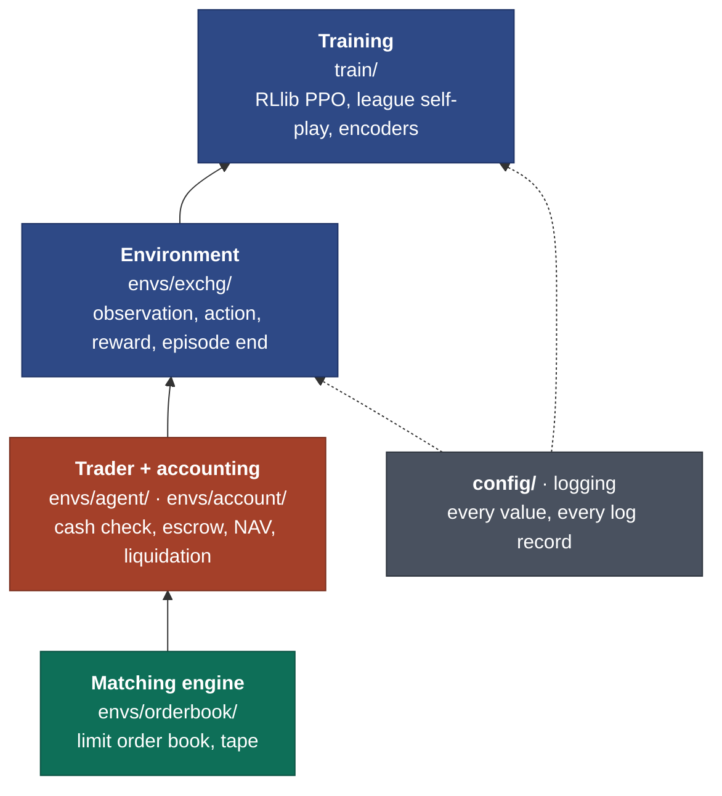

# gym-continuousDoubleAuction

A multi-agent reinforcement learning environment built around a simulated stock exchange: a
continuous double auction with a price-time priority limit order book. Agents are traders who
place market, limit, modify and cancel orders against each other. All liquidity, every price and
every profit come from the agents themselves. There is no external market data.

The environment is a Gymnasium / Ray RLlib `MultiAgentEnv`. It comes with a league-based
self-play PPO training pipeline on RLlib 2.56's new API stack.

> **Research only.** This repository is not meant for real trading in any form. See the
> [disclaimer](#disclaimer).

---

## Highlights

- **A working exchange.** A matching engine with price-time or pro-rata allocation, sequential or
  batch clearing, self-match prevention and an exact `Decimal` ledger. Total NAV plus fees always
  equals the starting cash, and every episode checks it.
- **Risk controls.** Every order is checked against free cash. Maintenance margin, liquidation
  and auto-deleveraging are built in, and maker and taker fees are configurable.
- **A learning problem designed to be learnable.** Each agent observes the book and its own
  account. The action space is masked to the actions that are possible. The reward has six signed
  terms in units of starting capital.
- **League self-play.** Trainable policies play against random baselines and frozen champion
  snapshots, drawn by weighted matchmaking.
- **Research tooling.** Five selectable observation encoders, JEPA pretraining, a reward-free
  probe harness, Continual Backprop, evaluation and weight export.
- **Reproducible and tested.** Every value lives in `config/*.json`. Runs can be seeded and
  resumed from checkpoints. Over 2,000 tests run in CI.

## How it fits together



Each layer builds on the one below it. One environment step, end to end, is drawn in
[docs/02_architecture.md](docs/02_architecture.md).

## Quick start

Python 3.12 on 64-bit Linux. Two CPU cores, 8 GB of RAM and 10 GB of disk are plenty, and no GPU
is needed ([requirements](docs/00_getting_started.md)). After
`pip install -r requirements.txt && pip install -e ".[dev]"` in a virtual environment:

```bash
python -m gym_continuousDoubleAuction.CDA_rand --steps 200 --agents 4   # the exchange, random agents
python -m pytest gym_continuousDoubleAuction/test -q                     # the unit tests
python -m gym_continuousDoubleAuction.train.train                        # league self-play PPO
```

[Getting started](docs/00_getting_started.md) has the full install (CPU, GPU via Docker, Colab)
and what to do after the first run.

## Documentation

All documentation is in [`docs/`](docs/README.md). Its index maps every document and gives
reading paths for common goals.

| Start with | For |
|---|---|
| [00 Getting started](docs/00_getting_started.md) | Install, check, first training run |
| [01 Overview](docs/01_overview.md) | What the project is and the question it is built to ask |
| [02 Architecture](docs/02_architecture.md) | Layers, classes, the step lifecycle, data flow |
| [26 Runbook](docs/26_runbook.md) | Every command: configure, train, resume, inspect, troubleshoot |
| [15 Findings](docs/15_findings_and_recommendations.md) | Where the project stands: what was wrong and what is fixed |
| [28 Glossary](docs/28_glossary.md) | The terms the documents use |
| [Contributing](docs/CONTRIBUTING.md) | How to set up, the rules a change follows, what to run before pushing |

## Project status and history

This is version 2. Version 1 (2020) is on the
[`original_v1`](https://github.com/ChuaCheowHuan/gym-continuousDoubleAuction/tree/original_v1)
branch, and its README is kept as [docs/README_v1.md](docs/README_v1.md). The
[changelog](docs/17_changelog.md) records what changed since then and why.

## Acknowledgements

The order book matching engine is adapted from
[dyn4mik3/OrderBook](https://github.com/dyn4mik3/OrderBook).

## Disclaimer

This repository is meant for research purposes only and must **never** be used for trading of
any form. Past performance is no guarantee of future results. If you suffer losses from using
this repository, you alone are responsible for them. The author will **not** be held responsible
in any way.

## How to cite

> Chua Cheow Huan. (2025). *gym-continuousDoubleAuction* (Version 2.0.0) [Computer software].

Citations in other formats are under **"Cite this repository"** on the repository page
([`CITATION.cff`](CITATION.cff)). For version 1.0.0, cite the
[`original_v1`](https://github.com/ChuaCheowHuan/gym-continuousDoubleAuction/tree/original_v1)
branch.

## License

See [LICENSE](LICENSE).
