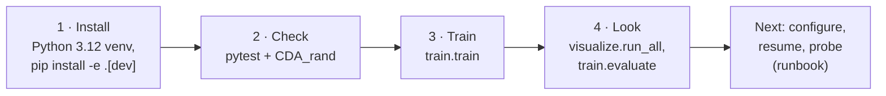

# 0. Getting Started

From a fresh clone to a first training run in four steps. Each step links to the page with the
full detail. Once this works, the [runbook](26_runbook.md) is the operator's reference for
everything after it.

---

## 0.1 The path



## 0.2 Install

Python **3.12** is the only version CI tests.

```bash
git clone https://github.com/ChuaCheowHuan/gym-continuousDoubleAuction.git
cd gym-continuousDoubleAuction
python3.12 -m venv .venv && source .venv/bin/activate
python -m pip install --upgrade pip setuptools wheel

# CPU-only machine: take the CPU torch wheel first so the CUDA build is not pulled in
pip install torch==2.13.0 --extra-index-url https://download.pytorch.org/whl/cpu

pip install -r requirements.txt
pip install -e ".[dev]"
```

`pip install -e .` is required. On import, the package registers the env with Gymnasium and reads
its configuration from the repository's `config/` folder ([18](18_configuration.md) §1).

| Where you run | Use |
|---|---|
| Linux / macOS laptop, CPU | the commands above |
| A machine with an NVIDIA GPU | the training image, [19_docker.md](19_docker.md) |
| Google Colab | the notebook, [20_colab.md](20_colab.md) |

## 0.3 Check that it works

```bash
# the exchange alone, random agents, no learning: a few seconds
python -m gym_continuousDoubleAuction.CDA_rand --steps 200 --agents 4

# the full suite: unit tests, then real RLlib builds (about four to six minutes)
python -m pytest gym_continuousDoubleAuction/test -q
```

The first command ends with `completed 200 steps with 4 random agents.`. Use `pytest` to run
tests; running a test file directly with `python test_x.py` does nothing
([10](10_testing.md) §0).

## 0.4 Train

```bash
python -m gym_continuousDoubleAuction.train.train
```

This runs league self-play PPO with every value from `config/train_config.json`. Pass a flag for
a one-off change: `--iters 2` for a short run, `--seed 1` to pin randomness. `--help` lists
every flag. The run writes:

| What | Where |
|---|---|
| Run log and per-iteration metrics | `results/<run_id>/run.log`, `results/<run_id>/progress.jsonl` |
| Checkpoints, shared across runs so a restart resumes | `results/chkpt/iter_<n>/` |
| Per-step record of sampled episodes (Parquet) | `episode_data/<run_id>/` |

The full output tree and what to watch while a run goes are in [26](26_runbook.md) §26.5–26.6.

## 0.5 Look at the result

```bash
python -m gym_continuousDoubleAuction.visualize.run_all            # every chart
python -m gym_continuousDoubleAuction.train.evaluate \
    --checkpoint results/chkpt/iter_00016 --episodes 4               # play the trained policies
```

## 0.6 Where to go next

| You want to | Read |
|---|---|
| Understand what the market and the agents are | [01_overview.md](01_overview.md), then [02_architecture.md](02_architecture.md) |
| Change a value: agents, cash, reward, network | [18_configuration.md](18_configuration.md) |
| Resume, inspect, probe, pretrain, troubleshoot | [26_runbook.md](26_runbook.md) |
| Know where the project stands | [15_findings_and_recommendations.md](15_findings_and_recommendations.md) |
| Look up a term (NAV, mark, ADL, champion…) | [28_glossary.md](28_glossary.md) |
| Contribute | [CONTRIBUTING.md](CONTRIBUTING.md) |
