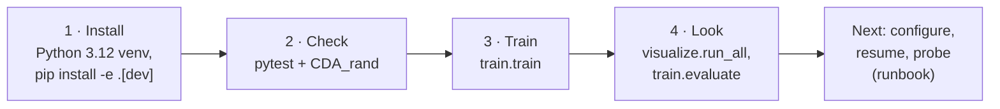

# 0. Getting Started

What a machine needs, then a fresh clone to a first training run in four steps. Each step links to the page with the
full detail. Once this works, the [runbook](26_runbook.md) is the operator's reference for
everything after it.

---

## 0.1 The path



## 0.2 What you need

**The short answer:** any 64-bit Linux machine with Python 3.12, 2 CPU cores, 8 GB of RAM and
10 GB of free disk runs everything comfortably. No GPU is needed. Training spends over 90% of its
time sampling on the CPU: stepping the order book in Python and running the policy for each agent.

| | Minimum | Recommended |
|---|---|---|
| **OS** | 64-bit Linux | Linux (CI uses GitHub's `ubuntu-latest`), or Windows with WSL2 and the repository on the Linux filesystem ([19](19_docker.md) §19.4). macOS is not tested |
| **Python** | 3.12 | 3.12, the only version CI tests (`setup.py` says `>=3.12`) |
| **CPU** | 1 core: the `cpu` profile samples in-process | 2 or more cores: the `gpu` profile runs 2 env runners in parallel, and sampling is the bottleneck |
| **RAM** | 4 GB (peaks measured below: 2.2 GB training, 3.3 GB integration tests) | 8 GB, for parallel env runners and headroom |
| **GPU** | None | Optional. An NVIDIA GPU through the Docker image (CUDA 12.8) speeds up only the PPO update, about 8% of an iteration at the default model size |
| **Disk** | About 3 GB: roughly 2 GB for a CPU-only install (estimated), plus about 250 MB of output per default run | 10 GB: the CUDA install is 6.2 GB (measured), plus the Docker image if you use it, plus room for the per-step record (capped at 2 GiB per writer) |
| **Shared memory** (Docker only) | Docker's 64 MB default works, with a Ray warning | `--shm-size=2g` ([19](19_docker.md) §19.2) |
| **Network** | Install time only: PyPI, and `download.pytorch.org` for the CPU torch wheel | None at run time |

### What to expect on that hardware

Measured on a 4-vCPU Intel Xeon at 2.1 GHz with 15 GB of RAM and no GPU, at the shipped
configuration (8 agents, `max_step` 4,096, 4 episodes per iteration, the `cpu` profile):

| Task | Wall time | Peak RAM |
|---|---|---|
| `CDA_rand.py` smoke run (1,000 steps, 4 random agents) | 8 s | 0.6 GB |
| Unit tests (2,133 when measured; 2,208 now) | 3 min | 2.9 GB |
| Integration tests (185 when measured; 190 now, real RLlib builds) | 3.5 min | 3.3 GB |
| One training iteration (16,384 env steps) | 2 min 40 s: 2 min 26 s sampling at about 112 steps/s, 12.5 s PPO update | 2.2 GB |
| The default 16-iteration run | about 45 min (extrapolated from one iteration) | 2.2 GB |
| One checkpoint | | 6.5 MB on disk |

With 2 env runners (the `gpu` profile), sampling runs in two processes, so an iteration should take
roughly half as long. That figure is an estimate, not a measurement. The per-step Parquet record
adds about 34 MB per recorded episode; one episode in ten is recorded by default, about 220 MB per
default run ([11](11_logging_and_observability.md) §1.1). Pass `--no-episode-data` to turn it off.

## 0.3 Install

Python **3.12** is the only version CI tests: `setup.py` says `>=3.12`, and scipy's pin has no
3.11 wheels ([10](10_testing.md) §7).

```bash
git clone https://github.com/ChuaCheowHuan/gym-continuousDoubleAuction.git
cd gym-continuousDoubleAuction
python3.12 -m venv .venv && source .venv/bin/activate
python -m pip install --upgrade pip setuptools wheel

# CPU-only machine: take the CPU torch wheel first so the CUDA build is not pulled in
pip install torch==2.13.0 --extra-index-url https://download.pytorch.org/whl/cpu

pip install -r requirements.txt
pip install -e ".[dev]"
```

Install the checkout editable (`pip install -e .`). On import, the package registers the env with
Gymnasium and reads its configuration from the repository's `config/` folder, so an edit there takes
effect on the next run ([18](18_configuration.md) §1). A non-editable install also works, but it reads
the copy of `config/` shipped inside the package instead.

| Where you run | Use |
|---|---|
| A Linux machine, CPU only (macOS is untested) | the commands above |
| A machine with an NVIDIA GPU | skip the CPU wheel line and let `requirements.txt` resolve torch, or use the training image, [19_docker.md](19_docker.md) |
| Google Colab | the notebook, [20_colab.md](20_colab.md) |

## 0.4 Check that it works

The same three checks CI runs ([10](10_testing.md) §7), cheapest first. CI runs them in the order
unit suite, `CDA_rand`, integration suite, and runs `CDA_rand` with no arguments (1,000 steps,
4 agents).

```bash
# the exchange alone, random agents, no learning: a few seconds
python -m gym_continuousDoubleAuction.CDA_rand --steps 200 --agents 4

# the unit tests (about 3 minutes; test/integration is left out by default, pyproject.toml addopts)
python -m pytest gym_continuousDoubleAuction/test -q

# RLlib wiring, real Algorithm builds, save/restore, evaluate (about 3.5 minutes)
python -m pytest gym_continuousDoubleAuction/test/integration -q
```

The first command ends with `completed 200 steps with 4 random agents.`. Use `pytest` to run
tests; running a test file directly with `python test_x.py` does nothing
([10](10_testing.md) §0).

## 0.5 Train

```bash
python -m gym_continuousDoubleAuction.train.train
```

This runs league self-play PPO with every value from `config/train_config.json`. Pass a flag for
a one-off change: `--iters 2` for a short run, `--seed 1` to pin randomness. `--help` lists
every flag. The run writes:

| What | Where |
|---|---|
| Run log and per-iteration metrics | `results/<run_id>/run.log`, `results/<run_id>/progress.jsonl` |
| Checkpoints, shared across runs so a restart resumes | `results/chkpt/iter_<n>/` |
| Per-step record of sampled episodes (Parquet) | `episode_data/<run_id>/` |

The full output tree and what to watch while a run goes are in [26](26_runbook.md) §26.5–26.6.

## 0.6 Look at the result

```bash
python -m gym_continuousDoubleAuction.visualize.run_all            # every chart
python -m gym_continuousDoubleAuction.train.evaluate \
    --checkpoint results/chkpt/iter_00016 --episodes 4               # play the trained policies
```

## 0.7 Where to go next

| You want to | Read |
|---|---|
| Understand what the market and the agents are | [01_overview.md](01_overview.md), then [02_architecture.md](02_architecture.md) |
| Change a value: agents, cash, reward, network | [18_configuration.md](18_configuration.md) |
| Resume, inspect, probe, pretrain, troubleshoot | [26_runbook.md](26_runbook.md) |
| Know where the project stands | [15_findings_and_recommendations.md](15_findings_and_recommendations.md) (open), [29_fixed_issues.md](29_fixed_issues.md) (fixed) |
| Look up a term (NAV, mark, ADL, champion…) | [28_glossary.md](28_glossary.md) |
| Contribute | [CONTRIBUTING.md](CONTRIBUTING.md) |
