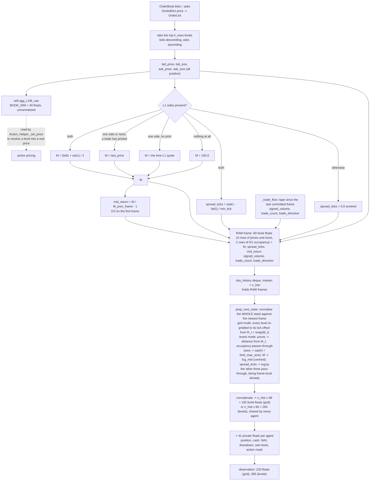

# 5. Observation Space

The complete specification of what agents see — layout, normalization, temporal stacking, market
scalars, and the raw/normalized split — followed by the measured feature scales and the design
defects.

Related: [02_architecture.md](02_architecture.md) §2.5 (step 6),
[06_action_space.md](06_action_space.md) (price levels resolve against the *un*normalized book),
[10_testing.md](10_testing.md) §4.

---

## 1. Shape at a glance

```
snapshot (one frame), book_mode "grid" (the default, S3-15) = 48 floats
  index    0:21   bid sizes at tick offsets -10..+10 from the reference R
                  cell c is the price R + (c - 10) * tick; sqrt(V / limit_max_size)
          21:42   ask sizes at the same 21 offsets
             42   log_mid              ln(M_frame) - log_mid_centre
             43   log1p_spread_ticks   0.0 if the book is not two-sided
             44   mid_return           M_frame / M_previous_frame - 1
             45   signed_volume        initiator-signed qty / limit_max_size
             46   log1p_trade_count    trades since the previous frame
             47   trade_direction      last initiator: +1 buy, -1 sell, 0 none

snapshot (one frame), book_mode "levels" (kept for comparison) = 66 floats
  index    0:10   normalized bid prices    (M_t - P) / M_t      of the 10 best occupied levels
          10:20   normalized bid sizes     sqrt(V / limit_max_size)
          20:30   normalized ask prices    (P - M_t) / M_t
          30:40   normalized ask sizes     sqrt(V / limit_max_size)
          40:50   bid occupancy            1.0 where the level holds an order (S3-14)
          50:60   ask occupancy
          60:66   the same six scalars

private block (per agent) = 41 floats = 9 base + 2 x k_rows own book + 2 counts + 1 flag + 9 mask
             0   position        tanh(net_position / position_scale)
             1   position_val    mark-to-market exposure / init_nav
             2   cash            free cash / init_nav
             3   cash_on_hold    escrowed against live orders / init_nav
             4   nav             nav / init_nav, so 1.0 at reset
             5   drawdown        (nav - max_nav) / init_nav, <= 0
             6   vwap_vs_mid     (M - VWAP) / M when a position is open, else 0
             7   realised_pnl    total_profit / init_nav
             8   time_left       1 - t_step / time_left_horizon (the latest possible end; 18 section 3.4)
          9-18   own_bid_size_k  THIS agent's resting size at public bid level k,
                                 sqrt(V / limit_max_size), 0 where it has none
         19-28   own_ask_size_k  same for asks, non-negative like the public ask block
            29   own_bid_count   this agent's resting bids / max_own_orders, clipped to 1
            30   own_ask_count   same for asks
            31   unmatched_last_step   1.0 if its last modify/cancel named no order
         32-40   can_<category>  the action mask: 1.0 where that category is possible for
                                 this agent on the coming step (06 section 7); pass always 1.0

observation = n_hist frames concatenated, then the private block
  default n_hist = 4  →  shape (233,) = 4x48 + 41 in grid mode; (305,) = 4x66 + 41 in levels mode
  layout: [ O_{t-3} | O_{t-2} | O_{t-1} | O_t | private ]
  the most recent frame ends at index n_hist * SNAPSHOT_DIM, NOT at the end
```

**The book prefix is shared; only the private tail differs between agents.** The book is computed
once per step and handed to everyone — it is the public order book, and that half was never the
defect.

**Never slice the newest frame off the end of the vector.** `obs[-SNAPSHOT_DIM:]` returns the
private block plus a truncated final snapshot, and every field read from it is then misaligned.
Slice against `n_hist * SNAPSHOT_DIM` instead. This is the same failure that `[-40:]` produced
before `EXTRA_DIM` existed — 38 book values plus 2 scalars, silently misaligning every block slice
while still passing several assertions.

Widths are defined once, in
[`config/tunable_constants.json`](../config/tunable_constants.json) under `observation_layout`:

```jsonc
"k_rows": 10,      // book depth, price levels per side
"book_rows": 4,    // bid_price, bid_size, ask_price, ask_size
"extra_dim": 6,    // the market scalars; State_Helper.EXTRA_FIELDS names them
"private_dim": 41  // the per-agent block; State_Helper.private_fields(k_rows) names them
```

### 1.0 Why there is a private block at all

The reward is literally `f(nav, prev_nav, max_nav, …)` and, until this block existed, **none of
those were observable**. Every agent received the byte-identical public vector — measured,
`distinct obs vectors across agents: 1`. An agent long 100 lots and one short 100 lots therefore
saw the same input and needed opposite actions, which a policy, being a function of its
observation, cannot do. That is finding **S1-2**.

`drawdown` is the entry that could not have been recovered any other way: the reward's drawdown
term depends on `max_nav`, a path functional over the entire episode, so no amount of recurrence
could reconstruct it from a stream that never showed it.

Every field is normalised by the trader's own `init_nav` or is already a ratio, so the block is on
the same O(1) scale as the normalised book. An unbounded private field would saturate the `tanh`
MLP exactly as the raw sizes once did ([S2-2](29_fixed_issues.md#s2-2--unnormalised-observation-scales-saturate-the-tanh-mlp-verified-fixed)). `State_Helper.private_fields(k_rows)` is the single
definition of the layout, and `__init__` checks its length against `private_dim`.

#### 1.0.1 The own-book block (indices 9–30) and the dead-action flag (31)

The block tells an agent *where* its escrowed cash is committed, not only how much, so a `modify`
or `cancel` is aimed at state the policy can see (the blind version is [S3-24](29_fixed_issues.md#s3-24--modify-and-cancel-cannot-be-aimed-so-they-are-mostly-dead-actions-verified-fixed)). The block is this agent's resting size at each of the `k_rows` public levels on each side, on the
public book's `sqrt(V / limit_max_size)` scale (non-negative on both sides since S4-17), so level k of the own book is
level k of the public book **in the same snapshot** — which is what lets the tokenising encoders
carry own size as two extra channels of each level token
(`train/model/encoders/tokenize.py`; the level tokens were zero-padded to the scalars' width
anyway, so it costs no width). Orders deeper than the shown book are in the two counts, which are
normalised by `action_space.max_own_orders` — the same number the `order_slot` action head is
sized by, so what the agent sees and what it can aim at agree ([06](06_action_space.md) §1.5).
`unmatched_last_step` is 1.0 on the observation that follows a `modify` or `cancel` with nothing
resting on its side, so the consequence of a dead action is in the next input rather than only in
a log. It is read from the live book after the step's orders are processed, which is the book the
newest snapshot was taken from. `BOOK_ROW_ORDER` and
`EXTRA_FIELDS` are checked the same way against `book_rows` and `extra_dim`, so a width set in the
config that the builder does not produce raises at construction instead of misaligning every
consumer downstream.

`book_dim` (= `book_rows × k_rows` = 40) and `snapshot_dim` (= 46) are **derived** in
`state_helper`, not stored, so they cannot disagree with `k_rows`. Inside the env, use the
instance attributes `self.k_rows` / `self.book_dim` / `self.snapshot_dim`, which
`State_Helper.__init__` sets from the config. The module-level `K_ROWS` / `BOOK_DIM` /
`SNAPSHOT_DIM` names read the same config at import and exist for consumers with no env instance —
the visualizers and the tests. See [18_configuration.md](18_configuration.md) §4.1.

**Never hardcode 40, 46, 160, 184, 193 or 216.** Use `self.snapshot_dim`, or import `SNAPSHOT_DIM` (and
`BOOK_DIM` when you specifically mean the book block). The `[-40:]` slicing that predated `EXTRA_DIM` failed
*silently* rather than loudly when the width changed — it returned the last 38 book values plus
2 scalars, misaligning every block slice by 2 while still passing several assertions.

Both sides are stored as the prices and sizes they are — **non-negative in the newest frame, on
both sides**. Asks used to be negated so that the sign encoded the side; since 2026-09-18 (S4-17,
[17](17_changelog.md) §49) the block's position is the only encoding of side, which is what lets
an encoder share weights between the two halves of the book. The older frames of the stack can
carry a negative price entry, because they are measured against the *newest* midpoint (§2.2).

The declared space is a `Box` with **finite, measured bounds** — §1.2 — built by
`State_Helper.observation_bounds` from `observation_bounds` in `tunable_constants.json`
([`continuousDoubleAuction_env.py`](../gym_continuousDoubleAuction/envs/continuousDoubleAuction_env.py)).
It was `Box(-inf, inf)` until the same date (S4-15).

---

### 1.1 How one snapshot is built



Two things this picture makes concrete. The raw book is kept **beside** the normalised one and is
`BOOK_DIM`, not `SNAPSHOT_DIM` — the market scalars are observation-only, so action pricing is
untouched by them (§5). And the deque holds **raw** frames: normalisation is deferred to emission
so that one midpoint, `M_t`, normalises every frame in the stack (§2.2). The per-frame normaliser
this replaced is [S2-6](29_fixed_issues.md#s2-6--every-frame-in-the-observation-stack-has-a-different-normalizer-verified-fixed).

### 1.2 Bounds and clipping

The bounds are finite and measured (the `Box(-inf, inf)` they replaced is S4-15 in
[29](29_fixed_issues.md#s4--minor)). Every entry of the vector is
a ratio, a logarithm or a `tanh` with a range that is either an identity or measurable, so the
space declares one `[low, high]` pair per feature family, from `observation_bounds` in
[`tunable_constants.json`](../config/tunable_constants.json) ([18](18_configuration.md) §4.1.1):

| Family | low | high | Why |
|---|---|---|---|
| `bid_price` | −128 | 1 | `(M − P) / M < 1` for `P > 0` is exact; the low side is a fallback tail (an older frame's bid above a collapsed `M_t` reads negative) |
| `ask_price` | −1 | 128 | `(P − M) / M > −1` is exact; the high side is a fallback tail |
| `bid_size`, `ask_size`, own sizes | 0 | 8 | `sqrt(V / limit_max_size)`; about 1.4 is the widest seen |
| `bid_occupied`, `ask_occupied` | 0 | 1 | 0/1 by definition (§1.3); `levels` mode only |
| `log_mid` | −8 | 8 | floor is `log(min_tick) − log_mid_centre`, −6.21 at the stress config and exactly what was measured; e⁸ is a 2,981× drift from the anchor centre |
| `log1p_spread_ticks` | 0 | 10 | e¹⁰ is 22,026 ticks; the widest possible spread is `(P_max − min_tick) / min_tick`, 4,999 ticks at the stress config |
| `mid_return` | −1 | 64 | `M_t / M_prev − 1 > −1` is exact; the high side is a fallback tail |
| `signed_volume` | −8 | 8 | about ±0.6 seen |
| `log1p_trade_count` | 0 | 8 | e⁸ is 2,981 trades in one step; 9 seen |
| `trade_direction`, `position` | −1 | 1 | defined so |
| NAV ratios (`position_val`, `cash`, `nav`, `realised_pnl`) | −8 | 8 | within about −1 … 1.4 seen; one envelope of eight starting NAVs |
| `cash_on_hold` | 0 | 8 | ≥ 0 by construction |
| `drawdown` | −8 | 0 | ≤ 0 by construction |
| `vwap_vs_mid` | −128 | 1 | `(M − VWAP) / M < 1` is exact; the low side is a fallback tail |
| `time_left`, counts, `unmatched_last_step`, `can_*` | 0 | 1 | defined so |

**Measured** means 20 seeded episodes × 400 steps of random play at the shipped config and 20 more
at a stress config (6 agents, 20,000 cash, anchors 5–500, tick 0.1), with at least **4× headroom**
over the widest value seen on every side that is not an identity; the exact numbers, and the
protocol, are in [16](16_verification_log.md) §16.22.

**The floor tails.** Four fields have a tail that no sample pins down. Under random play the price
level itself random-walks — every ghost quote is `last_price ± a few ticks`, every trade moves
`last_price` — and in some episodes it walks down to the tick floor, where a tick is a large
fraction of price and a level a dozen ticks away reads as a multiple of the midpoint: an ask at
23× the midpoint, a cost basis at 32×, a midpoint that grew fourteenfold in one step were all seen
(every one in a book whose `M` was one to three ticks; [16](16_verification_log.md) §16.23 traced
them). Their extremes are set by the config, not by chance: `(price / min_tick − 1)` for the price
rows, `mid_return` and `vwap_vs_mid`, and `log(min_tick) − log_mid_centre` for `log_mid`. The
bounds above cover every value measured with headroom; a price that collapses further is
**counted, not hidden** — that is what the clip counter is for. These tails come from the
additive tick in a book whose midpoint is only a few ticks, not from the zero ambiguity that the
occupancy rows of §1.3 remove.

### 1.3 Occupancy, and what zero means

Without help, a price cell reading `0.0` could mean an absent level, a quote resting exactly at the
reference price, or the lone best quote of a one-sided book (whose own price is the reference). Two
mechanisms keep those apart; the measurements of the ambiguity they removed are in
[S3-14](29_fixed_issues.md#s3-14--zero-means-three-different-things-in-the-observation-verified-fixed).

- **Two occupancy rows per snapshot** (indices 40–59): `1.0` where the level holds an order. They
  ride in the raw frame, so every frame in the stack keeps the occupancy it was taken with, and pass
  through normalisation unchanged. With them, `occupied and 0.0` reads "a quote at the reference
  price" and `absent and 0.0` reads "nothing here" — two values, two meanings. A tokenising encoder
  gets them as two more channels of each level token (`tokenize.py`).
- **A one-sided book is referenced to the last trade, not to its lone quote** (§2.1). The best
  quote then reads its distance from the price that printed, which is information. This is also the chain `Exchg_Helper.mark_price` has used since
  S2-5, so what the agent sees and what its NAV is marked at agree on a one-sided book.

The occupancy row equals `size > 0` on every cell of every step (pinned by
`test_occupancy_channel.py`); an occupied cell reading `0.0` is a quote sitting exactly at the last
trade. Layout version 4: same fields plus 20 per snapshot, 296 floats at defaults.

The occupancy rows belong to the `levels` layout. In the `grid` layout (§1.4, the default since
S3-15) the price is the coordinate, so there is no price row and no zero to disambiguate; the
last-trade reference applies in both.

### 1.4 The book as a fixed tick-offset grid

In the `levels` layout slot *k* means "the *k*-th occupied price", whose distance from the market
wanders from step to step; the measurements, and why the grid became the default, are in
[S3-15](29_fixed_issues.md#s3-15--level-index-is-a-non-stationary-coordinate-verified-fixed).

`book_mode: "grid"` (an env-config key, [18](18_configuration.md) §3) replaces the level index
with a fixed coordinate:

- **Reference price** `R = snap_to_tick(M)`, with `M` the chain of §2.1. `R` is a tick-grid price.
- **Two rows, `bid_size` and `ask_size`, over `2 × k_rows + 1` cells.** Cell *c* is the price
  `R + (c − k_rows) × tick`, and holds `sqrt(V / limit_max_size)` of what rests there. Same cell,
  same distance, on every step.
- **Every frame in the stack is re-gridded against the newest `R_t`** at emission, so a resting
  order that has not moved sits in the same cell of every frame — the one-normaliser property of §2.2,
  in grid coordinates. The history deque still holds the raw six-row `levels` frames, which is how the
  re-gridding is possible.
- **The action shares the grid.** Price code *j* quotes exactly `R − j × tick` for a bid and
  `R + j × tick` for an ask; the `price_offset` head still shades by one tick. There is no ghost
  logic, because every code names a price. Measured after the change, code *j* landed at **j ± 0.9
  ticks** on both sides at both configs, the 0.9 being the offset head.
- **The own-book block follows**: entry *d* is this agent's size *d* ticks from `R` on the passive
  side, which is public cell `k_rows − d` (bids) or `k_rows + d` (asks); the tokeniser puts it on
  that cell's token.

**What the window costs.** Anything more than `k_rows` ticks from `R` is not shown. Under random
play in `levels` mode a ±10-tick window covered 72.5% of resting volume (shipped) and 81.4%
(stress); once the agents quote *on* the grid it covers 93.3% and 93.9%, and ±16 covers 99.5% and
99.8% ([16](16_verification_log.md) §16.24 has the curve). `k_rows` is the knob, and it also sets the
price code's cardinality — the two are one number on purpose.

**Layout version 5.** The mode is recorded in every checkpoint's layout stamp, so a `levels`
checkpoint is refused by a `grid` run by name rather than by width — and the two can have the same
width at exactly one `n_hist`. `ObsLayout.from_obs_space` infers the mode from the width, trying
the process default first.

`set_next_state` clips every emitted vector to these bounds and writes the number of elements it
clipped to `num_obs_clipped_step`, which reaches `info`, the episode record and the training
metric `obs_clip_fraction` ([11](11_logging_and_observability.md) §1.2). A bound is a claim about
the market; the counter is what makes a wrong claim a counted event rather than a silent
saturation. Under the shipped bounds it is **0 on every one of the 112,000 agent-steps measured**.
The first smoke test, with `bid_price` on `[0, 1]`, clipped 192 elements in 50 steps — the older
frames' negative entries — which is the case `test_observation_bounds.py` now pins.

---

## 2. Price and volume normalization

### 2.1 Level-1 midpoint `M`

Let `P_bid,1` and `P_ask,1` be the Level-1 prices.

| Condition | `M` |
|---|---|
| both L1 sides present | `(P_bid,1 + P_ask,1) / 2` |
| otherwise, a trade has printed (`last_price > 0`) | `self.last_price` |
| one side only and nothing has printed | that side's L1 quote |
| nothing at all | `100.0` (`price_anchor_fallbacks.state_helper_midpoint`) |

The last trade comes before the lone quote since S3-14 (2026-09-18); it was the other way round,
which made the best quote of every one-sided book read exactly `0.0` (§1.3). The chain is now the
one `Exchg_Helper.mark_price` uses for the NAV mark ([07](07_reward_function.md)), so the price the
agent is shown and the price it is marked at agree whenever the book is not two-sided.

`M` is therefore always strictly positive, so no division or logarithm in the pipeline can fault.

### 2.2 Prices — fractional distance from `M`

For level *k* ∈ {0 … 9}:

$$\text{norm\_P\_bid}_k = \begin{cases} \dfrac{M - P_{bid,k}}{M} & P_{bid,k} > 0 \\ 0.0 & P_{bid,k} = 0 \end{cases}
\qquad
\text{norm\_P\_ask}_k = \begin{cases} \dfrac{P_{ask,k} - M}{M} & P_{ask,k} > 0 \\ 0.0 & P_{ask,k} = 0 \end{cases}$$

Since `P_bid,k <= M <= P_ask,k` in the frame the midpoint was taken from, both come out `>= 0` in
the newest frame: the fractional distance from the top of the book, with the side given by the
block and not by a sign (asks were once negated: S4-17 in [29](29_fixed_issues.md#s4--minor)). In an **older** frame of the
stack a bid resting above the newest midpoint reads negative, and an ask below it too — that is
the one-normaliser property below doing its job, and the bounds of §1.2 allow for it.

**`M` here is `M_t`, the newest frame's midpoint, for every frame in the stack.** Normalisation
happens once at emission, not once per frame as it enters the deque, so the same absolute price
reads the same number in all four frames and a difference between frames is a real price move
(the defect this replaced is [S2-6](29_fixed_issues.md#s2-6--every-frame-in-the-observation-stack-has-a-different-normalizer-verified-fixed)). The older frames' own midpoints are not lost — each keeps its own `log_mid`.

This is the right instinct, and the same thing a practitioner does before feeding a book to a
model: it makes the representation invariant to the episode's random price anchor.

### 2.3 Volumes — square root

$$\text{norm\_V\_bid}_k = +\sqrt{V_{bid,k} / \texttt{limit\_max\_size}} \ge 0 \qquad
\text{norm\_V\_ask}_k = +\sqrt{V_{ask,k} / \texttt{limit\_max\_size}} \ge 0$$

The root dampens extreme volume spikes while preserving relative liquidity signals; the divisor is
what puts the result on the same order as the price block. Sizes carry no dependence on the
midpoint, so unlike prices they normalise identically in every frame of the stack.

> Dividing by `limit_max_size` before the square root puts the size block on the price block's
> scale: a standard-deviation ratio of **3.7×** and every book feature inside ±1.2 (§6). The bare
> `sqrt(V)` this replaced is [S2-2](29_fixed_issues.md#s2-2--unnormalised-observation-scales-saturate-the-tanh-mlp-verified-fixed).

### 2.4 Why normalize at all

Raw LOB snapshots carry large unbounded prices and high-variance volumes. Fed directly to a
network they cause gradient instability and slow convergence. Midpoint normalization makes the
price features scale-invariant; the `sqrt` transform compresses volume dynamic range.

---

## 3. Market-level scalars

Six scalars are appended to **every frame** (not once per stack). They are **always on** — there
is no config flag and no second code path. `State_Helper.EXTRA_FIELDS` is the definition of the
order, and `__init__` checks its length against `extra_dim`.

| # | Index | Scalar | What it carries |
|---|---|---|---|
| 1 | 40 | `log_mid` | The absolute price level midpoint normalisation discards |
| 2 | 41 | `log1p_spread_ticks` | How wide the market is, in the units the action space quotes in |
| 3 | 42 | `mid_return` | The motion of the denominator every price is divided by |
| 4 | 43 | `signed_volume` | Initiator-signed traded quantity since the previous frame |
| 5 | 44 | `log1p_trade_count` | How many trades happened in that interval |
| 6 | 45 | `trade_direction` | Which side the last one was initiated from |

The last four carry what the book alone cannot: what executed (scalars 4–6), and whether the
anchor moved rather than the book (`mid_return`). Their absence was [S2-7](29_fixed_issues.md#s2-7--no-trade-flow-information--the-tape-loop-is-dead-code-verified-fixed) and
[S2-6](29_fixed_issues.md#s2-6--every-frame-in-the-observation-stack-has-a-different-normalizer-verified-fixed).

### 3.1 `log_mid` (index 40)

$$\texttt{log\_mid} = \ln(M_{frame}) - \ln\!\sqrt{\texttt{initial\_price\_min} \cdot \texttt{initial\_price\_max}}$$

Reuses the `M` already computed for normalization — no extra book queries. Note it is the
**frame's own** midpoint, not the `M_t` the prices are divided by: that is what lets an agent
recover the level each frame sat at after the stack has been put on one denominator (§2.2).

**Centred, and that matters.** Uncentred, `ln(M)` is a near-constant — measured at 4.55–4.64 over
a 400-step rollout — a standing +4.6 bias into a `tanh` first layer while every price feature
beside it had a standard deviation of 0.04. Subtracting the log of the geometric mean of the
price-anchor range spans it about −1.15…+1.15 instead, carrying identical information. Geometric
rather than arithmetic mean because the quantity is a logarithm, so that puts the two ends of the
range symmetrically about zero.

**Range:** ≈ 0.40 – 1.16 measured over 400 steps at the shipped `[10, 100]` anchor range
([16](16_verification_log.md) §16.12).

**Why it exists.** Midpoint normalization makes the observation scale-free, which *discards `M`
itself*. Two markets at price 10 and price 100 were previously indistinguishable — yet `min_tick`
is absolute (= 1), so one tick is a 10% move in the first market and a 1% move in the second.
Agents were being asked to choose tick-denominated price offsets without being able to perceive
what a tick was worth. `log_mid` restores that anchor.

### 3.2 `log1p_spread_ticks` (index 41)

$$\texttt{log1p\_spread\_ticks} = \ln\!\left(1 + \frac{P_{ask,1} - P_{bid,1}}{\texttt{min\_tick}}\right)
\quad\text{if both L1 sides exist, else } 0.0$$

Computed from the same `l1_bid` / `l1_ask` locals as `M`, so it is guaranteed consistent with the
top of book actually present in the observation.

**`min_tick`, not `tick_size` — deliberate, and now the same number.** `Action_Helper.min_tick`
*is* the `tick_size` config key: it is the tick the action space quotes in, and `_set_price` is
the only thing in the system that builds a price. Reading it here makes observation units match
action units by construction. (When this was written the two were independent — `min_tick` was a
hardcoded 1 and the config key was inert — so the choice was a workaround; it is now simply the
right source. See [02_architecture.md](02_architecture.md) §2.7.)

**The `0.0` sentinel is unambiguous.** A resting book can never be locked or crossed — any bid
`>= best ask` is filled on arrival ([03_matching_engine.md](03_matching_engine.md) §2.1) — so a
two-sided book always has `spread >= 1` tick, and every real measurement maps to
`log1p(x) >= log1p(1) = 0.693`. `log1p(0) = 0` sits cleanly below the valid range.

**Range:** 0 (sentinel), then ≈ 0.693 – 4.6 for spreads of 1 to 100 ticks. Measured 0.0 – 3.40,
non-zero on 89.0% of frames ([16](16_verification_log.md) §16.12).

**Why `log1p` rather than raw `spread / tick`:** raw spread is unbounded — a thin early-episode
book can produce 50+, which would sit beside price features of magnitude ~0.5. `log1p` compresses
it to the same order as `log_mid`, keeps the zero sentinel exact, and preserves monotonicity. The
cost is diminishing sensitivity at wide spreads, which is acceptable: the difference between a
40- and a 50-tick spread matters far less than between 1 and 2.

### 3.3 `mid_return` (index 42)

$$\texttt{mid\_return} = \frac{M_{frame}}{M_{previous\ frame}} - 1$$

The motion of the anchor itself, `0.0` on the first frame of an episode — the same value a market
that did not move reports, which is the right reading of "nothing has changed yet".

It is the other half of normalising the stack by one `M_t` (§2.2). Once the whole stack is normalised by one `M_t`, a price
that did not move reads identically in every frame; `mid_return` is where the information about
the *anchor* having moved goes instead, rather than being smeared through all forty book features.

**Range:** measured −0.19 – 0.23, non-zero on 48.0% of frames.

### 3.4 Trade flow (indices 43–45)

$$\texttt{signed\_volume} = \frac{1}{\texttt{limit\_max\_size}}\sum_{\text{fills since the last frame}} \pm q
\qquad
\texttt{log1p\_trade\_count} = \ln(1 + n)
\qquad
\texttt{trade\_direction} \in \{-1, 0, +1\}$$

`_trade_flow` walks the tape from `_tape_cursor` — where it stood when the last frame was
committed to the deque — to its end, so the interval is exactly one frame regardless of how many
times `set_agg_LOB` was called in between (it runs twice per step; only `prep_next_state`
advances the cursor).

**Signed by the *initiator's* side**, which is what makes it order flow rather than volume: a fill
whose aggressor bought is `+q`, one whose aggressor sold is `−q`. That is the quantity
microstructure research finds most predictive of short-horizon returns, and it is the single
largest public feature the observation used to lack.

`trade_direction` is the initiator side of the **last** fill in the interval, `0.0` if there was
none. Zero is unambiguous here: the two live values are ±1.

**Ranges:** `signed_volume` −0.080 – 0.108 (non-zero 57.5%), `log1p_trade_count` 0.0 – 1.61,
`trade_direction` ±1 — the last two non-zero on 57.8% of frames, which is the fraction of frames
in which any trade happened at all.

### 3.5 Why per-frame

Each frame becomes self-describing: `log_mid` lets an agent recover the level that frame sat at,
and the three flow scalars describe the interval that *ended* at it, so a stack of four frames is
four intervals of order flow rather than one. Appending at the *end* also keeps all existing
`[0:10] / [10:20] / [20:30] / [30:40]` block slicing correct.

---

## 4. Temporal history stacking

### 4.1 Why

A single snapshot at time *t* tells an agent nothing about **how the market arrived** at that
state — whether prices are trending, order flow is accelerating, or a large order is being
worked. A window of the *N* most recent snapshots enables learning momentum and mean-reversion
patterns, and distinguishes a stable book from a rapidly evolving one.

### 4.2 Design decisions

| Decision | Choice | Rationale |
|---|---|---|
| Observation format | Flat 1-D `(N × SNAPSHOT_DIM + PRIVATE_DIM,)` | Maximum compatibility with RLlib built-in policies (FCNet, LSTM expect flat inputs) |
| History scope | One shared environment-level `obs_history` deque | All agents observe the same public market; per-agent history would be redundant |
| Default window *N* | 4 | Balances temporal context against input dimensionality |
| Configurability | `config["n_hist"]` | Consistent with the existing RLlib config pattern |

### 4.3 Mechanism

`State_Helper` holds `self.obs_history = deque(maxlen=n_hist)`.

- `reset_traders_agg_LOB()` generates the initial **raw** frame *O₀* and fills the deque with *N*
  copies of it, then normalises and concatenates. Padding with copies of *O₀* rather than zeros
  avoids misleading agents into thinking there was prior inactivity.
- `prep_next_state()` appends the new raw frame (the deque drops the oldest automatically),
  advances `_tape_cursor` and `_prev_frame_mid`, and normalises the whole stack by `M_t`.

Every agent receives the same **book prefix** and its own private tail:

```python
for trader in self.traders:
    states = self.set_next_state(states, trader, stacked_obs, ...)
```

The reset path goes through `set_next_state` too, so the two blocks are laid out by exactly the
same code at step 0 as at every later step — a reset that ordered them differently would be
invisible until a policy trained on it behaved oddly on its first action.

**[verified]** — the number of distinct observation vectors across agents was **1** before the
private block existed, at reset and at every step. That was S1-2; §1.0 is the fix.

---

## 5. The raw book: `agg_LOB_raw`

Alongside the normalized observation, `set_agg_LOB()` keeps an **unnormalized** 40-element
snapshot in `self.agg_LOB_raw`. This is what `Action_Helper._set_price()` reads to turn an
agent's discrete price-level selection into an actual market price.

**`agg_LOB_raw` is `BOOK_DIM` (40), not `SNAPSHOT_DIM`.** The market scalars are an
observation-only addition; action price resolution
(`np.array(agg_LOB_source).reshape(4, 10)`) is untouched by them. This separation is the key
safety property of the design and is pinned by `test_agg_LOB_raw_still_book_sized`.

`_set_price()` accesses it via `getattr(self, 'agg_LOB_raw', self.agg_LOB)` so `State_Helper`
stays importable independently of the mixin chain.

### Timing

The observation returned at the end of step *t* reflects the book after all of *t*'s orders, and
the `agg_LOB_raw` used to resolve action prices at *t+1* is recomputed from that same book state.
There is no off-by-one between what the agent sees and what its price-level selections resolve
against.

One consequence worth knowing: *within* a step, `agg_LOB_raw` is frozen at the start while orders
execute sequentially, so a trader executing fourth prices its levels against a stale book. That
is consistent with the environment's "all traders suffer the same lag" assumption, but it does
mean a chosen level can already be crossed by the time it executes.

---

## 6. Measured feature scales

**[verified]** — 4 agents × 400 steps at default config, `reset(seed=7)` with the action spaces
seeded too ([16](16_verification_log.md) §16.12):

| Block | min | max | std |
|---|---|---|---|
| `bid_price` | 0.0000 | 0.3385 | 0.0663 |
| `bid_size` | 0.0000 | 1.1136 | 0.2471 |
| `ask_price` | −0.5856 | 0.0000 | 0.0823 |
| `ask_size` | −0.9214 | 0.0000 | 0.2433 |

| Scalar | min | max | std | non-zero |
|---|---|---|---|---|
| `log_mid` | 0.3963 | 1.1612 | 0.1722 | 100.0% |
| `log1p_spread_ticks` | 0.0000 | 3.4012 | 0.8147 | 89.0% |
| `mid_return` | −0.1935 | 0.2308 | 0.0374 | 48.0% |
| `signed_volume` | −0.0800 | 0.1080 | 0.0255 | 57.5% |
| `log1p_trade_count` | 0.0000 | 1.6094 | 0.4480 | 57.8% |
| `trade_direction` | −1.0000 | 1.0000 | 0.7592 | 57.8% |

Size/price standard-deviation ratio **3.7×**, and every book feature inside ±1.2 — a range a
`tanh` first layer can use.

Measured under the negated-ask convention; since S4-17 the two ask rows carry the same magnitudes
with a positive sign, so read their `min` column as `max`. The 20-episode extremes behind the
bounds of §1.2 are in [16](16_verification_log.md) §16.22.

The scales before the fix (a 220× ratio) are in [S2-2](29_fixed_issues.md#s2-2--unnormalised-observation-scales-saturate-the-tanh-mlp-verified-fixed) and [29](29_fixed_issues.md#05-6--feature-scales-before-the-fix).

The one-normaliser-per-stack property, measured directly rather than by correlation — a bid
resting at 90 while the midpoint moves 100 → 96:

| | frame at mid 100 | frame at mid 96 |
|---|---|---|
| normalised bid L1 | 0.0625 | 0.0625 |
| `log_mid` | 0.0000 | −0.0408 |

`mid_return` on the newest frame is −0.0400, i.e. 96/100 − 1. The order had not moved; its
denominator had.

Round-trip verification of the transforms (inverting both must recover the live book). Recorded
before the private block and the four new scalars existed, so the shape is the book part alone at
its old width; the round trip itself is unaffected:

```
OBS SHAPE          = (168,)   <- book only, extra_dim 2; the observation is 233 floats now
best bid/ask raw   = 67.0 / 76.0
exp(log_mid)       = 71.500015     ← matches (67 + 76) / 2 = 71.5
expm1(log1p_spread)= 9.0           ← matches 76 - 67 = 9 ticks
total NAV          = 4,000,000     ← conserved
all finite         = True
```

Inverting `log_mid` now needs the centre added back first: `exp(log_mid + log_mid_centre)`.

---

## 7. Design defects

Two things the observation does not do, both open. The seven defects this section used to
describe are fixed; their history is in [29_fixed_issues.md](29_fixed_issues.md):

| Was | Fixed under |
|---|---|
| Each frame in the stack normalised by a different denominator | [S2-6](29_fixed_issues.md#s2-6--every-frame-in-the-observation-stack-has-a-different-normalizer-verified-fixed) |
| Zero meant "empty level", "price at the midpoint" and "best quote of a one-sided book" | [S3-14](29_fixed_issues.md#s3-14--zero-means-three-different-things-in-the-observation-verified-fixed) |
| The tape loop was dead code; no trade-flow information | [S2-7](29_fixed_issues.md#s2-7--no-trade-flow-information--the-tape-loop-is-dead-code-verified-fixed), [05 §7.3](29_fixed_issues.md#05-73--the-tape-loop-that-built-nothing) |
| Level index was a non-stationary coordinate | [S3-15](29_fixed_issues.md#s3-15--level-index-is-a-non-stationary-coordinate-verified-fixed) |
| Size features 80–250× the price features | [S2-2](29_fixed_issues.md#s2-2--unnormalised-observation-scales-saturate-the-tanh-mlp-verified-fixed), [05 §7.5](29_fixed_issues.md#05-75--a-bare-square-root) |
| Redundant negated asks; `Box(-inf, inf)` bounds | S4-17 and S4-15 in [29](29_fixed_issues.md#s4--minor) |
| No private state | [S1-2](29_fixed_issues.md#s1-2--observation-contains-no-private-state-verified-fixed) |

### 7.1 Four-times stacking of slowly-changing absolute levels — open

Consecutive frames are near-identical, so most of the book dimensions are near-duplicates, while the
informative quantity (the change) must be recovered as a difference of large, similar numbers —
poor conditioning. The unused `state_diff` that computed exactly this was deleted in the hygiene
pass (S4-3). `mid_return` supplies the anchor's delta; nothing supplies the book's.

### 7.2 The last traded price is not a feature — open

The trade-flow scalars (§3.4) carry signed volume, count and direction, but not the price of the
last trade. `mid_return` and the midpoint fallback chain make most of what it would carry
recoverable.

---

## 8. A recommended layout

Roughly, per frame, all in tick units and depth shares:

```
market (public):
  log(M)                                    1    restores the anchor  [DONE]
  spread in ticks                           1                         [DONE]
  volume at +/-N tick offsets from mid     2N    [DONE] the grid, §1.4
  occupancy mask for that grid             2N    [DONE] occupancy rows, §1.3
  signed traded volume last step            1    [DONE] signed_volume
  trade count / direction last step         2    [DONE] log1p_trade_count,
                                                        trade_direction
  M_t / M_{t-1} - 1                         1    [DONE] mid_return

private (per agent):
  net position, VWAP, unrealized P&L        3    [DONE] position, vwap_vs_mid,
                                                        position_val
  cash, cash_on_hold, NAV/init_cash         3    [DONE]
  drawdown from peak                        1    [DONE]
  own resting volume on the same grid      2N    [DONE] own-book block, §1.0.1
  t_step / max_step                         1    [DONE] as time_left
```

Everything on both lists is shipped. See §1 for the blocks as built, and
`State_Helper.PRIVATE_FIELDS` / `EXTRA_FIELDS` for the field orders.

**Time remaining is now in the observation.** It was missing and cheap, and the argument for it
still explains why it is there: this is a finite-horizon episode, so the optimal policy is
genuinely time-dependent — inventory should be flattened toward the end. `time_left` is
`PRIVATE_FIELDS[8]`, carried as `1 - t_step / max_step` so it *falls* to zero at truncation.

Stacking raw snapshots and normalising the whole stack once at emission is done (§2.2). Explicit
frame deltas, rather than relying on the network to difference the stack, are not: `mid_return`
supplies the anchor's delta and nothing supplies the book's.

---

## 9. Consumers of the observation width

Anything that slices an observation must use `SNAPSHOT_DIM` / `BOOK_DIM`:

| Site | Usage |
|---|---|
| [`continuousDoubleAuction_env.py`](../gym_continuousDoubleAuction/envs/continuousDoubleAuction_env.py) | `Box` shape is `(n_hist * SNAPSHOT_DIM + PRIVATE_DIM,)`, with `low` / `high` from `State_Helper.observation_bounds` (§1.2) |
| [`exchg_helper.py`](../gym_continuousDoubleAuction/envs/exchg/exchg_helper.py) `print_table` | Slices the emitted book block (`obs_book_dim`) before reshaping it `(rows, cells)` for the mode, then prints trailing scalars on their own line. Without the slice, `reshape` raises `ValueError` on **every rendered step**. |
| [`visualize_orderbook.py`](../gym_continuousDoubleAuction/visualize/visualize_orderbook.py) | Slices the newest frame at `[(n_hist-1) * SNAPSHOT_DIM : n_hist * SNAPSHOT_DIM]`, deriving `n_hist` from the width after taking `PRIVATE_DIM` off — deliberately **not** `obs[-SNAPSHOT_DIM:]`, which returns the private block plus a truncated frame — and reads rows by name through `obs_row_slice`, which follows the process default `book_mode` |
| `test_obs_normalization.py`, `test_observation_history.py`, `test_obs_market_features.py` | All shape literals derive from the constants |

Rendered output for the scalars looks like:

```
log_mid = 0.269698; log1p_spread_ticks = 2.302585; mid_return = -0.004000;
signed_volume = 0.012000; log1p_trade_count = 1.098612; trade_direction = 1.000000
```

---

## 10. Compatibility

Any policy checkpoint built against an older observation width will not load against the current
one, and an episode Parquet record written under one width has `obs` lists of a different length
than the reader expects. This is unavoidable whenever the observation dimension
changes; the width has changed six times (40 → 160 with stacking, 160 → 168 with the first two
market scalars, 168 → 177 with the private block, 177 → 193 with the four trade-flow and
mid-return scalars, 193 → 216 with the own-book block, §1.0.1, 216 → 296 with the occupancy
rows, §1.3, and 296 → 224 with the grid as the default layout, §1.4). Layout version 3
(2026-09-18) changed the **meaning** without the width: asks positive (§2.2) and finite bounds
(§1.2) — a mismatch the tensor shapes would never catch. Layout version 5 introduced a mode whose
two settings can share a width at one `n_hist`, which is why the mode travels in the stamp.

Since S4-19 the observation and action layout versions, the private-field list and the action-key
list are written into `league_state.json` beside every checkpoint, and `train.build_algo` and
`train.evaluate` compare them before restoring, refusing a mismatch by name. Observation layouts:
1 the 193-float vector, 2 the 216-float vector with the own-book block, 3 the same width with
positive asks and finite bounds, 4 the 296-float vector with the occupancy rows and the last-trade
reference for a one-sided book, 5 the `book_mode` key with the 224-float grid as the default and
the 296-float `levels` layout kept beside it, 6 the nine-entry action mask at the end of the
private block (233 and 305 floats). Action layouts: 1 the five-component `Dict`, 2 with the `order_slot`
head, 3 with `size_mean` on `Box(0, 1)` instead of `Box(-1, 1)`, 4 with the one `size` head in place of
`size_mean` and `size_sigma`.
