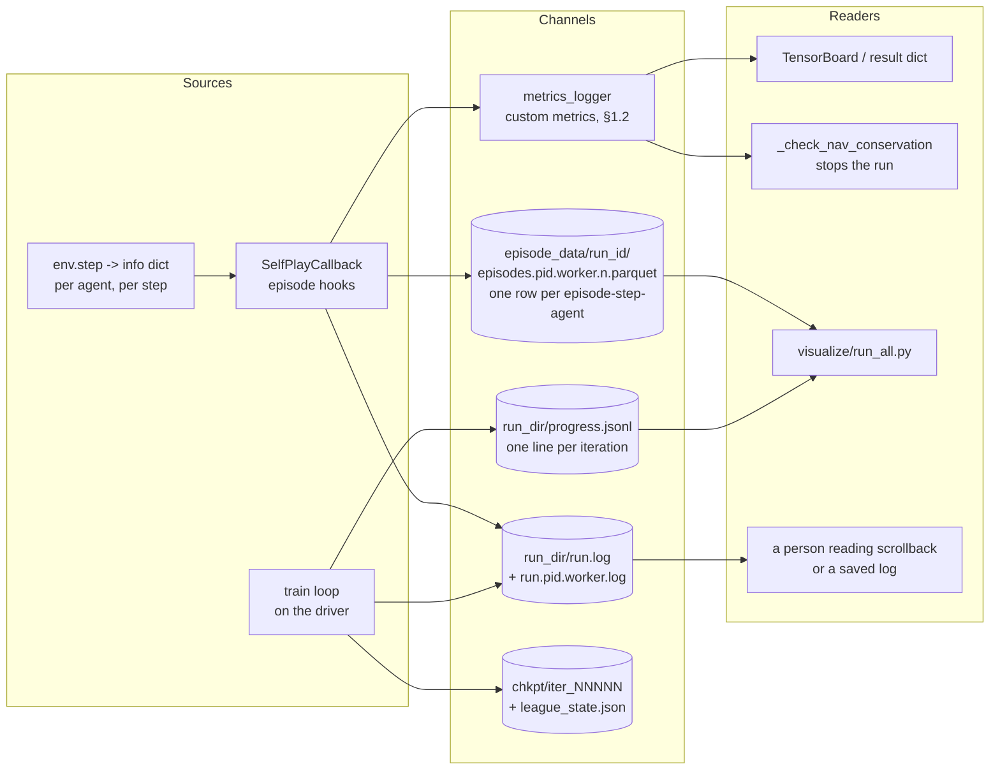

# 11. Logging and Observability

An audit of what training records, where it goes, and the gap between what is computed and what
is surfaced.

Related: [08_self_play_league.md](08_self_play_league.md) (the callback that does most of the
logging), [09_distributed_training.md](09_distributed_training.md) (what changes with multiple
workers), [14_perspective_ai_engineer.md](14_perspective_ai_engineer.md) §5.4.

**Status.** Every module logs through `logging` (§1.3), the conservation check stops a corrupt run
(§1.5), and the custom metrics of §1.2 and a typed, queryable per-step record (§1.1) cover what the
run computes. What is left in §2 needs new computation rather than aggregation of something already
in hand. The defects this replaced are in [29](29_fixed_issues.md#11-0--no-logging-framework-and-a-conservation-check-that-printed).

**Concurrency.** §1.10 is the answer to "is this thread safe or process safe", which is a separate
question from coverage and was for a long time answered only in prose. It now has tests.

**Distribution.** §5 is the audit of what all of the above does once `num_env_runners > 0`, which
is the shape the GPU profile runs. Its findings are fixed;
§1.5, §1.1 and §1.15 here describe what they became, and the defects are in
[29](29_fixed_issues.md#from-21--logging-review).

---

## 1. What is currently logged

Five channels, with different lifetimes and different readers. Nothing is written twice: each
number has exactly one home, and the arrows below are where it goes.



Two things this picture is meant to make obvious. The episode hooks run on **whichever process
sampled the episode**, so with `num_env_runners > 0` their log lines and their Parquet files are
the worker's, not the driver's — which is why the run log carries `pid=` and `iter=`, and why the
conservation check reports a *metric* instead of raising. And `progress.jsonl` is the driver's
alone: one line per iteration, holding the whole result dict, written and closed per iteration so
a killed run keeps what it had finished.

### 1.1 The per-step episode record (Parquet)

**Where:** `on_episode_step` hands the step to
[`train/episode_record.py`](../gym_continuousDoubleAuction/train/episode_record.py);
`on_episode_end` releases the episode to a background writer thread, which writes
`<episode_data_dir>/<run_id>/episodes.<pid>.<worker>.<n>.parquet`. A file is written once
`episode_rows_per_file` rows have accumulated **and at the end of every sample** (`on_sample_end`),
so the finished episodes are on disk when an iteration returns ([29](29_fixed_issues.md#11-11--a-short-run-wrote-no-episode-record) has the defect
this replaced). The cost is that a run has about one small file per runner
per iteration; any Parquet reader takes the directory. **One row per (episode, step,
agent)**, with a declared schema.

| Column group | Columns |
|---|---|
| Identity | `run_id`, `iteration`, `episode_id`, `step`, `agent_id`, `module_id`, `wall_time`, `episode_complete` |
| NAV | `nav` (float, for arithmetic), `nav_str` (the exact `Decimal` string) |
| Account | `net_position`, `VWAP`, `carrying_vwap`, `cash`, `cash_on_hold`, `position_val`, `drawdown`, `max_nav`, `num_trades`, `num_trades_step`, `num_passive_fills_step`, `order_step_placed`, `num_rejected_step`, `num_unmatched_step`, `num_obs_clipped_step`, `is_pass_action` |
| Market | `last_price`, `best_bid`, `best_ask`, `spread` |
| Reward | `reward`, and `reward_term_*` for each of the five signed contributions |
| Raw | `obs` (list), `action` (list), `info_extra` (JSON for any `info` key with no column) |

**What `obs` and `action` mean in a row.** A row is the *second half* of a transition: `action` is
the action taken **in** this step and `obs` is the observation that step **produced**. They are
not (o_t, a_t). For (o_t, a_t) pairs, shift `obs` down one row within an agent's episode. The
probe reads only `obs` (with `episode_id`, `step`, `agent_id`), so nothing in the repository pairs
the two columns today; a world-model or offline-RL reader must do the shift itself
([15](15_findings_and_recommendations.md) R-11, #181).

**How many unfinished episodes are buffered.** The recorder keeps at most
`episode_max_live_episodes` (default 8) unfinished episodes per process, and the run raises that
to `num_envs_per_env_runner` when a runner steps more environments than that: an episode with no
place in the buffer is dropped from the record ([15](15_findings_and_recommendations.md) R-10,
#180).

Five properties of the record, each answering a defect of the `pickle.dump` it replaced
([29](29_fixed_issues.md#11-11--the-pickled-episode-record)):

* **Typed and queryable.** `ray.data.read_parquet`, pandas or DuckDB read it without this package
  installed, and `pickle`'s arbitrary-code-execution-on-load is gone. The schema is *declared*, not
  inferred — inference would let two files of one run disagree about a column's type whenever an
  episode happened to hold only nulls in it. An `info` key with no column is preserved as JSON in
  `info_extra` rather than dropped, and `test_episode_record.py` fails if `InfoBuilder` grows a
  field the schema does not cover.
* **Off the hot path.** A bounded queue hands rows to one background thread, so the env runner's
  step loop pays a buffer append. A full queue drops a batch with a warning rather than blocking —
  putting the filesystem into the sampling loop is the failure this exists to remove.
* **It cannot raise into the hook.** Every failure is a warning. On a remote env runner an
  exception out of `on_episode_end` is a killed and restarted worker, not a stopped run.
* **`--no-episode-data` now costs nothing.** `on_episode_step` no longer touches observations or
  actions when the record is off.
* **It is bounded.** `episode_sample_every` (default **10**) records one episode in N, chosen by
  `crc32` of the episode id so every runner samples the same subset without coordinating;
  `episode_max_bytes` (default 2 GiB) caps what each writer keeps, deleting its own oldest files
  first. Per writer, not per directory: deleting another worker's files is a cross-process race for
  no benefit, so a run with N runners keeps up to N × the cap.

**`episode_complete` belongs in the `WHERE` clause of every per-episode query.** `close` writes
whatever was still in flight — a killed run's tail is often the part worth having — but those rows
stop at whatever step sampling stopped at. Unlabelled, every per-episode aggregate (an episode's NAV
trajectory, its return, a Sharpe over it) would silently include the fragment as a whole episode.
The flag was added after cross-checking two channels against each other: a two-runner run recorded
**8** distinct `episode_id`s while the run logs held **6** NAV tables, because `on_episode_end`
fires only for episodes that actually end. With the flag the two agree exactly — 6 complete, 2
truncated. Episodes dropped by the live-buffer cap are a different case and are not written at all:
eviction is a memory valve, and an episode discarded because too many were open says nothing about
the run.

The path is **absolute and run-scoped** (`TrainConfig.episode_data_path`). It is neither by
accident: the callback is pickled into every env runner, and a relative path is resolved against
whatever working directory that worker inherited. It stays outside `run_dir` deliberately —
`runtime_profiles.json` splits `results_root` from `episode_data_root` so the bulky record can be
kept off the Drive FUSE mount the checkpoints need.

**Why pyarrow and not Ray Data.** §5.6 item 5 said "Parquet via Ray Data";
this writes Parquet with `pyarrow.parquet` directly. The reason is the objection §5 raised against
RLlib's own offline recording: it starts a Ray Data execution *inside* the env runner, clamped to
`num_cpus_per_env_runner`, competing with sampling on a profile with two cores. The output is
identical — `ray.data.read_parquet` reads these files natively — so nothing downstream is given up.
pyarrow is not a new dependency; `ray[rllib]` already requires it.

**The measurement that sizes the bounds.** At `max_step=4096` and 8 agents a step is 8,314 bytes
pickled, so an unsampled episode is **~34 MB** per worker. Nothing in the repository writes a
pickle.

### 1.2 RLlib `metrics_logger` custom metrics

| Metric | Value | Window | Emitted in |
|---|---|---|---|
| `nav_conservation_error` | `abs(total NAV − total initial cash)`, as a float | 1 | `on_episode_end` |
| `pass_action_fraction` | Share of agent-steps where the agent chose `category=0` | 10 | `on_episode_end` |
| `order_rejection_fraction` | Share of agent-steps where an order was refused for want of cash | 10 | `on_episode_end` |
| `unmatched_action_fraction` | Share of agent-steps where a `modify` / `cancel` named no resting order (S4-14) | 10 | `on_episode_end` |
| `obs_clip_fraction` | Share of agent-steps whose observation had at least one element clipped to the declared Box bounds (S4-15); 0 unless a bound is wrong for the market | 10 | `on_episode_end` |
| `nav_conservation_violations` | Episodes that failed the check | `reduce="sum"` | `on_episode_end` |
| `nav_conservation_unchecked` | Episodes the check could not run on: exchange fees are on and the finished env's accounts were unreadable. A skip, not a pass; absent when every episode was checked | `reduce="sum"` | `on_episode_end` |
| `reward_term_mean_<term>` × 6 | Mean of each signed reward contribution | 10 | `on_episode_end` |
| `reward_term_var_share_<term>` × 6 | That term's share of the reward's variance | 10 | `on_episode_end` |
| `episode_nav_mean` / `_min` / `_max` | Per-agent NAV at episode end | 10 | `on_episode_end` |
| `mean_agent_drawdown` | Mean per-agent drawdown at episode end | 10 | `on_episode_end` |
| `mean_abs_net_position` | Mean absolute inventory at episode end | 10 | `on_episode_end` |
| `mean_num_trades` | Mean trades per agent over the episode | 10 | `on_episode_end` |
| `maker_fill_ratio_max` | The most maker-like agent's share of its own fills | 10 | `on_episode_end` |
| `module_sharpe`, `module_sortino`, `module_max_drawdown`, `module_hit_rate`, `module_position_turnover`, `module_mean_abs_position`, `module_max_abs_position` | Each module's risk-adjusted performance in the episode (docs/15 S3-9), nested under the module id. Per-step returns from the exact NAV, not annualised; a metric undefined for the episode (a Sharpe with no variance) is left out, not logged as 0. Definitions in `train/performance.py` | `reduce="mean"` over the iteration | `on_episode_end` |
| `module_realised_pnl`, `module_unrealised_pnl`, `module_markout_<h>` | Each module's realised and unrealised P&L at episode end (they sum, less fees, to NAV minus the starting NAV) and the mark-out per contract filled at each `markout_horizons` step count (docs/15 S3-9, #286) | `reduce="mean"` over the iteration | `on_episode_end` |
| `module_trades_per_episode` | Each module's trades per episode, nested under the module id; read by the champion guard (docs/15 S3-11) | `reduce="mean"` over the iteration | `on_episode_end` |
| `league_size` | `num_trainable + num_random + champion_count` | 1 | `on_train_result` |
| `league_mean_return` | Mean module return across the league | 10 | `on_train_result` |
| `league_std_return` | Std dev of module returns | 10 | `on_train_result` |
| `champions_promoted` | Champions created this iteration | `reduce="sum"` | `on_train_result` |
| `available_modules` | Size of the matchmaking pool | 1 | `on_train_result` |
| `idle_modules` | Modules that played no episode this iteration | 1 | `on_train_result` |
| `iterations_since_champion` | Iterations since the last snapshot | 1 | `on_train_result` |

**28 metrics**, up from six. What was missing was never capture — it was aggregation: §2.3, §2.4
and §2.5 all described numbers already sitting in `info` or already computed in the callback and
then dropped.

The split matters. The `on_train_result` metrics are per *iteration* and are emitted on the driver.
The `on_episode_end` ones are per *episode* and are emitted **on the env runners**, which is where
the episode hooks run. `nav_conservation_error` keeps `window=1` because an error in one episode out
of many must not be averaged away (§1.5); the fractions and the per-episode reductions use
`window=10`, matching the league metrics, because a single episode is noisy and the question they
answer is the trend.

**The `on_train_result` metrics are one iteration late, so `result["league"]` exists.** The hook is
handed a `result` that has already been compiled, so a value logged through `metrics_logger` there
is reduced on the following pass: `champions_promoted` reads `1.0` in the row for the iteration
*after* the promotion. This has always been true of `league_size` and the return statistics; the
champion metrics simply made it visible.

The callback therefore also writes the same state **directly into `result["league"]`**, which lands
in the row for the iteration it describes. RLlib's call site invokes this hook before
`Trainable.log_result` specifically "so that the user has a chance to mutate the result", and its
own TODO beside the `metrics_logger` argument notes there is "probably no point in adding more Stats
here" — so this is the sanctioned path, not a trick. `progress.jsonl` writes the whole result dict,
so a reader joining `result["league"]` on `training_iteration` gets correctly aligned values; the
metrics channel is kept unchanged for anything reading RLlib's metrics rather than the result
(Tune, a Prometheus exporter, `algo.metrics.peek`), and those readers still see the lag.

`result["league"]` carries `size`, `mean_return`, `std_return`, `threshold`, `promoted`,
`refused_passive` (1 when the champion guard turned a candidate away that iteration),
`available_modules`, `idle_modules`, `champions` and — once there has been one —
`iterations_since_champion`.

**`maker_fill_ratio_max` is a maximum for a reason.** The maker share summed over *all* agents is a
tautology in a closed double auction: `process_acc` runs once per side of every trade, both sides
increment `num_trades_step`, and only the passive side increments `num_passive_fills_step` — so the
aggregate is exactly `0.5` in every episode whatever anyone did. A real 3-iteration run reported
`0.5000` three times ([29](29_fixed_issues.md#11-12--maker_fill_ratio-measured-a-conservation-identity)). The maximum across
agents does carry signal: 0.5 everywhere means nobody is specialising, one agent at 0.9 against the
others' 0.3 is a policy that has learnt to quote and wait. Agents below five fills are excluded, or
one passive fill out of one trade would pin the maximum at 1.0 for the whole run.

**Two of them exist to be alerted on, not plotted.** `nav_conservation_violations` is how a broken
ledger reaches the driver at all (§1.5), and `idle_modules` is the S3-12 signature — a league
quietly shrinking to whichever modules the mapping fn happens to draw.

**The variance shares are the docs/07 §6.4 split, live.** Measured on a real 2-iteration run:
`nav_term` 0.95, `drawdown_penalty` 0.05, the other three below 1e-8. That is the answer to "which
term is actually driving the signal", without reading a file back afterwards. A
term that is large but constant contributes no variance and correctly reports no share — which is
why the shares, not the means, are the diagnostic.

**Why the two activity fractions exist.** They separate the two behaviours a return series cannot
tell apart. An agent that stops trading looks identical in its returns whether it *chose* to pass
or whether every order it sent was refused. The first is the collapse to always-pass that S1-3 and
S3-11 described ([29](29_fixed_issues.md#s3-11--no-entropy-bonus-and-champion-promotion-cannot-detect-passivity-verified-fixed)):
a passive policy's returns series looks unremarkable, and `pass_action_fraction` trending to 1.0
states it outright. The second is a
policy quoting past its cash; `order_step_placed` cannot express it, being 0 both for an agent that
never tried and for one whose order was refused.

**[verified]** on a real 2-iteration run: `pass_action_fraction` reported `0.122` and `0.130`,
consistent with 1 of 9 action categories being the pass code for near-uniform untrained policies.

### 1.3 Logging (stdout and a run log, filterable)

Every module reports through the standard library's `logging`, configured in one place by
[`logging_setup.py`](../gym_continuousDoubleAuction/logging_setup.py):

```python
from gym_continuousDoubleAuction.logging_setup import get_logger

logger = get_logger(__name__)
```

**[verified]** no `print()` survives in `envs/` or `train/`; `test_logging_setup.py` asserts it,
so a new one fails CI. `visualize/` is deliberately exempt - those are one-shot terminal tools
whose stdout *is* the product.

| Level | What goes here |
|---|---|
| `DEBUG` | Per-step detail: the env's `_render` dumps, LOB and account tables, mark-to-market, the episode hooks' derived parameters, the policy map at episode start |
| `INFO` | Per-episode and per-iteration events: the NAV table, league statistics, champion creation and removal, checkpoint writes, iteration summaries |
| `WARNING` | A recoverable surprise: a requested GPU that is absent, an unreadable checkpoint, a repaired league state |
| `ERROR` | A broken invariant: NAV conservation failing, a champion that could not be created |

Three properties this buys that `print` could not:

* **Worker attribution.** The format carries the pid, so with `num_env_runners > 0` the
  interleaved episode hooks are separable by process.
* **An off switch.** `cda_log_level` in `train_config.json` (or `$CDA_LOG_LEVEL`, or
  `--log-level` on the random runner) sets the level. Remote EnvRunners are separate interpreters
  that never run `main()`, so `configure()` exports the level into the environment and each
  worker's first `get_logger` call picks it up. That export reaches a worker only when this
  process starts the cluster, because the raylet inherits our environment; against
  `ray.init(address=...)` on a cluster that was already running it never arrives. So the same
  variables are also passed as a `runtime_env`, which Ray applies to the workers it starts for the
  job whoever started the cluster - see `logging_setup.worker_env_vars`.
* **A record that outlives the terminal.** See §1.9 - the log is written to a rotating file under
  `log_base_dir` as well as stdout.

Each line is stamped `<date> <time> <level> pid=<pid> iter=<iteration> <module>: <message>`. The
date is there because a training run outlasts a day and a time-only stamp cannot be ordered across
midnight; `iter=` is the training iteration, which is what lets a line be joined to the
`progress.jsonl` row for the same iteration. It reads `-` in any process that does not know the
iteration - see §1.9.

`cda_log_level` is deliberately separate from `log_level`, which is Ray's: Ray at INFO is noise,
while this package at INFO is the output a run is meant to produce.

The env's per-step render is now gated on both `is_render` **and** DEBUG being enabled, so the
tabulate tables and pandas DataFrames of the whole book, tape and every account are not built for
output that would be dropped. `env.render()` still defaults to `is_render=True` on a bare env, but
at the default INFO level that no longer produces anything.

### 1.4 Legacy Ray actor storage (`g_store`) - removed

Deleted; what it was and why is in [29](29_fixed_issues.md#11-14--the-g_store-telemetry-that-could-not-run).

### 1.5 The NAV conservation check

The sum of every agent's NAV must equal the cash the system started with: the ledger is `Decimal`
end to end, so trading moves cash and never creates it. The check reports on the runner and stops
on the driver:

```python
# on the env runner, in on_episode_end
if metrics_logger:
    metrics_logger.log_value("nav_conservation_error", float(abs(error)), window=1)
    metrics_logger.log_value(NAV_VIOLATIONS_METRIC, 0.0 if conserved else 1.0, reduce="sum")
if not conserved:
    logger.error(message)

# on the driver, in train(), after algo.train()
if nav_violations(result) and cfg.strict_nav_check:
    raise NavConservationError(message)
```

The check is **`Decimal` end to end**. `info["NAV"]` is the exact `str()` of a `Decimal`
(§2.6), so it is parsed back with `Decimal`, and `total_initial_cash` is built as a `Decimal`
too; `float()` is applied only where the value leaves for the metrics stack, which reduces with
NumPy and will not take a `Decimal`. The comparison that decides the raise is therefore exact.

* The **metric goes out either way**, so a run has a series to inspect rather than only the moment
  it broke. `window=1` keeps it per-iteration: an error in one episode out of many must not be
  averaged away.
* **`strict_nav_check` defaults to true.** A conservation break means the ledger is corrupt and
  every reward computed from NAV afterwards is meaningless, so the run stops. Set it false in
  `train_config.json`, or pass `--no-strict-nav-check`, for a run that would rather finish and be
  inspected afterwards; the ERROR log and the metrics still happen.
* **The stop is the driver's, not the hook's.** The callback reports - ERROR,
  `nav_conservation_error`, and a `nav_conservation_violations` count - and
  `train._check_nav_conservation` raises `NavConservationError` on the driver after the iteration,
  before the checkpoint, so it works at every runner count: a raise on a remote env runner would
  only restart that runner ([29](29_fixed_issues.md#11-15--raising-in-the-episode-hook-stopped-nothing)). `NavConservationError` subclasses `AssertionError`.
* **`nav_tolerance`** (default `1e-6`) is headroom for a change that legitimately removes cash
  from the system, such as fees - see
  [13_perspective_financial_trader.md](13_perspective_financial_trader.md) §4. It is **not**
  absorbing arithmetic noise: with the check exact, the expected error is `0`, and the tolerance
  can be set to `0` to enforce that — the comparison is `abs(error) <= nav_tolerance`, inclusive,
  so `0` means "conservation must be exact" rather than "every episode is a violation". At the
  default the inclusive and exclusive forms differ only on an error of exactly `1e-6`. The float
  check this replaced could not resolve this tolerance above `init_cash ≈ 1e10` ([29](29_fixed_issues.md#11-15--a-float-check-that-could-not-resolve-its-tolerance)).

Covered by `test_nav_callback.py` (25 tests) in two halves: the hook reports a violation without
raising, counts it, keeps the error exact at an account size `float` cannot resolve, and emits the
counter on conserved episodes too; the driver raises under the default, warns and continues when
non-strict, says which file holds the detail, and reads a missing or unparseable metric as "nothing
seen" rather than as a failure. `test/integration/test_distributed_observability.py` then runs a
real `num_env_runners=1` iteration and asserts the counter actually arrives on the driver — which
is the claim the in-process tests cannot make.

### 1.6 Per-iteration training history (`progress.jsonl`)

`train()` calls `algo.train()` directly rather than through `tune.Tuner`, so nothing writes
`progress.csv` or TensorBoard event files ([29](29_fixed_issues.md#11-16--no-per-iteration-record) has what this replaced). Every iteration
appends one JSON object to `<run_dir>/progress.jsonl` (§1.11):

```python
result = algo.train()
_log_iteration(iteration, target, result, cfg)
_append_progress(result, cfg)
```

* **The whole result dict**, not a chosen subset. The loss terms, KL, entropy, timers and learner
  stats are all in there; deciding today which of them a future question needs is exactly the
  mistake that produced this gap.
* **`_json_safe` runs first.** RLlib results carry numpy scalars and arrays, occasional objects
  with no JSON form, and NaNs. Numbers stay numbers (a bare `default=str` would write `"1.5"` and
  make every reader parse it back), non-finite floats become `null` — `NaN` and `Infinity` are not
  valid JSON — and anything left over is stringified.
* **Opened and closed per iteration.** These runs normally end by being killed, so a buffer held
  open for the run would lose the iterations it had already finished. Append mode also means a
  resumed run extends its history rather than truncating it.
* **Every failure is swallowed with a warning.** A full disk must not take down a run that is
  otherwise training fine.
* It sits under `log_base_dir`, not with the per-step episode record: one short line per iteration
  belongs with the things that must survive a disconnect, which is why `runtime_profiles.json`
  splits `results_root` from `episode_data_root` in the first place. It is in this run's own
  directory - see §1.11 for why sharing one file across runs is not safe.

Covered by `test_progress_log.py` (one line per iteration, appends across a restart, numbers
survive as numbers, awkward values, and a write failure that must not stop the loop) and by
`test/integration/test_progress_and_vf.py`, which trains a real PPO and reads the file back.

### 1.7 Per-step `info` (account, market and reward decomposition)

`InfoBuilder.set_info` (then `Info_Helper`) reported three fields — `reward`, `NAV`, `num_trades`. Everything else a
step knew about itself was computed, consumed and dropped: the position, the drawdown the penalty
had just been charged on, the spread, and the five reward components. §2.2–2.4 below were that
gap; what follows is what closes it.

**The original three are unchanged** — same names, same types, same order. `NAV` stays a *string*,
the exact `str()` of a `Decimal`, because the conservation check parses it back with `Decimal`
(§1.5) and `visualize_nav.py` with `float()`. §2.6 tracks that round trip as its own question and
is not settled here.

| Group | Fields |
|---|---|
| Account (§2.3) | `net_position`, `VWAP`, `cash`, `cash_on_hold`, `position_val`, `drawdown`, `max_nav`, `num_trades_step`, `num_passive_fills_step`, `order_step_placed`, `num_rejected_step`, `num_unmatched_step`, `num_obs_clipped_step` |
| Activity (§2.2) | `is_pass_action` — did this agent choose to do nothing this step |
| Market (§2.2) | `last_price`, `best_bid`, `best_ask`, `spread` |
| Reward (§2.4) | `reward_terms`: `nav_term`, `order_penalty`, `trade_penalty`, `drawdown_penalty`, `passive_bonus` |
| Action | `model_action` — as the model emitted it, before `set_actions` reshapes it for the book |

Four decisions worth stating, because each could reasonably have gone the other way:

* **The reward terms are signed contributions that sum to `reward`, and the sum *is* the reward.**
  `set_reward` accumulates the dict rather than evaluating a second expression, so the logged
  split cannot drift from the number the agent was trained on. The accumulation is a left-to-right
  loop, deliberately **not** `sum()`: on Python 3.12+ the builtin applies Neumaier compensated
  summation to floats, which disagrees with plain accumulation on ~44% of random inputs (~1e-13
  relative). Instrumenting the reward must not change it.
* **New numeric fields go out as plain numbers, not strings.** They are diagnostics, not
  invariants — nothing reconstructs the ledger from them, and `float` is what the metrics stack
  and `json` consume. `NAV` alone keeps the string treatment, for the reason above.
* **`net_position` is reported as a float** even though `account.py` initialises it to `int` 0. The
  account rebuilds it as a `Decimal` on the first fill, so the underlying type changes partway
  through an episode; the reported field holds one type throughout.
* **`spread` is `None`, not `0.0`, on a one-sided book.** The observation needs a finite sentinel
  and uses `0.0`; a log does not, and `0.0` there would be indistinguishable from a book whose
  touch is one tick wide — the ambiguity [15 S3-14](15_findings_and_recommendations.md) is about.

Covered by `test_info_dict.py` (24 tests): back-compat of the original three, the terms summing
exactly, penalties matching coefficient × counter, the counters being read *before*
`set_step_outputs` zeroes them, `spread` on a one-sided book, and the whole dict surviving
`json.dumps`.

### 1.8 The type policy

Everything above assumes a field means one thing and holds one type. Before this, four did not.

| Kind | Type | Fields |
|---|---|---|
| Money | `Decimal` | `cash`, `cash_on_hold`, `position_val`, `init_nav`, `nav`, `prev_nav`, `max_nav`, `profit`, `total_profit` |
| Price | `Decimal` | order and trade `price`, `VWAP`, `best_bid`, `best_ask`, `spread` |
| Size | `int` | order and trade `quantity`, `net_position`, `num_trades`, the per-step counters |
| Signal | `float` | `reward`, `drawdown` |

**Why it is not cosmetic.** `Decimal * float` raises `TypeError`; `Decimal * int` does not. The
orderbook carries two local workarounds for exactly that error, both inside `process_order_list`
and both commented with the traceback they came from
(`TypeError: unsupported operand type(s) for -: 'decimal.Decimal' and 'float'`). The now-deleted
`modify_cash_transfer` in `cash_processor.py` was a third site that would have raised on the modify
path with a float size. Sizes being `int` makes that class of failure unreachable rather than
worked around.

The second failure is a field that changes type partway through an episode, which breaks any
consumer that checks it. Measured over a real run, before the fix: `net_position` was `int` until
the first fill and `Decimal` after; `VWAP` was `Decimal` until a position went flat, then `int`
(a bare `0` in `Account._covered`); `reward` was `int` until the first `set_reward`; `drawdown` was
`Decimal` until the first step.

**Signals are the deliberate exception.** `reward` must be a `float` — RLlib requires it — and
`drawdown` feeds the reward. They are learning signals, not money. The observation is `float32`
by construction, so prices and sizes are converted at that boundary too.

**`last_price` is the other exception**, and it stays a `float`. It never reaches the ledger:
`mark_to_mkt` passes the tape's `Decimal` to the account, while `last_price` is a separate anchor
consumed only by `_set_price`'s NumPy arithmetic and by `state_helper`, which already wraps it in
`float()`. Making it a `Decimal` would mean converting back at both consumers and buys no
exactness.

**`envs/orderbook/` is deliberately not changed** — see `ec1f5ea`, "Intentional revert because I
don't want code in orderbook folder to change." The book stores sizes as `Decimal`
(`Order.__init__` coerces on the way in), and a fill reports whichever type its branch happened to hold:
`quantity_to_trade` (int) on a partial or exact fill, `head_order.quantity` (Decimal) when the
incoming order is larger — 84 against 10 on one tape. That mixing is absorbed at the single point
every trade passes through, `trader._normalise_trade_sizes`, before any account arithmetic sees
it. The coercion is lossless by construction rather than by luck: ints go in, the book only
subtracts whole sizes from whole sizes, and a fractional size raises instead of truncating
silently.

Sizes are `int` at ingress too (`_set_action_mkt_depth`), which is a separate guarantee: the old
`(size + min_size) * 1.0` — commented *"\*1 for float"* — was the single character that made every
downstream size a float. Egress normalisation hides an ingress regression completely, so both ends
are pinned by `test_type_policy.py` (15 tests); the ingress tests exist precisely because a
mutation restoring that `* 1.0` left every other test in the file green.

**`info` is a serialisation boundary, not part of the policy.** JSON has no `Decimal`, so money
and prices are emitted as `float` there, except `NAV`, which pays the string cost because the
conservation check (§1.5) depends on its exactness. Sizes need no conversion — `int` is JSON-native.

### 1.9 The run log

§1.6 is the run's machine-readable history and §1.7 the step's; the run log keeps its narrative —
the per-episode NAV tables, the league statistics, and the ERROR that precedes a
`strict_nav_check` stop ([29](29_fixed_issues.md#11-19--the-run-narrative-lived-only-in-scrollback) has the stdout-only log it replaced).

Every process writes a rotating log file under `log_base_dir`, beside `progress.jsonl`:

| File | Written by | Contains |
|---|---|---|
| `run.log` | the driver | iteration summaries, league statistics, champion events, checkpoint writes |
| `run.<pid>.<worker>.log` | each env runner | the per-episode NAV tables and the conservation ERROR |

**Why one file per process rather than one shared file.** `RotatingFileHandler` is not safe across
processes: two of them crossing the size threshold together rename and truncate the same file
underneath each other, losing lines from both. That rules out sharing — and sharing is not
something to give up lightly here, because the split is not cosmetic. The episode callbacks run on
the env runners, so with `num_env_runners > 0` the NAV tables and the conservation ERROR are
emitted in a worker and *nowhere else*. **[verified]** against a real two-runner run: a
driver-only file captured 7 lines and none of the NAV tables; with per-process files the worker
logs carry them. `log_base_dir` reaches the workers through `$CDA_LOG_DIR`, the same channel the
level takes, because an env runner never executes `train.main`.

Rotation bounds the output: `file_max_bytes` per file, `file_backup_count` older files kept. This
is the one item from §3's persistence table that the run log could otherwise have re-created.
Setting `file_name` to `""` disables file logging entirely.

A failure to open the file is a **warning, not an exception**. Logging is instrumentation, and a
run that cannot write its log should still train — the same rule `_append_progress` follows.

**The `iter=` field.** `progress.jsonl` is keyed by iteration and the log was keyed by nothing, so
joining them meant matching on wall-clock order. Log lines now carry the training iteration,
tracked in a `ContextVar` — per-thread rather than a module global, since the driver loop may not
be the only thread. It reads `-` where the iteration is unknown, which is every env runner and the
driver before the first iteration and after the last. Not `0`, which is a real iteration number.

A worker's NAV table is therefore dated, attributed and durable: §1.12 sends each runner the
iteration. The dash remains for a process that legitimately has no iteration: the driver before the
first one and after the last.

Covered by `test_logging_setup.py` (61 tests): the file appears beside the metrics and mirrors
stdout, rotation bounds it, an unwritable destination warns instead of raising, a worker resolves
the directory from the environment and writes its own uniquely tagged file, the driver keeps the
plain name, the iteration tag follows `set_iteration` and defaults to a dash, the timestamp
carries the date, and - see §1.10 - concurrent configuration, two-process isolation, unhandled
exceptions and warning capture.

### 1.10 Thread safety and process safety

The short answer: **thread safe on both the write and the setup path; process safe by not sharing
files rather than by locking them.** The holes this section once described are fixed and tested;
they are in [29](29_fixed_issues.md#11-110--thread--and-process-safety-holes).

**Writes, within a process.** Safe, and always were. `logging.Handler.handle()` acquires the
handler's `RLock` around `emit()`, and `RotatingFileHandler.doRollover()` runs inside `emit`, so
concurrent `logger.info` from several threads can neither interleave a line nor rotate the file
twice. `test_concurrent_writers_do_not_tear_a_line` pins it.

**Setup, within a process.** Safe. The whole handler swap in `configure()` - close and remove the
existing handlers, add replacements - is under `_configure_lock`, so two threads cannot produce
duplicate handlers or close one the other is emitting through.

**Across processes.** `RotatingFileHandler` has no cross-process interlock, and the design's answer
is not to make sharing safe but to stop processes sharing a file:

| Writer | File | What keeps it apart |
|---|---|---|
| Driver | `run.log` | its own run directory (§1.11) |
| Env runner | `run.<pid>.<worker>.log` | pid *and* Ray worker id |
| Driver | `progress.jsonl` | its own run directory (§1.11) |
| Env runner | `episodes.<pid>.<worker>.<n>.parquet` | pid, Ray worker id *and* a per-writer sequence number, under a run-scoped directory (§1.1) |

The names are chosen for the cases that make a weaker key fail:

* **A pid is unique per node, not per cluster.** The worker log name carries Ray's worker id, which
  is unique cluster-wide, behind the pid, which is what the `pid=` field of each line matches. Ray is
  read out of `sys.modules` rather than imported, so consumers of the module (`--help` included) do
  not pay for importing ray, and the import cannot run ahead of `configure()` and
  `runtime.apply_env_vars()`.
* **Each run has its own directory** (§1.11), so two concurrent runs - or a notebook session
  alongside a CLI run - do not share `run.log` or `progress.jsonl`.
* **The episode record's path is absolute and run-scoped** (§1.1). The per-writer file naming is
  what lets each process enforce its own byte cap without deleting another's files.

**Why a shared `progress.jsonl` is worse than a shared log.** Not just rotation: line integrity.
`_append_progress` calls `json.dump(result, fh)`, which writes incrementally - 61 `write()` calls
for a trivial dict. Python's `TextIOWrapper` coalesces those into ~8 KiB chunks, so a small record
is a single `O_APPEND` write and atomic; a real RLlib result dict with learner stats and timers is
larger than the buffer and splits (measured: 31 KB → 4 syscalls, 314 KB → 39). Two drivers
appending would interleave *inside* one JSON line and produce a record nothing can parse.

**The `iter=` tag is process-wide, not per-thread.** It is a module global - one training loop per
process, so the iteration is a property of the process. A `ContextVar` would be per-thread, so a line
the driver logged from any thread but the loop would read `iter=-`, and a value set inside a Ray actor
task is not guaranteed to still be in context for the next task, which §1.12's broadcast needs.
Assignment of an int is atomic under the GIL, so it needs no lock.

Covered by `TestConcurrentConfiguration` and `TestSeparateProcesses` in `test_logging_setup.py`,
which spawn real subprocesses because that is the one thing threads cannot stand in for.

### 1.11 One directory per run

Everything above keeps the *processes of one run* from colliding; this keeps two runs apart
([29](29_fixed_issues.md#11-111--two-runs-wrote-into-one-directory) has the shared directory it replaced).

Each run gets a directory under `log_base_dir`, named by `run_id`:

```
results/                          <- log_base_dir
  chkpt/iter_000010/              <- shared across runs, deliberately
  run_20260816_094500_a3f9/       <- run_dir
    progress.jsonl
    run.log
    run.4231.01000000.log
```

`run_id` is generated from the local date, time and four random hex digits - the timestamp so a
listing is readable and orderable, the random suffix because two runs launched by the same script
in the same second would otherwise collide on the second. Setting
`run_id` in `train_config.json` or passing `--run-id` reuses an existing directory, which is how a
restored run extends the `progress.jsonl` it left behind.

**The checkpoint tree is deliberately *not* run-scoped.** Restoring from a disconnect means finding
the newest `iter_*` written by an *earlier* run; a per-run checkpoint tree would hide it and every
resumed run would start from nothing. So the thing that must be shared is shared, and the two files
that cannot tolerate sharing are not. `warn_about_stale_checkpoints` already covers the cost of
that sharing.

`run_id` is out of `TrainConfig.__eq__`: it names the run rather than configuring it, and since one
is generated per instance, comparing it would make no two configs equal - including the checked-in
file against its own defaults, which `test_config_sources.py` asserts, and a restored checkpoint's
config against the current one, which `config_divergence` reports on.

### 1.12 The iteration reaches the env runners

The driver knows the iteration, and `foreach_env_runner` reaches every runner, so it is sent
([29](29_fixed_issues.md#11-112--worker-lines-carried-no-iteration) has the `iter=-` it replaced). `_broadcast_iteration` does that at the top of each iteration, before `algo.train()` starts
sampling. It is best-effort and quiet: a runner that is restarting, or an RLlib rename, degrades to
`iter=-` rather than stopping a training run. `local_env_runner=False`, because the
driver's own runner shares its process and `set_iteration` has already tagged it.

This is what makes the run log joinable to `progress.jsonl` under `num_env_runners > 0`, which is
the configuration where it matters: the episode callbacks run on the runners, so the per-episode
NAV tables and the conservation ERROR are emitted there and nowhere else.

### 1.13 A run that dies says why, in the log

An unhandled exception - including the `strict_nav_check` stop - is logged into `run.log`, so the
log does not end mid-narrative ([29](29_fixed_issues.md#11-113--a-dying-run-left-its-reason-in-scrollback) has the defect). Three things catch it:

* `main()` logs the traceback where it happens, so it is tagged with the `iter=` that failed rather
  than appearing after the teardown lines;
* `sys.excepthook`, for anything that gets past that - and for every *worker* process, which no
  try/except on the driver could reach;
* `threading.excepthook`, for a thread dying, which Python handles separately again.

The previous hooks are chained rather than replaced, so stderr and any debugger still see what they
always did. `KeyboardInterrupt` is logged as a one-line INFO with no stack: these runs are normally
ended by being killed, and a full traceback for an intentional Ctrl-C is noise at the end of every
session.

`warnings.warn` is captured too, via `logging.captureWarnings(True)`. A `DeprecationWarning` from
Ray or gymnasium is the earliest signal that an upgrade is about to break this repository. Capture alone is not enough - it logs to
`py.warnings`, which is outside this package's namespace and inherits none of its handlers, so the
record would fall through to logging's last-resort handler and reach stderr anyway. The package's
handlers are mirrored onto it.

### 1.14 The stream handler writes to stdout

The handler is explicitly `sys.stdout` (a bare `logging.StreamHandler()` writes to stderr, which
this package once did - [29](29_fixed_issues.md#11-114--the-stream-handler-wrote-to-stderr)), so `python -m gym_continuousDoubleAuction.train.train >
run.txt` captures the run. Warnings and errors are not split onto stderr
separately - they are part of the same narrative, and two streams reorder against each other.

### 1.15 Ray's own logging, and propagation

Everything above concerns *this package's* logging. Ray's is a separate stream, emitted in the
processes where it matters most: an env runner's restart notices,
RLlib's "No samples returned from remote workers", and the traceback `EnvRunnerGroup` swallows when
a runner dies (§5.2.1) are emitted by Ray's loggers in workers this package
never touches.

`ray.init(logging_config=ray.LoggingConfig(...))` is the one lever that reaches them: Ray applies it
to the driver and to every process it starts for the job. `ray_log_encoding` in `train_config.json`
selects `TEXT` (default, human-readable with job and worker ids attached) or `JSON`; an empty string
leaves Ray's logging alone. It is feature-detected - a Ray without the API, or one that rejects an
argument, costs the run its log formatting and nothing else.

Setting it also turns **propagation off** on this package's logger. `LoggingConfig` configures the
*root* logger, and this package's handler hangs off `gym_continuousDoubleAuction` with propagation
on, so every line would otherwise be printed twice. Propagation stays on by default - and is turned back on explicitly for a run with no encoding, so an
earlier run in the same process (a notebook, a `compare` sweep) cannot leave it off (issue #238) - because that is
what any root-attached handler depends on - `caplog`, which is how most of the test suite reads log
output, among them. It is a `configure()` argument rather than a constant for exactly that reason:
the duplication exists only once Ray has configured root.
---

## 2. What is not logged but should be

### 2.1 Training metrics

**`vf_explained_var`** is logged per trainable module on every iteration, read from
`result["learners"][<module_id>]` and keyed on `trainable_policy_ids`, since only the modules in
`policies_to_train` appear in that block. `test/integration/test_progress_and_vf.py` asserts in CI
that it is finite and `>= 1e-3` for every trainable module ([10 §6.2.2](10_testing.md)). Its
history as the metric that would have exposed S1-1 is in [29](29_fixed_issues.md#11-21--vf_explained_var-was-not-logged).

Everything else on this list is *computed* by RLlib and reaches `progress.jsonl` (§1.6) as part of
the full result dict. What is still missing is surfacing: none of it is in the iteration log line
or aggregated into a metric worth alerting on.

| Missing | Why it matters |
|---|---|
| `vf_loss` vs `vf_loss_unclipped` | The saturation is invisible from `total_loss` alone |
| Per-policy reward mean / min / max / std | Only league aggregates are logged; individual trends are invisible |
| Policy win rate versus random and versus champion | The key signal for league-based training |
| Loss values (policy, value, entropy) | Fundamental for diagnosing learning pathologies |
| KL divergence / clip fraction | Detects excessively large policy updates |
| Iteration wall-clock time, sample throughput | Throughput analysis and scaling decisions |

### 2.2 Environment and market data

`last_price` and the bid-ask spread are **done** — both are in the per-step `info` dict (§1.7),
alongside `best_bid` and `best_ask`. What is still missing:

The do-nothing count and the rejection rate are **done**, and are metrics rather than only
fields: `is_pass_action` and `num_rejected_step` per agent-step in `info`, aggregated into
`pass_action_fraction` and `order_rejection_fraction` (§1.2). The pass flag is set where
`_CATEGORY_MAP` lives, so a reader of `info` does not need to know that `category=0` means pass;
`test_info_dict.py` cross-checks the two agree.

| Missing | Why it matters |
|---|---|
| Order book depth per level | Liquidity analysis |
| Market / limit / modify / cancel action counts per episode | Reveals strategy evolution — the *pass* share is now covered, the breakdown across the other four types is not |

### 2.3 Agent and account state

**Done, both halves.** All of these are in the per-step `info` dict (§1.7), and the end-of-episode
state is now reduced into metrics as well: `episode_nav_mean`/`_min`/`_max`, `mean_agent_drawdown`,
`mean_abs_net_position`, `mean_num_trades` and `maker_fill_ratio` (§1.2). Aggregated across agents
rather than emitted per agent, because the league reassigns opponents every episode - a metric named
for `agent_3` would be a different policy each time, the same mislabelling
`module_episode_returns_mean` exists to avoid.

The per-step fields: current `drawdown` and `max_nav`,
`net_position` (every step, not only at episode end), `VWAP`, `cash`, `cash_on_hold`,
`position_val`, and the three per-step counters `order_step_placed`, `num_passive_fills_step` and
`num_trades_step`, read before `set_step_outputs` zeroes them.

Passive fill ratio is not emitted as its own field: it is exactly
`num_passive_fills_step / num_trades_step`, and both are now logged, so deriving it needs no
further instrumentation. A field would only add a division-by-zero convention to argue about.

### 2.4 Reward decomposition

**Done.** All six terms — `nav_term`, order penalty, trade penalty, drawdown penalty, passive
bonus, dead-action penalty — are in `info["reward_terms"]` as signed contributions that sum exactly to `reward`
(§1.7). The variance split in [07_reward_function.md](07_reward_function.md) §6.4 is measurable
from the per-step record without further instrumentation, as is over- or under-trading,
risk-aversion learning and market-making uptake.

The aggregation is **done too**. `reward_term_mean_<term>` and `reward_term_var_share_<term>` are
emitted per episode (§1.2), computed from running sums rather than a retained series - an episode is
`max_step` × `num_agents` agent-steps, and keeping all of them to produce six numbers is the memory
cost §1.1 is about. The shares are normalised across the six terms, so a term that is large but
*constant* correctly reports no share: what the split answers is which term is driving the signal,
not which is biggest.

### 2.5 League and self-play state

Three of the five are **done** and are metrics now (§1.2): `champions_promoted`,
`iterations_since_champion` - the number `_should_create_champion` had computed and discarded on
every call - and `available_modules`, joined by `idle_modules`. Champion *matchups* are also
recoverable without new instrumentation: the episode record's `module_id` column says which module
played each agent slot in each episode (§1.1), so "who played whom" is a group-by rather than a
missing field.

| Missing | Why it matters |
|---|---|
| Per-champion win rate over time | Without it, champion pool management is blind. The raw material is now in the episode record; nothing computes the rate |

### 2.6 The `info["NAV"]` string round-trip

`InfoBuilder` serialises NAV as a **string**
([`info_helper.py`](../gym_continuousDoubleAuction/envs/exchg/info_helper.py)) —
presumably to survive `Decimal` JSON encoding — and every consumer parses it back with `float()`
(the league callback, `visualize_nav.py`). That round trip discards the exactness `Decimal` was
chosen for, and it makes the info dict awkward for RLlib metric aggregation.

---

## 3. Persistence problems

| Issue | Impact |
|---|---|
| `progress.jsonl` grows without rotation | One line per iteration is small, but nothing bounds it across a run that pins its `run_id` and resumes repeatedly |

The persistence problems that are fixed - seven of them, including everything about the pickled
episode record - are in [29](29_fixed_issues.md#11-3--persistence-problems-that-are-gone).

The run log's file *count* is bounded too: `file_max_worker_files` prunes the oldest worker logs, and
`file_keep_head` keeps the start of every log (§5.2.5).

---

## 4. Recommended additions

The additions this section used to recommend - `logging` in place of `print`, a NAV conservation
stop with its metric, `progress.jsonl`, `vf_explained_var` with a CI assertion, and four sketched
metric calls - all exist ([29](29_fixed_issues.md#11-4--recommended-additions-that-are-done)). What is
left needs a *new computation*, not a reduction of something already in hand.

What remains, in order:

1. **Surface the §2.1 training metrics** (`vf_loss` vs unclipped, KL, clip fraction, per-policy
   reward spread, throughput) in the iteration log line. All are already in `progress.jsonl`; none
   is in the one line a person actually reads while a run is going.
2. **Per-champion win rate over time** (§2.5). The raw material is in the episode record now - the
   `module_id` column says who played which slot in which episode - so this is a query someone has
   to write, not instrumentation someone has to add.
3. **Per-episode desk metrics** that need a series rather than an endpoint: Sharpe, max drawdown
   over the episode, turnover. The account state at episode end is a metric now (§1.2), but these
   need the whole NAV trajectory, which is what the episode record is for. See
   [13_perspective_financial_trader.md](13_perspective_financial_trader.md) §7.
4. **Action-type counts per episode** (§2.2): the pass share is covered, the breakdown across
   market / limit / modify / cancel is not.
5. **Order book depth per level** (§2.2), the one item on this list that needs a new field in
   `info` rather than a reduction of an existing one.

---

## 5. Distributed runs: multiple env runners, multiple learners, and Ray's built-ins

What the logging above does once `num_env_runners > 0`, which is the shape the GPU profile runs:
what broke when the run was distributed, what the concurrency story is once Ray's fault tolerance
is in the picture, and whether Ray/RLlib already provide the per-step recording this repository
hand-rolls. It was written as a separate audit (`21_logging_review.md`, since deleted), whose §N is
§5.N here. See also [09_distributed_training.md](09_distributed_training.md).

Everything marked **[verified]** was checked against Ray 2.56.1 as pinned in `requirements.txt`,
either by reading the installed source at the line cited or by running the code.

**Every finding here is fixed, and all eight recommendations in §5.6 are implemented.** §5.1 and
§5.4–§5.5 describe what was audited; each §5.2–§5.3 finding says what the code does instead, and the
defect it replaced is in [29_fixed_issues.md](29_fixed_issues.md#from-21--logging-review). §5.6
records what was built and where it departed from the recommendation.

### 5.1 What is logged, and by what mechanism

Five separate channels, with different writers, different destinations, and different failure
modes. Conflating them is the main reason the multi-runner behaviour is hard to reason about.

| # | Channel | Mechanism | Payload | Written by | Destination |
|---|---|---|---|---|---|
| 1 | Run narrative | stdlib `logging` via `logging_setup.get_logger` | NAV tables, league stats, champion events, iteration summaries, tracebacks | driver **and** every env runner | stdout + `run.log` / `run.<pid>.<worker>.log` under `run_dir` |
| 2 | Per-iteration history | `json.dump` append | the entire `algo.train()` result dict | driver only | `<run_dir>/progress.jsonl` |
| 3 | Custom metrics | RLlib `MetricsLogger.log_value` | 6 values (§1.2) | env runners (3) + driver (3) | RLlib result dict → channel 2 |
| 4 | Per-step episode record | `pickle.dump` | `obs`/`act`/`reward`/`info` for every step | env runners | `<episode_data_dir>/<episode_id>.pkl` |
| 5 | Per-step `info` | returned from `env.step` | 21 fields per agent per step | the env | consumed by 3 and 4; otherwise dropped |

The table is the audited state. Channel 4 is Parquet now, bounded and run-scoped (§5.6 items 3, 5 and 6),
and channel 3 carries 27 values rather than 6 (§5.6 item 8).

Channel 4 was the only per-step *persistence*, and it was entirely bespoke — no Ray or RLlib
machinery was involved in it. That is the crux of §5.4 and §5.5.

The plumbing that makes channel 1 work across processes is worth naming, because §5.2's problems are
all failures of the same plumbing applied to the other channels:

* the level and the log directory travel to workers as `$CDA_LOG_LEVEL` / `$CDA_LOG_DIR`, exported
  by `configure()` **and** passed through `ray.init(runtime_env=...)` by `merge_runtime_env()`, so
  they arrive whether or not this process started the cluster;
* the log directory is made **absolute** before export (`configure` in `logging_setup.py`);
* each process writes its own file, tagged with pid *and* Ray worker id, because
  `RotatingFileHandler` has no cross-process interlock;
* the training iteration is pushed to the runners each iteration by `train._broadcast_iteration`,
  so a worker's lines can be joined to a `progress.jsonl` row.

None of channels 2–5 has any of that.

---

### 5.2 Problems under multiple env runners

#### 5.2.1 `strict_nav_check` stops the run from the driver

the episode hook reports a violation as the `nav_conservation_violations` metric and the driver
raises `NavConservationError` after `algo.train()`, so the check stops a run at every runner count
(§5.6 item 1). (#212.) The defect is in
[29](29_fixed_issues.md#21-21--strict_nav_check-restarted-a-worker-instead-of-stopping-the-run).

#### 5.2.2 No per-step store when episode data is disabled

with `episode_data_dir: null` the callback retains nothing per step (§5.6 item 2). (#213.) The
defect is in
[29](29_fixed_issues.md#21-22--the-per-step-store-accumulated-with-episode-data-disabled).

#### 5.2.3 `episode_data_dir` is absolute and run-scoped

`TrainConfig.episode_data_path` resolves `<episode_data_dir>/<run_id>` to an absolute path,
pickled into the callback every runner receives (§5.6 item 3). (#214.) The defect is in
[29](29_fixed_issues.md#21-23--episode_data_dir-was-neither-absolute-nor-run-scoped).

#### 5.2.4 The episode record is written off the sampling thread

the record is Parquet, written from one background thread, and every failure in the writer is a
warning (§5.6 items 3, 5 and 6). (#215.) The defect is in
[29](29_fixed_issues.md#21-24--the-pickle-write-was-synchronous-on-the-sampling-hot-path).

#### 5.2.5 Worker log files are bounded, and each keeps its head

`file_max_worker_files` bounds the number of worker logs in the directory, and `file_keep_head`
keeps the first `file_max_bytes` of every log as `<name>.head`. Size the pruning above the number of
runners plus learners: an idle live runner whose file is older than the newest N would lose its
file. (#216.) The defect is in
[29](29_fixed_issues.md#21-25--log-files-proliferated-with-worker-restarts).

#### 5.2.6 What the learner processes get

`_broadcast_iteration` also reaches remote learners (`num_learners > 0`); a learner that does
not answer within the timeout is a warning. The repository's profiles use `num_learners=0`, so no
real remote learner has run this path. (#217.) The defect is in
[29](29_fixed_issues.md#21-26--learner-processes-never-received-an-iteration).

#### 5.2.7 The cluster's own logging reaches the run log

the driver warns in `run.log` when a process that should write a run log has none, and
`capture_ray_logs` attaches the run-log file handler to the Ray loggers, so RLlib's diagnostics land
in the same file with the same `pid=` and `iter=` fields. Ray prints its own records to the console;
the stream handler is not mirrored. (#218.) The defect is in
[29](29_fixed_issues.md#21-27--the-runtime_env-did-not-cover-the-clusters-own-logging).

---

### 5.3 Concurrency and parallelism

#### 5.3.1 What is genuinely safe

§1.10 is accurate and this review found nothing to add to it:

* **writes within a process** — `logging.Handler.handle()` takes the handler `RLock` around
  `emit()`, and `doRollover` runs inside `emit`, so lines cannot tear and the file cannot rotate
  twice;
* **setup within a process** — the remove-close-add sequence in `configure()` is under
  `_configure_lock`;
* **across processes** — safety is by *not sharing files*: `run_dir` separates runs, pid + Ray worker
  id separates runners, episode id separates pickles. `run.log` and `progress.jsonl` are the driver's
  alone.

`_iteration` as a module global with atomic int assignment is the right model, for the reasons
stated. All of this has tests (`TestConcurrentConfiguration`, `TestSeparateProcesses`).

#### 5.3.2 In-flight episodes are bounded in `store` and `_activity`

both live-episode dicts are bounded, oldest evicted first (§5.6 item 4). (#219.) The defect is in
[29](29_fixed_issues.md#21-32--in-flight-episodes-leaked-from-store-and-_activity).

#### 5.3.3 A runner the broadcast misses reads `iter=-`

a remote runner clears its tag in `on_sample_end`, so a runner the next broadcast misses reads
`iter=-`, not the previous iteration. The local runner shares the driver's process and is left
alone. (#220.) The defect is in
[29](29_fixed_issues.md#21-33--the-iteration-tag-was-stale-after-a-missed-broadcast).

#### 5.3.4 One copy of the narrative on the console

a worker writing its own file echoes only `worker_console_level` (default `WARNING`) and above
to stdout, so the NAV table is in its file and not twice. Set `worker_console_level` to `INFO` (or
empty) to see the remote runners' per-episode narrative live on the console. (#221.) The defect is
in [29](29_fixed_issues.md#21-34--duplicate-narrative-on-the-console).

---

### 5.4 What Ray and RLlib already offer

| Facility | What it does | Fit here |
|---|---|---|
| `MetricsLogger` | Per-episode/iteration scalars, reduced across runners, merged into the result dict | **Already used** (6 metrics). Correct tool for aggregates. **Not** a per-step store — in 2.56 `reduce=None` silently becomes `"ema"` when no window is given **[verified]** `utils/metrics/metrics_logger.py:409-411`, so "keep every value" is not a supported mode |
| Tune loggers / TensorBoard | `progress.csv`, TB event files | Unavailable as used: `algo.train()` is called directly, and outside Tune `Trainable` points `_logdir` at a `tempfile.mkdtemp()` **[verified]** `ray/tune/trainable/trainable.py:663-671` with no result logger attached. `progress.jsonl` is the deliberate replacement |
| `ray.LoggingConfig` | Configures the **root** logger of the driver and every task/actor of the job; `encoding="JSON"`, plus `additional_log_standard_attrs` **[verified]** `ray.LoggingConfig` in 2.56 | Genuinely useful for §5.2.7 — one switch gives structured logs with job/worker/actor/task ids in every Ray process. Needs care: it configures the *root* logger, and this package's logger propagates to root, so naive adoption double-prints every line |
| Ray Data | Distributed Parquet/JSONL writing | The right substrate for channel 4, but it must be driven deliberately (see §5.5) |
| **RLlib offline recording** (`config.offline_data(output=...)`) | Records sampled experience to Parquet via `OfflineSingleAgentEnvRunner` | See §5.5 — **blocked** |

---

### 5.5 Is Ray's Offline Dataset Logging suitable for the per-step record?

**No, not in Ray 2.56.1, and not for a reason that can be worked around by configuration.** It is
still the right destination to aim at, and the gap is worth stating precisely so the decision can be
revisited on a version bump.

**The blocker.** Setting `output` selects the recording env-runner class in `EnvRunnerGroup`, and
that selection begins with an explicit multi-agent refusal **[verified]**
`env/env_runner_group.py:151-163`:

```python
if config.output:
    # No multi-agent support.
    if config.is_multi_agent:
        raise ValueError("Multi-agent recording is not supported, yet.")
```

This environment is multi-agent by construction (8 agents, league self-play). Enabling `output`
would not degrade — it would raise at `build()`.

**Three further mismatches, which matter even after that lands.**

1. **The columnar format drops `info` entirely.** `_map_episodes_to_data` writes exactly
   `EPS_ID, AGENT_ID, MODULE_ID, OBS, ACTIONS, REWARDS, NEXT_OBS, TERMINATEDS, TRUNCATEDS` plus
   extra *model* outputs **[verified]** `offline/offline_env_runner.py:307-341`. This repository's
   per-step record is *mostly* `info` — NAV, `reward_terms`, the account state, the market touch.
   Recording in episode format (`output_write_episodes=True`, the default) does preserve infos,
   since they are part of `SingleAgentEpisode`'s state, but that format is msgpack blobs meant to be
   read back by RLlib, not something `visualize_nav.py` or a notebook can query.
2. **Episode format constrains `batch_mode`.** `output and output_write_episodes and batch_mode !=
   "complete_episodes"` is a config error **[verified]** `algorithms/algorithm_config.py:5433-5440`.
   That is a real constraint on a 4,096-step environment.
3. **It runs Ray Data inside the env runner.** `OfflineSingleAgentEnvRunner.__init__` clamps the
   Data execution resources to `num_cpus_per_env_runner` **[verified]**
   `offline/offline_env_runner.py:40-45` — 0.25 in `train_config.json`, 1.0 on the GPU profile.
   Recording competes with sampling for the same core, on a profile with two cores total. The
   synchronous-write problem of §5.2.4 does not disappear; it changes shape.

**Verdict.** Offline recording is designed for *producing training datasets for offline RL*, not for
diagnostics. This repository's per-step record is diagnostic: it exists so `reward_terms` variance,
NAV trajectories and rejection behaviour can be examined after a run. Even with multi-agent support,
the columnar path would not carry the fields that motivate it. The parts genuinely worth adopting
are the *substrate* (Ray Data, Parquet, one directory per worker per write event, `filesystem=` for
cloud storage) rather than the RLlib feature.

---

### 5.6 Recommendations — all eight implemented

Ordered as they were written: 1–3 defects, 4–6 the format work, 7–8 adoption of Ray built-ins. Each
now records what was actually built and where it differed from the recommendation.

**1. `strict_nav_check` stops a distributed run.** ✅ The callback no longer raises. It logs the
ERROR, `nav_conservation_error`, and a new `nav_conservation_violations` counter
(`reduce="sum"`, emitted on conserved episodes too so the key always exists); the driver reads it
after `algo.train()` and raises `NavConservationError` — a subclass of `AssertionError`, so any
existing `except` still catches. The check runs after `_append_progress`, so the failing iteration's
numbers are on disk, and before the checkpoint, because a corrupt ledger is not a state worth
saving. Non-strict now warns *on the driver*, which previously said nothing at all about a violated
run — the per-episode ERROR is in a worker's file.

*Beyond the recommendation:* the raise had to go entirely, not merely be supplemented. A throwing
`sample()` means `get_metrics()` never runs, so the raise would have destroyed the very metric the
driver check reads. At `num_env_runners=0` the stop is now one iteration later than it used to be;
that is the price of one code path that works at every runner count.

**2. Accumulation stops when the record is off.** ✅ `on_episode_step` no longer touches
observations or actions when `episode_data_dir` is None. Verified by the test that caught it:
1,000 steps with the record off now retains nothing.

**3. The write is guarded, absolute and run-scoped.** ✅ `TrainConfig.episode_data_path` resolves
`<episode_data_dir>/<run_id>` to an absolute path. Every failure in the writer is a warning. No
env-var plumbing was needed after all — the absolute path is pickled into the callback that every
runner already receives, which is simpler than the `runtime_env` channel the recommendation
proposed and has the same effect.

**4. The live-episode dicts are bounded.** ✅ Both of them: the recorder evicts the oldest buffered
episode past `max_live_episodes`, and the callback's activity tallies past `_MAX_LIVE_EPISODES`.
Insertion-ordered, so "oldest" means the episode that started first.

**5. Parquet instead of `pickle`.** ✅ One row per (episode, step, agent), a declared schema, and
`run_id` / `iteration` / `wall_time` / `module_id` columns — which also closes "the files carry no
timestamp or iteration metadata" from §3 and makes champion matchups a group-by. An `info`
key with no column is preserved as JSON in `info_extra`, and a test fails if `InfoBuilder` grows a
field the schema does not cover.

*Deliberate deviation:* this writes with `pyarrow.parquet` from one background thread, **not** via
`ray.data` as the recommendation said. Starting a Ray Data execution inside an env runner is the
objection §5.5 raises against RLlib's own offline recording — it clamps to `num_cpus_per_env_runner`
and competes with sampling on a two-core profile. The output is byte-for-byte the same thing
`ray.data.read_parquet` consumes, so nothing downstream is lost.

**6. The record is bounded.** ✅ `episode_sample_every` (default 10, chosen by `crc32` of the
episode id so every runner picks the same subset without coordinating) and `episode_max_bytes`
(default 2 GiB per writer, oldest deleted first). Both were needed: at ~34 MB per episode the
default was previously "record until the disk fills".

**7. `ray.LoggingConfig`, and propagation off.** ✅ `ray_log_encoding` (`TEXT` by default, `JSON`
available, empty to leave Ray alone), feature-detected so an older or newer Ray degrades to its own
formatting. Setting it also passes `propagate=False`, since `LoggingConfig` configures the root
logger and both handlers would otherwise print every package line twice. Propagation stays on by
default — `caplog` and any other root-attached handler depend on it — so it is a `configure()`
argument rather than a constant.

**8. The per-step `info` is reduced into metrics.** ✅ Six metrics became 27. Per episode:
`reward_term_mean_*` and `reward_term_var_share_*` for all five contributions, `episode_nav_mean` /
`_min` / `_max`, `mean_agent_drawdown`, `mean_abs_net_position`, `mean_num_trades`,
`maker_fill_ratio`. Per iteration: `champions_promoted`, `iterations_since_champion` — the number
`_should_create_champion` had computed and thrown away on every call — `available_modules` and
`idle_modules`.

The variance shares are computed from running sums, not a retained series, which matters for the
same reason item 2 does. On a real 2-iteration run they read `nav_term` 0.95, `drawdown_penalty`
0.05, and the other three below 1e-8 — the docs/07 §6.4 split, live, from a run rather than from a
post mortem.

---

### 5.7 What was found while implementing, and while checking the implementation

More defects turned up while the recommendations were being built and checked: a 30-second hang at
process exit (#222), league metrics one iteration late (#223, now written to `result["league"]` in the row
they describe), live episode state pickled into every runner (#224), and `maker_fill_ratio` measuring a
conservation identity (#225, now `maker_fill_ratio_max`). All are fixed; the narratives, and the lesson
that an aggregate over all agents of a two-sided quantity is a conservation identity, not an observation,
are in [29](29_fixed_issues.md#21-7--what-was-found-while-implementing).

---

### 5.8 What the console records

**The console is not a complete record under multiple runners, and never was.** A two-runner run put
6 NAV tables in the per-worker log files and 2 on the console. Ray forwards worker stdout to the
driver on a best-effort basis and stops when the worker is killed, so the tail is lost. This is
pre-existing Ray behaviour rather than anything this work introduced — and it is exactly the reason
§1.9 gives for the per-process files existing. Worth stating because it makes the console
misleading as a record: the files are complete, the terminal is a sample.

The corrections this audit made to other documents, and three defects found by cross-checking the
channels (unmarked episode fragments, a racy excepthook guard, and the notebook path turning
propagation off without a `LoggingConfig`), are in [29](29_fixed_issues.md#21-8--corrections-to-other-documents-and-three-more-defects).

---

## 6. Continual Backprop metrics

Emitted per trainable module by `CBPLearnerMixin` when `cbp_enabled` or `cbp_metrics_only` is set,
through the same `self.metrics.log_dict(..., key=module_id, window=1)` path the MoE and JEPA terms
use. Absent entirely when both are false. Full context in
[25_continual_backprop.md](25_continual_backprop.md) §4.1.

The first three are the **three correlates of loss of plasticity** both papers track. The Nature
paper's claim for continual backprop is precisely that it is the only method that keeps all three
healthy at once, so they are read together rather than individually.

| Metric | Reduction across layers | What a bad value looks like |
|---|---|---|
| `cbp_dead_unit_frac` | max | Rising. Units whose mean \|activation\| has fallen below the threshold and stopped contributing |
| `cbp_mean_weight_magnitude` | mean | Rising. Weight growth is the correlate L2 addresses and CBP also suppresses |
| `cbp_batch_effective_rank` | mean | **Confounded — see below.** Units becoming redundant, but measured on the training minibatch |
| `cbp_saturated_unit_frac` | max | Rising. Specific to tanh, which is this project's default: past \|h\| > 0.9 the local gradient vanishes |
| `cbp_utility_min` / `_median` | min / mean | A widening gap means capacity is concentrating in fewer units |
| `cbp_mature_unit_frac` | mean | **Pinned at 0.0 means the mechanism cannot fire at all** — see below |
| `cbp_replacements` | **sum** | **Flat at 0 means it never fired** |

`cbp_replacements` is summed rather than averaged because it counts events in the network rather
than describing a layer; `cbp_dead_unit_frac` and `cbp_saturated_unit_frac` take the max and
`cbp_utility_min` the min, because one collapsing layer is the thing worth seeing and an average
over healthy neighbours would hide it. The rest are averaged. Reduced to one value per module
rather than emitted per layer, which would be 80 series for a 16-layer `moe_transformer`.

**The two that decide whether any of the others mean anything** are `cbp_replacements` and
`cbp_mature_unit_frac`. A continual backprop that never fires — which is the *expected* outcome at
the shipped replacement rate over a short run, for the cadence reason in
[18 §5.6.4](18_configuration.md) — logs exactly what a working one logs. Read those two first.

`cbp_batch_effective_rank` runs an SVD and is therefore computed every `cbp_metrics_every_n_updates`
optimiser steps rather than every one; the same counter gates keeping an activation sample in the
forward hook at all.

### The rank metric is confounded, and was renamed to say so

The rank of an activation matrix depends on the inputs as much as on the network. This one is
measured on whatever minibatch training produced, and the policy chooses its own inputs — so under
S1-3, where passivity is the joint optimum, a converging agent visits a narrower set of book states
and this falls **with the network unchanged**.

Measured ([16](16_verification_log.md) §16.16), over ~18,000 optimiser steps: this metric fell
**24.6%** while the same network's rank on a fixed corpus moved by **+2.5% to −1.9%**. Read on its
own it is a textbook plasticity collapse; it is the agent's behaviour.

It is kept because "what the network is doing on the data it is training on" is a real thing to
want, and it is named for the batch it is measured on rather than for what it looks like it
measures. **For a statement about the network, use `train/probe/rank.py`** across checkpoints
([23](23_probe_harness.md) §10), where the corpus is fixed while the encoder varies.

The other two correlates are robust to this — weights do not depend on the batch, and a unit dead
on one input distribution is generally dead on others — but both read zero on the shipped network
for their own reasons: `cbp_dead_unit_frac` is ReLU-shaped and a tanh unit does not die toward
zero, and `cbp_saturated_unit_frac` uses the per-unit batch mean, which is stricter than the
papers' per-output definition.
