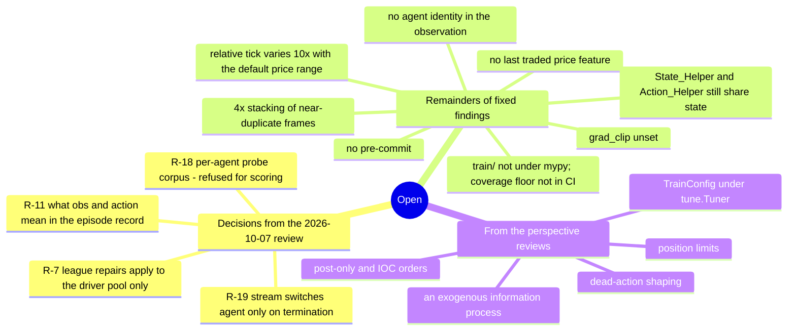

# 15. Findings and Recommendations

Where the project stands, and what is still open. **[verified]** marks a finding confirmed by
executing the code; raw output is in [16_verification_log.md](16_verification_log.md).

**Every fixed finding is in [29_fixed_issues.md](29_fixed_issues.md)**, under the ID it was filed
with (`S1-1` … `S4-28`, and the fixed `R-n`). This document keeps only what is open: the review
decisions that were documented or guarded rather than fixed, and the parts of fixed findings that
were deliberately left undone.

Every finding is also a GitHub issue: resolved ones are closed with how they were resolved, and the
open ones are the
[open issues](https://github.com/ChuaCheowHuan/gym-continuousDoubleAuction/issues?q=is%3Aissue+is%3Aopen).
Severity is a label (`S1-blocking` … `S4-minor`); the review's open decisions carry
`needs-decision`.

---

## Status in brief

All 53 S1–S3 findings and all 28 S4 findings in the register are fixed, as are 14 of the 19 items
from the 2026-10-07 review ([29](29_fixed_issues.md)). The main problems had been in the learning
problem rather than the simulator: agents observed no private state, the reward had a dominant
do-nothing strategy, and the reward scale disabled PPO's critic. All three are fixed, along with
the observation-pipeline and action-path defects found after them.

What is open is small and mostly a matter of choice: four review items that need a decision
rather than a patch, a handful of remainders recorded when their findings were closed, and the
next steps the three perspective reviews name.

---

## Open decisions from the 2026-10-07 review

Findings from the 2026-10-07 review that were not fixed, because each changes the game the policy
plays, the distributed or checkpoint design, or a research method, and so needs a decision first.
Each was documented or guarded instead. The 14 that were fixed are in
[29](29_fixed_issues.md#from-the-2026-10-07-review).

| ID | Finding |
|---|---|
| R-7 ([#177](https://github.com/ChuaCheowHuan/gym-continuousDoubleAuction/issues/177)) | **Documented** ([17](17_changelog.md) §87). A known, deliberate limit, now stated in `docs/08`: repairs apply to the driver's pool, the restore logs a warning whenever it repairs anything, and it only happens after unpickle drift. Pushing the repair to remote runners waits for a case that needs it. Was: The league repair made on restore is not pushed to remote env runners |
| R-11 ([#181](https://github.com/ChuaCheowHuan/gym-continuousDoubleAuction/issues/181)) | **Documented** ([17](17_changelog.md) §87). `obs` is the observation the step produced and `action` the action taken in it; the shift needed for (o_t, a_t) pairs is written down in `docs/11` and the schema. Nothing in the repository pairs them. Was: The Parquet record's `obs` column is the observation after the step, paired with that step's action, and the probe corpus reads it. Changes what the record means and what the probe scores |
| R-18 ([#188](https://github.com/ChuaCheowHuan/gym-continuousDoubleAuction/issues/188)) | **Guarded** ([17](17_changelog.md) §87). A per-agent corpus is refused for scoring (`report.run`, and the probe CLI). A per-stream lookup is the proper fix if per-agent scoring is ever wanted. Was: **[verified]** Probe targets shift by rows, not by steps, so under `--per-agent` (or any gap in the rows) a target reads the wrong future row. A correct fix needs a stream id separate from the episode id, or the episode split leaks across agents |
| R-19 ([#189](https://github.com/ChuaCheowHuan/gym-continuousDoubleAuction/issues/189)) | **Documented** ([17](17_changelog.md) §87). Low impact: the stream switches agent only when the lead agent terminates (0.3% of rows at low cash), and every target is a public-book quantity. Written down in `docs/23`. Was: The rollout and Parquet probe corpora switch agent mid-episode |

R-12 (Continual Backprop with `num_learners > 1`, refused rather than synchronised) left with
Continual Backprop: CBP is now the [cda-cbp](https://github.com/ChuaCheowHuan/cda_cbp) package,
whose own validation refuses that combination, and synchronising the choice across learners is
work for that package ([#182](https://github.com/ChuaCheowHuan/gym-continuousDoubleAuction/issues/182))
([25](25_continual_backprop.md), [17](17_changelog.md) §100).

---

## Open remainders of fixed findings

Parts of a finding that were deliberately left undone when the rest of it was fixed. The fixed part
of each is in [29](29_fixed_issues.md).

| From | What is open |
|---|---|
| S1-1 | `grad_clip` is unset. The critic's learning is guarded (`vf_explained_var >= 1e-3` in `integration/test_progress_and_vf.py`); clipping the gradient is not |
| S4-6 | `train/` is not under `mypy` (only `envs/` is, at zero errors), and the coverage floor applies where `pytest --cov` is run, not in CI ([10](10_testing.md) §7) |
| S4-10 | `State_Helper` and `Action_Helper` still share the env's `self`: they share the observation layout and the book snapshot on every call. What they share is declared in `SharedState` and checked by `mypy` ([02](02_architecture.md) §2.4) |
| S2-6 / [05](05_observation_space.md) §7 | The book is stacked as four near-identical absolute frames; the informative change between frames is left for the network to difference. `mid_return` supplies the anchor's delta and nothing supplies the book's |
| S3-4 | With the default `initial_price_min` / `initial_price_max` of 10 and 100, the tick's size *relative* to the price varies 10× across episodes. Narrowing the range is a config change, not a code change |
| S1-2 | Agent identity is not in the observation: two agents in the same private state cannot tell which role they play. It matters only if roles should be learned by one shared module; with one module per trainable agent it is moot ([12](12_perspective_rl_researcher.md) §2) |
| S2-7 | The last traded price is not an observation feature. `mid_return` and the reference-price fallback carry most of what it would ([05](05_observation_space.md) §7.2) |
| S4-6 | A formatter is enforced (`ruff format --check` in `test_types`), but there is no `pre-commit` configuration |

---

## Open from the perspective reviews

The items the three perspective documents still list as their next steps. Each document's agenda
section links here; the done items of each agenda are in [29](29_fixed_issues.md).

| From | What is open | Effort |
|---|---|---|
| [12](12_perspective_rl_researcher.md) §5.6 | Whether refused or dead actions should be shaped. `dead_action_penalty` ships at `0.0`, because any positive value makes the reward negative-sum across agents again (S1-3). A reward-design decision | S |
| [13](13_perspective_financial_trader.md) §10, item 10 | Position limits: real risk control rather than a reward penalty | M |
| [13](13_perspective_financial_trader.md) §10, item 11 | Post-only and IOC order types, required for realistic market making | M |
| [13](13_perspective_financial_trader.md) §10, item 12 | An exogenous information process (a latent fundamental and informed traders), which turns redistribution into price discovery | L |
| [14](14_perspective_ai_engineer.md) §5.11, item 9 | Add `pre-commit` and enforce the coverage floor in CI (the S4-6 rows above) | S |
| [14](14_perspective_ai_engineer.md) §5.11, item 12 | Move `TrainConfig` under `tune.Tuner`, for scheduling, fault tolerance and sweeps | M |
| [14](14_perspective_ai_engineer.md) §5.11, item 15 | Finish the composition refactor for the state/action pair (the S4-10 row above) | L |

---

## Severity legend

| Level | Meaning |
|---|---|
| **S1 — Blocking** | Prevents the system from doing what it is built to do |
| **S2 — Major** | Substantially degrades results or correctness |
| **S3 — Moderate** | Real defect with a bounded blast radius |
| **S4 — Minor** | Hygiene, maintainability, polish |

---

---

## What is genuinely good

It would misrepresent the repository to list only defects. The following are above the standard
for research code:

- **The matching engine is correct**, including the subtle parts: price/time priority, FIFO
  queues per level, priority loss on size increase and retention on decrease, book-walking for
  aggressive limits, and correct partial fills.
- **The ledger is exact and conserved.** `Decimal` throughout, and total NAV equals total initial
  cash to the cent after 300 random steps **[verified]**.
- **Buying-power logic is subtle** — only the risk-*increasing* portion of an order is
  cash-checked, so closing and covering always succeed, and market orders are priced off the
  contra side with a tape fallback. It said "and right" here until S1-5: the rule was right per
  order and wrong in aggregate, because nothing netted an order against the trader's *other*
  resting orders, so N individually-closing orders were each approved against the same lots. Left
  in the list, amended, because the design is sound and the defect was one missing term in it.
- **Position flips are atomic** (`_covered_side_chg`) — the case most toy exchanges get wrong,
  with four dedicated tests.
- **The RLlib new-API-stack migration was done properly.** Module classes declared through
  `MultiRLModuleSpec` (the only thing the new stack reads), `RandomRLModule` as a true uniform
  sampler rather than a frozen random network, and per-module metrics keyed by real `ModuleID`.
- **The distributed self-play code is the strongest in the repo.** Four load-bearing ordering
  constraints in champion creation, each explained in comments at the RLlib-internals level and
  each covered by a regression test — including the `WEIGHTS_SEQ_NO` force-push and the
  `crc32`-vs-`hash()` determinism fix.
- **Integration tests guard their own premise.** `test_sampling_actually_happens_remotely` and
  `test_learner_group_is_actually_remote` prevent the remote suites from degrading into vacuous
  duplicates — a discipline most codebases lack.
- **Observation normalisation is well reasoned.** Midpoint-relative prices make the
  representation invariant to the random price anchor, and the two scalars that restore what the
  transform discards (`log_mid`, `log1p_spread_ticks`) are documented with their exact rationale,
  including why `0.0` is a safe sentinel.
- **Deterministic ghost-level pricing** replaced a random-price fallback that turned action codes
  into lottery tickets in thin books — correctly motivated and well tested.
- **Dependency pins are explained, not just asserted** (`gymnasium` ↔ Ray coupling; CPU-vs-CUDA
  torch wheel selection; Ray's `/dev/shm` requirement).
- **2,191 unit tests pass** (plus 148 integration), covering every position-flip path, cash-check edge case, modify-order
  scenario and observation invariant, and — since the encoder group — the contract every selectable
  network must meet.

---
