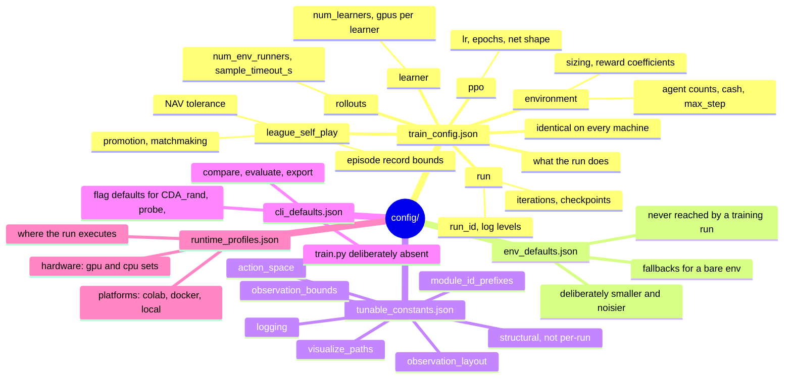
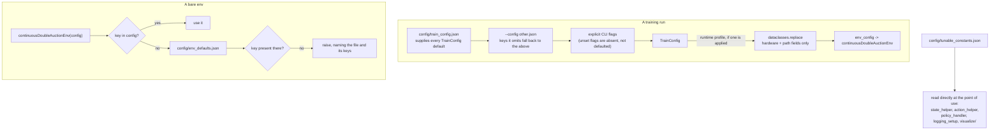
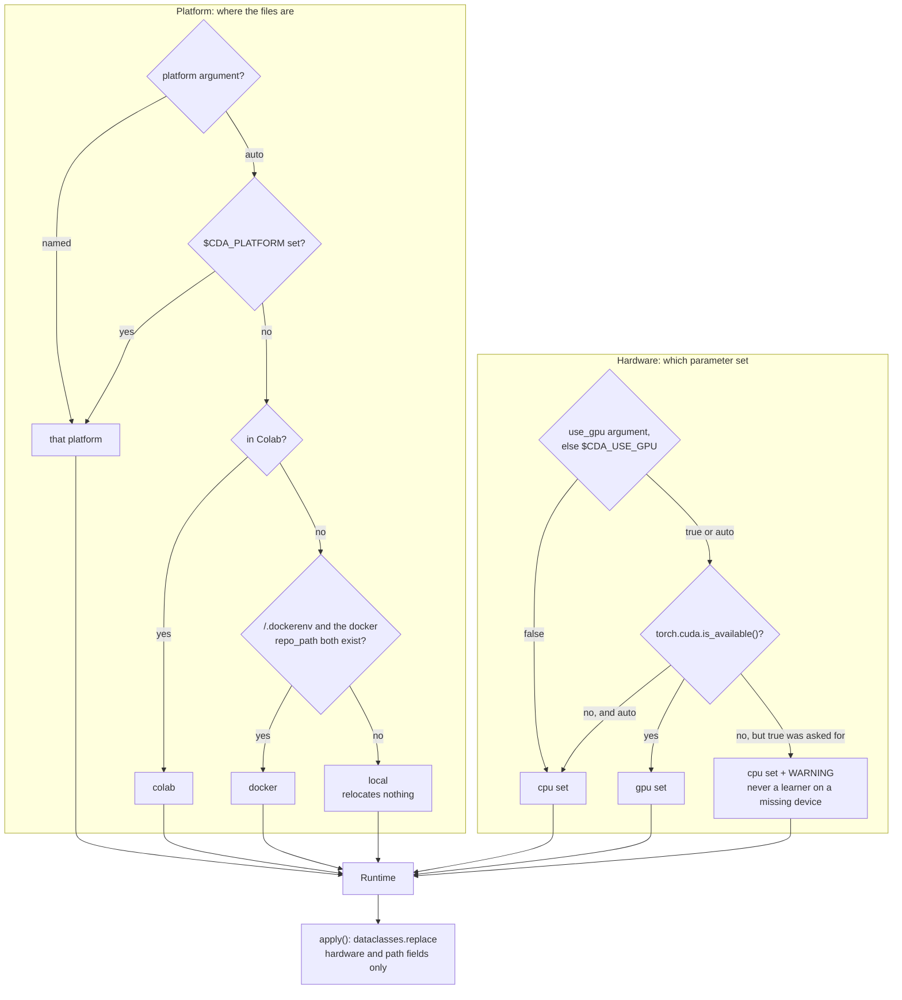

# 18. Configuration

Every value in the project lives in `config/`. No module holds a literal copy of one.

The `config/` folder at the repository root holds five JSON files, **all five of which are real
inputs**. Python code declares the *schema* — what each knob is called, what type it has, what it
does — and reads the *value* from these files through
[`config_loader.py`](../gym_continuousDoubleAuction/config_loader.py). No configured value is
read with `.get(key, some_default)`, and no function takes one as a literal keyword default (an
argument left as `None` is read from the file), because a default written in Python is exactly the
second copy this arrangement exists to remove. `.get` with a default does appear on runtime dicts,
such as actions, orders and `info`, which hold no configured values.

JSON has no comment syntax, so each file (and each group inside it) carries a `_source` key naming
the module that reads it, plus a `_description` and often a `_note`. The loader strips any key
beginning with `_`, at every level.

---

## 1. The five files

| File | Holds | Read by |
|---|---|---|
| [`config/train_config.json`](../config/train_config.json) | Every `TrainConfig` value, **including the env keys** | `TrainConfig`, `default_model_config`, `SelfPlayCallback` |
| [`config/env_defaults.json`](../config/env_defaults.json) | Fallbacks for an env built without a full config dict | `continuousDoubleAuctionEnv` and the env mixins |
| [`config/tunable_constants.json`](../config/tunable_constants.json) | Structural constants: space layout, ID prefixes, logging setup, path defaults | `state_helper`, `action_helper`, `policy_handler`, `logging_setup`, `visualize/` |
| [`config/cli_defaults.json`](../config/cli_defaults.json) | Flag defaults with no other config home | `CDA_rand`, `train/probe`, `train/compare`, `train/export`, `train/evaluate` |
| [`config/runtime_profiles.json`](../config/runtime_profiles.json) | *Where* a run executes: the `gpu` / `cpu` hardware sets and per-platform paths | `train/runtime.py`, `CDA_train.ipynb` |



The split between the first file and the last is the one worth holding on to: `train_config.json`
is **what the run does** and is identical on every machine; `runtime_profiles.json` is **what the
machine is** and changes with it. Moving a run between hardware sets changes wall-clock time and
output paths, not the trained policy. See [§8](#8-runtime-profiles).

### 1.1 The loader

```python
from gym_continuousDoubleAuction.config_loader import constant, env_default, group, value

k_rows = constant("observation_layout", "k_rows")  # tunable_constants.json
init_cash = env_default("init_cash")  # env_defaults.json
ppo = group("train_config.json", "ppo")
```

Three rules it enforces:

- **A missing key raises**, naming the file, the group, and the keys that *are* present. A key
  absent from the JSON is a configuration bug, not an invitation to fall back.
- **`_`-prefixed keys are documentation** and are stripped recursively.
- **Files are read once** and cached per directory. `reload()` clears the cache.

`$CDA_CONFIG_DIR` points the loader at a different config tree. That is how the tests in
[`test_config_sources.py`](../gym_continuousDoubleAuction/test/test_config_sources.py) prove there
are no literals left: they copy `config/`, change a value, and assert the change comes out the far
end of the env or of `TrainConfig`. A literal left behind in Python would keep the old value and
fail.

### 1.2 Derived values are not stored

`snapshot_dim` is `book_rows × k_rows + extra_dim`; `train_batch_size` is
`max_step × num_episodes_per_iter`; `limit_max_size` is `mkt_max_size × limit_size_multiple`. None
of these appear in any file. Writing a derived value down creates a second copy that can disagree
with the first — the same failure the files exist to prevent, one level up.

---

### 1.3 Precedence



Two properties this arrangement buys. **An unset CLI flag is absent from the namespace** — every
flag declares `argparse.SUPPRESS` — so the config file's value survives instead of being
overwritten by an argparse default. And **a missing key raises** rather than falling back to a
literal, which is what makes "no module holds a copy of a configured value" checkable: see §1.1.

---

## 2. Running it

```bash
python -m gym_continuousDoubleAuction.train.train --iters 4
python -m gym_continuousDoubleAuction.train.train --config sweeps/wide_book.json
```

```python
cfg = TrainConfig()  # values from config/train_config.json
env = continuousDoubleAuctionEnv(cfg.env_config)
```

Precedence is **`config/train_config.json` → `--config <other file>` → explicit flags**.

`train_config.json` is not something you opt into with a flag; it *is* the default. `TrainConfig()`
with no arguments reads it, so editing the file changes what a run does. `--config` is for running
against a *different* file — a sweep variant, or a config saved beside a past run — and keys that
file omits fall back to the checked-in one.

Every flag declares `argparse.SUPPRESS` as its default, so an unset flag is absent from the
namespace rather than carrying a value. That is what makes the precedence work, and it is also why
no flag has a default of its own: an argparse default would silently overwrite the config file for
any flag you did not pass.

Unknown keys raise rather than being ignored — a misspelled or renamed key would otherwise have no
symptom at all.

### 2.1 The one name change across the env boundary

**Adding an env key.** A field in `EnvSettings` (`envs/settings.py`), the key in `env_defaults.json` and in
`train_config.json`, and a `TrainConfig` field of the same name (or an entry in `TrainConfig._ENV_KEY_FIELDS`).
The env reads and validates every key once through `EnvSettings.from_config`, and `TrainConfig.env_config` is
generated from the same field list, so there is no third place to list it (issue #257).

The `environment` group of `train_config.json` is what `TrainConfig.env_config` forwards to the
env, so the env keys and the run settings live in one file. Two things to know:

- **One key changes name.** The field is `num_agents`; the env receives `num_of_agents`. Writing
  `num_of_agents` in `train_config.json` is rejected.
- **`num_trained_agents` sits in the `environment` group but is not forwarded** — it configures
  the policy/module wiring, not the env.

### 2.2 `env_defaults.json` and why it is separate

A training run supplies every env key from `train_config.json`, so it never reaches a fallback. A
bare `continuousDoubleAuctionEnv({})` — a test fixture, a notebook, an `env_config` you build by
hand — falls back to `env_defaults.json`.

Those standalone values deliberately differ from the training ones: `num_of_agents=5`,
`max_step=64`, `init_cash=1000000`. A bare env is small and cheap; a training env is large. Both
ship `is_render=false` ([29](29_fixed_issues.md) S4-7). Keeping them in a separate file is what lets both be
explicit instead of one being a literal buried in `__init__`.

---

## 3. Environment config

The `environment` group of `train_config.json`, forwarded as an `env_config` dict to
`continuousDoubleAuctionEnv` by `TrainConfig.env_config`. The original keys, with the standalone
default and the training value of each (the keys added since have their own subsections below):

| Key | Standalone default | `TrainConfig` value | Meaning |
|---|---|---|---|
| `num_of_agents` | 5 | 8 | Number of traders |
| `init_cash` | 1,000,000 | 1,000,000 | Starting cash per trader — must be > 0, see `env_defaults.json` |
| `tick_size` | 1 | 1 | The price grid; reaches `Action_Helper.min_tick`, see [02](02_architecture.md) §2.7 |
| `tape_display_length` | 10 | 10 | Tape rows kept for display |
| `max_step` | 64 | 4,096 | Steps before truncation |
| `is_render` | `False` | `False` | Log book, tape and accounts every step (DEBUG only) |
| `n_hist` | 4 | 4 | Observation history window |
| `initial_price_min` | 10 | 10 | Lower bound of the per-episode price anchor |
| `initial_price_max` | 100 | 100 | Upper bound of the per-episode price anchor |
| `min_size`, `mkt_max_size`, `limit_size_multiple` | 1 / 100 / 10 | same | Order sizing, consumed by `Action_Helper` |
| `order_penalty`, `trade_penalty`, `drawdown_penalty`, `passive_bonus`, `loss_multiplier` | 1e-05 / 2e-05 / 0.2 / 2e-05 / 1.0 | same | Reward coefficients, consumed by `Reward_Helper`. Each multiplies a quantity already expressed as a fraction of starting NAV, so 1e-05 is 0.1 basis point of initial capital. **`loss_multiplier` must stay 1.0** or the reward stops being zero-sum — see [07_reward_function.md](07_reward_function.md) §2.1 |

The standalone column is [`config/env_defaults.json`](../config/env_defaults.json) and the
training column is the `environment` group of
[`config/train_config.json`](../config/train_config.json). They differ deliberately: a bare env is
small, a training env is large. `TrainConfig.env_config` supplies every key
above, so a training run never reaches the fallbacks.

### 3.0 The book layout: `book_mode`

`"grid"` (default) or `"levels"` ([05](05_observation_space.md) §1.4, S3-15). An env-config key
rather than a structural constant so that a test or a `train.compare --set book_mode=levels` run
can build the other layout beside the default; `TrainConfig.book_mode` carries it, it is one of the
structural keys a restore cannot change (§5.3), and it travels in the checkpoint's layout stamp.
The module-level `SNAPSHOT_DIM` and `obs_row_slice` in `state_helper` follow the process default
from `env_defaults.json`.

### 3.0.1 The action mask: `action_mask`

`true` (default) or `false` ([06](06_action_space.md) §7). The env always emits the nine `can_*`
entries at the end of the private block; with the key on they say which action categories are
possible for the agent this step and the modules refuse the others, with it off they are all ones
and the policy is free to choose dead actions. Same layout either way, so
`train.compare --set action_mask=false` is the unmasked baseline. `TrainConfig.action_mask` carries
it into training.

### 3.0.2 The matching regime: `matching_rule`, `step_clearing`

| Key | Default | Meaning |
|---|---|---|
| `matching_rule` | `"fifo"` | How the quantity reaching one price level is split among the orders resting there: `"fifo"` (oldest first) or `"pro_rata"` (in proportion to size, largest-remainder rounded, residue in time order) |
| `step_clearing` | `"sequential"` | `"sequential"`: each order matches on arrival in the step's shuffled order. `"batch"`: the step's new orders clear together against the resting book at one uniform price |

Both are pluggable so the regimes can be compared under identical seeds
(`train.compare --set step_clearing=batch`); both change the game the agents play rather than the
layout, so a checkpoint restores across them. [06](06_action_space.md) §8 has the mechanics and the
measurement: under sequential clearing the first agent in the shuffle fills 18% more often than the
last, under batch the curve is flat and every step prints one price, at about 15% less volume.

### 3.0.3 Liquidation: `liquidation`, `maintenance_margin`, `liquidation_horizon`

| Key | Default | Meaning |
|---|---|---|
| `liquidation` | `"market_adl"` | `"market_adl"`: a trader below maintenance margin is closed out at the end of the step - resting orders cancelled, an immediate-or-cancel order to the book limited to its bankruptcy price, ADL at the mark for the remainder. `"gradual_adl"`: the same spread over up to `liquidation_horizon` steps ([04](04_accounting.md) §8.5). `"off"`: no margin; a trader terminated at NAV <= 0 keeps its position to the end of the episode (the behaviour before 2026-09-19) |
| `liquidation_horizon` | `10` | `"gradual_adl"` only: the most steps a close-out may take. The account is frozen, each step closes `ceil(remaining / steps_left)` in the book inside the band, and ADL takes what is left on the last step; if NAV reaches 0 first the remainder is closed at once. 1 is `"market_adl"`. Must be >= 1 |
| `maintenance_margin` | `0.3` | Equity a position must keep, as a fraction of its value at the mark: liquidated when `nav <= m * |net_position| * mark`. In `(0, 1)`: 0 is refused, because it liquidates only at NAV <= 0, when no equity is left to bound the close ([15](15_findings_and_recommendations.md) R-3). At NAV <= 0 the close is tried at the touch before ADL |

[04](04_accounting.md) §8 has the mechanism and a worked example. Positions are fully paid, so only
shorts can breach; at 0.3 an all-in short is closed out after a 54% rise instead of running on past
bankruptcy. Not `"none"` for the off switch: `train.compare --set` reads `none` as null. Both keys
change the game rather than the layout, so a checkpoint restores across them - and a checkpoint
written before they existed restores with the env defaults, i.e. with liquidation on.

### 3.0.4 Exchange fees: `maker_fee_bps`, `taker_fee_bps`

| Key | Default | Meaning |
|---|---|---|
| `allow_multiple_orders_per_level` | `false` | `false`: a limit at a price the trader already rests at replaces that order. `true`: it rests beside it, each with its own escrow and place in the queue (layering, multi-clip quoting). Changes the game; a checkpoint trained under one setting is not comparable with the other |
| `taker_fee_bps` | `0` | Fee the aggressing order pays, in basis points of a fill's notional. In `[0, 1000]`. A `Decimal` is accepted, as an account stores its rates that way |
| `maker_fee_bps` | `0` | Fee the resting order pays; negative is a rebate. In `[-1000, 1000]`, and the pair must sum to >= 0 |

Taken out of the trader's cash at the fill and collected by the exchange: `sum(NAV) + env.fees_collected`
equals the starting cash ([04](04_accounting.md) §9). Both ship at 0, so a fresh run is unchanged;
turning them on changes the game, so compare with `train.compare --set taker_fee_bps=2`. They do not
change the observation or action layout, so a checkpoint restores across them.

### 3.1 Order sizing

| Key | Value | Meaning |
|---|---|---|
| `min_size` | 1 | Smallest order size. Also the offset added to every size, since 0 is not a valid order |
| `mkt_max_size` | 100 | Upper bound on market order size |
| `limit_size_multiple` | 10 | Limit orders may be this many times larger than market orders |

`limit_max_size` and the two `*_size_mul` values are **derived**, not configured.
`limit_size_multiple` was previously the single-letter attribute `Action_Helper.N`.

### 3.2 Reward coefficients

Every coefficient multiplies a quantity already expressed as a **fraction of the trader's
starting NAV** — `set_reward` divides by `acc.init_nav` — so they are all in units of "reward per
unit of initial capital", and `1e-05` is 0.1 basis point of it.

| Key | Value | Meaning |
|---|---|---|
| `order_penalty` | 1e-05 | Per order placed this step (0.1 bps of initial capital) |
| `trade_penalty` | 2e-05 | Per trade filled this step (0.2 bps) |
| `drawdown_penalty` | 0.2 | Per unit of *change* in NAV below the running peak |
| `passive_bonus` | 2e-05 | Per passive (liquidity-providing) fill this step (0.2 bps) |
| `loss_multiplier` | 1.0 | Extra weight on negative NAV changes |
| `dead_action_penalty` | 0.0 | Per `modify`/`cancel` that named no resting order. Zero on purpose: a positive value is negative-sum (S1-3); the miss is already observable as `unmatched_last_step` |

Two of these are less free than they look:

- **`loss_multiplier` must be 1.0** to keep the game zero-sum. Total NAV is conserved exactly, so
  `Σ nav_change = 0` across agents; any value above 1 makes `Σ reward < 0`, which makes passing
  dominant for every agent and collapses the market — S1-3, when it shipped at 1.5 ([S1-3](29_fixed_issues.md#s1-3--doing-nothing-is-a-dominant-strategy-verified-fixed)).
- **`drawdown_penalty` multiplies a signed change, not a level.** The level was charged on all
  4,096 steps of an episode, so one early loss taxed every later step even from an idle agent
  ([S2-1](29_fixed_issues.md#s2-1--drawdown-is-penalised-as-a-level-not-an-increment-verified-fixed)). Clipping the change at zero would not have been the fix — see
  [07 §4.1](07_reward_function.md).

The micro-penalties were calibrated against measurement, not chosen: over 8,000 random-agent steps
a step that moves NAV at all moves it by a median 1.9e-03 of starting capital, so they sit at
0.5–1% of that. `passive_bonus` equals `trade_penalty`, making a passive fill net-free while an
aggressive one costs 0.2 bps.

These were literals inside `RewardModel.set_reward` until they were promoted to config — the
parameters most worth sweeping were the least reachable in the project. The formula they feed is
documented in [07_reward_function.md](07_reward_function.md) §2.

### 3.3 How the keys reach their consumers

The env reads every key once, through `EnvSettings` (issue #257), and hands each consumer its
share:

```
continuousDoubleAuctionEnv.__init__      EnvSettings.from_config(config) -> env_config, else env_defaults.json
  ├── RewardModel(**settings.reward_kwargs())          the six coefficients
  └── Exchg_Helper.__init__              **kwargs  (init_cash, tick_size, tape_display_length,
        │                                           matching_rule, step_clearing, mark_price_source,
        │                                           liquidation, maintenance_margin, liquidation_horizon)
        └── State_Helper.__init__        **kwargs  (consumes n_hist; sets the
              │                                     observation layout on the instance)
              └── Action_Helper.__init__ consumes min_size, mkt_max_size,
                                         limit_size_multiple, tick_size
```

`Exchg_Helper` builds the reward model's partner components itself (`EpisodeStatus`, `InfoBuilder`,
`LiquidationEngine`). The two remaining mixins each consume their own arguments and forward the
rest, so `kwargs` is empty by the time the chain reaches `object`. Argument defaults on the mixins
and `Exchg_Helper` are `env_default(...)` calls, so one constructed directly gets the same values
the env would have given it; the components read theirs when they are built.

### 3.4 Episode horizon: fixed or random

| Key | Default | Meaning |
|---|---|---|
| `episode_length_mode` | `"fixed"` | `"fixed"`: every episode truncates at `max_step`. `"random"`: each reset draws the horizon uniformly from `[max_step_min, max_step_max]` (inclusive) with the env's seeded generator, so `reset(seed=...)` reproduces it |
| `max_step_min`, `max_step_max` | `max_step / 2`, `max_step` | The range of the draw. Ignored in `"fixed"` mode |

The drawn horizon is reported once, as `episode_horizon` in the reset `infos`, and never shown
to the policy: `time_left` ([05](05_observation_space.md) §1) counts against `time_left_horizon`,
the **latest possible end** (`max_step_max` in random mode, `max_step` in fixed), so at truncation
it reads `1 − h / max_step_max` rather than 0. Showing the draw would hand the horizon back.
Termination on bankruptcy is unchanged in both modes, and `TrainConfig.train_batch_size` is sized
by the mean of the range (`expected_episode_length`), so `num_episodes_per_iter` is the number of
episodes an iteration holds *on average*.

**Why one would want it.** A known horizon makes the end of the episode a free option: an agent
learns that the last steps are where inventory can be dumped or spread crossed without a
tomorrow, and `time_left` tells it exactly when. A horizon drawn from a range removes the exact
end while keeping a bound the value function can still see. The cost is a noisier value estimate
near the end - the agent does not know whether a step is its last - and `time_left` no longer
reaching 0 in most episodes. Which of these matters is an empirical question; both modes run under
`train.compare --set episode_length_mode=random --set max_step_min=... --set max_step_max=...`.

### 3.5 Market variety: `market_variety`

| Key | Default | Meaning |
|---|---|---|
| `market_variety` | `{}` | `{}`: every episode runs under the configured market. Otherwise a dict mapping any of `matching_rule`, `step_clearing`, `maker_fee_bps` and `taker_fee_bps` to a non-empty list of values; each reset draws one value per listed key |

The draw uses the env's seeded generator, like the horizon above, so `reset(seed=...)` repeats an
episode's market, and keys are drawn in a fixed order whatever order the config lists them in. A
key not listed keeps its configured value. The matching rule takes effect on the book `reset`
builds, the clearing mode on every step, and the fees on every account. The drawn values are
reported as `market` in each agent's reset `infos`; the policy is not shown them. With `{}` nothing
is drawn, so the generator's stream, and every existing run, is unchanged.

Only these four keys can vary: none changes the observation or action space, and none needs the
env rebuilt. Construction refuses an unknown key, an empty list, a matching rule or clearing mode
the env does not have, and any maker and taker pair the lists can produce that the fee rules of
§3.0.4 reject. For example:

```json
"market_variety": {"matching_rule": ["fifo", "pro_rata"], "step_clearing": ["sequential", "batch"]}
```

**Why one would want it.** A league trains against changing opponents but on one fixed market,
so a policy can fit that market's rules. Drawing the rules per episode trains it across a spread
of markets, the environment-diversity lesson of DiscoRL's discovery runs (Oh et al., 2025). Judge
such a run on held-out markets rather than training return, since fees change returns. It changes
the game rather than the layout, so a checkpoint restores across it.

## 4. Structural constants

`config/tunable_constants.json`. These shape the observation and action spaces, the module-ID
naming contract, and the plot and path defaults.

### 4.1 Observation layout

| Key | Value | Meaning |
|---|---|---|
| `k_rows` | 10 | Book depth — price levels per side |
| `book_rows` | 6 | Rows in the book block: bid_price, bid_size, ask_price, ask_size, bid_occupied, ask_occupied (the last two 0/1, S3-14) |
| `extra_dim` | 6 | Market-level scalars appended: log_mid, log1p_spread_ticks, mid_return, signed_volume, log1p_trade_count, trade_direction |
| `private_dim` | 41 | The per-agent block: 9 base fields + 2 × k_rows own-book sizes + 2 counts + 1 flag + 9 action-mask entries ([05](05_observation_space.md) §1, [06](06_action_space.md) §7) |

`k_rows` is **one** definition with four consumers: the observation space, the action space's
`price` component, the reshape in `_set_price`, and the reshape in `print_table`. These were once
four independent literals that all happened to be 10, so changing depth raised `ValueError` or
silently made high levels unreachable.

Depth is now genuinely changeable: `State_Helper.__init__` reads the layout onto the instance as
`k_rows` / `book_rows` / `extra_dim` / `book_dim` / `snapshot_dim`, and the observation space is
built from `self.snapshot_dim`. Set `k_rows` to 6 and the observation, the action space and the
price logic all follow.

`book_rows` is checked against `BOOK_ROW_ORDER`, the tuple naming what `set_agg_LOB` actually
concatenates. A value the code cannot honour raises at env construction rather than being ignored.

The module-level `K_ROWS` / `BOOK_DIM` / `SNAPSHOT_DIM` names still exist in `state_helper`, read
from the same config at import. They are for consumers with no env instance to ask — the
visualizers, which read a pickled observation, and the tests. `BOOK_DIM` is the raw six-row frame
in either mode; `SNAPSHOT_DIM` is the emitted width at the process default `book_mode` (§3.0):
2 × (2 × k_rows + 1) + extra_dim = 48 in `grid`, book_rows × k_rows + extra_dim = 66 in `levels`.

#### 4.1.1 Observation bounds

`observation_bounds` is the finite `[low, high]` of every observation feature, in three
sub-groups keyed by the field names the layout uses — `book` (`BOOK_ROW_ORDER`, the two occupancy
rows on `[0, 1]`), `extra`
(`EXTRA_FIELDS`) and `private` (`BASE_PRIVATE_FIELDS`, plus `own_size` for the 2 × k_rows own-book
sizes, `own_count` for the two counts, and `unmatched_last_step`). `State_Helper.observation_bounds`
tiles them into the `low` / `high` arrays of the whole `n_hist * snapshot_dim + private_dim`
vector, the env declares its `Box` with those, and `set_next_state` clips to them and counts what
it clipped ([05](05_observation_space.md) §1.2). A field with no entry fails env construction by
name; a pair with `low >= high` fails too.

The values are the identity where the range is one and measured with 4× headroom where it is not;
the `_note_derivation` key in the file carries the numbers, and [16](16_verification_log.md) §16.22
the measurement. Tightening a bound is a representation decision — it is a `tanh`-friendly clip
that also throws information away — and the `obs_clip_fraction` metric is how to see what a
tighter bound costs before believing a result trained under it.

### 4.2 Action space

| Key | Value | Meaning |
|---|---|---|
| `category_n` | 9 | Side/type codes: none, then bid and ask × {market, limit, modify, cancel} |
| `price_offset_n` | 3 | Passive / join / aggressive, in ticks |
| `max_own_orders` | 4 | Cardinality minus one of the `order_slot` head that aims a modify or cancel at one of the agent's own orders; also the normaliser of the two own-order counts in the observation. The measured p90 of resting orders under random play ([06](06_action_space.md) §1.5) |
| `size_low` / `size_high` | 0.0 / 1.0 | Bounds of the `size` Box, the order size as a fraction of the size ceiling. `size_low` must be `>= 0` and below `size_high`, and `size_high` may not exceed 2.0 (the fraction at which an order reaches `mkt_max_size` / `limit_max_size`: 1.0 is half the maximum); `Action_Helper` refuses anything else |

The price code's cardinality is not here — it is `observation_layout.k_rows`.

Both counts are **checked against the code that decodes them**, which is the change that made them
real config rather than documentation:

- `category_n` must equal the size of `_CATEGORY_MAP`, the side/type table in `action_helper`. The
  old `if`/`elif` chain hardwired 9, so changing the number did nothing.
- `max_own_orders` must be ≥ 1; the head has `max_own_orders + 1` codes because 0 means "all" (cancel) or "oldest" (modify).
- `price_offset_n` must be odd, so the neutral "join" code is the middle one. The offset is now
  `price_offset - price_offset_n // 2` rather than a hardcoded `- 1`, so widening it to 5 extends
  the range symmetrically to ±2 ticks and works.

### 4.3 The rest

**Price anchor fallbacks** (`price_anchor_fallbacks`: `action_helper_last_price`,
`state_helper_midpoint`, both 100.0). The price used before any trade has printed, previously the literal
`100.0` written twice — once in `Action_Helper.__init__`, once in the observation midpoint fallback
in `state_helper`. Both paths are dead in practice, since `reset()` overwrites `last_price` from
`initial_price_min` / `initial_price_max`, but they are read from one place now and cannot drift.

**Module ID prefixes** (`module_id_prefixes`: `policy_prefix`, `champion_prefix`). `policy_` / `champion_` are a naming contract `SelfPlayCallback` parses,
not a knob — changing them invalidates existing checkpoints, whose module directories carry the old
prefix.

**Runtime env vars** (`runtime_env_vars`, today `RAY_DEBUG_DISABLE_MEMORY_MONITOR`). Set with
`setdefault` before `ray.init`, so a value already exported in the shell wins. (On the pinned Ray the
one variable configured is read only by a memory monitor that Ray's own test utilities construct, so it
does nothing in a training run; see [17](17_changelog.md) §77.)

**Logging** (`logging`: `level`, `env_var`, `format`, `datefmt`, `dir_env_var`, `file_name`,
`file_max_bytes`, `file_backup_count`, `file_keep_head`, `file_max_worker_files`,
`worker_console_level`, `capture_ray_logs`). The default level, the format string, `datefmt` (the date
format), `env_var` (the environment variable the level travels in, `CDA_LOG_LEVEL`) and `dir_env_var`
(the one the log directory travels in, `CDA_LOG_DIR`). Read by
[`logging_setup.py`](../gym_continuousDoubleAuction/logging_setup.py), which applies them once per
process on the first `get_logger` call — including inside Ray's worker processes, which never run
`main()` and would otherwise come up unconfigured. The pid is in the format on purpose: with
`num_env_runners > 0` several processes log into one stream. See
[11 §1.3](11_logging_and_observability.md).

The last four keys are about many processes writing logs ([11](11_logging_and_observability.md) §5.2.5, §5.2.7, §5.3.4):
`file_keep_head` keeps the first `file_max_bytes` of every run log as `<name>.head`, because rotation
discards the start of a run first; `file_max_worker_files` keeps only the newest N worker logs in a
directory (each restarted env runner opens a new set), `0` meaning no pruning; `worker_console_level` is
the lowest level a worker that is writing a file still echoes to stdout, which Ray forwards to the
driver console (`WARNING` by default, so a NAV table is in the worker's file and not twice; an empty
string echoes everything as before); `capture_ray_logs` mirrors the run-log file handler onto Ray's own
logger so RLlib's diagnostics land beside the narrative they explain.

**Visualize defaults** (`visualize_paths`). The paths the `visualize/` scripts read:
`episode_parquet_dir` (default `episode_data`) with `episode_parquet_fallback` (`../episode_data`,
tried when the first does not exist, as when run from inside `visualize/`), `training_log_dir`
(`results`) with `training_log_fallback`, and `default_agent_id` (`agent_0`), the agent a chart plots
when `--agent-id` is not given.

---

## 5. Training config

`TrainConfig` ([`config.py`](../gym_continuousDoubleAuction/train/config.py)) is the schema: it names
every knob, gives it a type, and documents what it does. It holds no values — each field's default
is `_default("key")`, which reads `config/train_config.json` when a `TrainConfig` is instantiated.

Two consequences worth knowing:

- **The dataclass and the file cannot disagree** ([29](29_fixed_issues.md#18-2--the-dataclass-and-the-file-disagreed) has the run that silently used the
  dataclass's values).
- **A key missing from the file raises**, rather than resolving to something written in Python.

Network shape is configured through `fcnet_hiddens`, `fcnet_activation` and `vf_share_layers`,
threaded to `default_model_config` via `create_multi_agent_config`. Called without arguments,
`default_model_config` reads the same `ppo` group directly, so both paths agree by construction.
`vf_share_layers` is `False` deliberately: the learners train against non-stationary league
opponents, where sharing a trunk between policy and value tends to destabilise the value estimate.

Which *kind* of network sits underneath that is the separate `encoder` group — see §5.4.

How that network is *updated* is the `optimizer` group (§5.6) and any installed extension enabled
in the `extensions` group (§5.7), such as Continual Backprop. Both are off by default in the sense
that matters: at their shipped values the optimiser is the one RLlib has always built and the
learner class is the one the encoder selects, unchanged.

`SelfPlayCallback` does the same with the `league_self_play` group and the two agent counts. That
group also carries the two knobs on the episode-end NAV conservation check: `nav_tolerance`, the
absolute cash tolerance, and `strict_nav_check` (`--no-strict-nav-check`), which decides whether a
violation stops the run or only logs. It defaults to stopping — a conservation break means the
ledger is corrupt — and the `nav_conservation_error` metric is emitted either way. The stop is
decided **on the driver**, from the `nav_conservation_violations` count, rather than raised inside
the episode hook: that hook runs on the env runner, where RLlib's fault tolerance swallows the
exception and restarts the worker. See [11 §1.5](11_logging_and_observability.md) and
[11 §5.2.1](11_logging_and_observability.md).

The same group carries the four knobs on the per-step episode record:

| Key | Flag | Meaning |
|---|---|---|
| `episode_data_dir` | `--no-episode-data` | Root of the record; `null` switches it off entirely, buffering included. Resolved to an absolute `<dir>/<run_id>` before it reaches the callback, because the callback is pickled into every env runner |
| `episode_sample_every` | `--episode-sample-every` | Record one episode in N, chosen by `crc32` of the episode id so every runner picks the same subset |
| `episode_max_bytes` | `--episode-max-bytes` | Cap on what **each writer** keeps, oldest deleted first but never the newest file (a cap smaller than one file is kept at one file and warned about, once); `0` keeps everything |
| `episode_rows_per_file` | — | Rows buffered before a file is written. A floor, not a size: rows are handed over a whole episode at a time, so no episode is split across two files. The buffer is also written at the end of every sample, so a file can hold fewer rows than this |
| `episode_max_live_episodes` | — | Floor for how many unfinished episodes the recorder buffers per process (8). The run raises it to `num_envs_per_env_runner` when a runner steps more environments than that, because an episode with no place in the buffer is dropped from the record ([15](15_findings_and_recommendations.md) R-10) |

`num_learners`, the reward coefficients and the sizing knobs have no CLI flag, so the file is the
only way to set them outside the Python API.

### 5.0 The entropy bonus and the champion guard

Four keys, added for [S3-11](29_fixed_issues.md#s3-11--no-entropy-bonus-and-champion-promotion-cannot-detect-passivity-verified-fixed), all with a shipped value that
differs from what RLlib or the earlier config gave:

| Key | Group | Shipped | Meaning |
|---|---|---|---|
| `gamma` | `ppo` | 0.999 | PPO discount. RLlib's own default is 0.99, an effective horizon of about 100 steps against a 4,096-step episode; 0.999 gives about 1,000. In `(0, 1]` |
| `lambda_` | `ppo` | 0.95 | GAE parameter. RLlib's own default is 1.0, which makes the advantage pure Monte-Carlo. In `[0, 1]`. Both are in the restore fingerprint: a resume of a 0.99 / 1.0 checkpoint keeps them and says so. Set 0.99 and 1.0 for the old behaviour |
| `entropy_coeff` | `ppo` | 0.01 | PPO entropy bonus at the start of the run. RLlib's own default is 0.0 |
| `entropy_coeff_final` | `ppo` | 0.001 | The value it has fallen to after `entropy_decay_iters` iterations, held there afterwards |
| `entropy_decay_iters` | `ppo` | 16 | Iterations over which it falls, linearly in env steps (one iteration is `train_batch_size` steps, whatever `num_learners` is). At least 1 |
| `std_dev_multiplier` | `league_self_play` | 1.5 | A champion must beat `league_mean + multiplier × league_std`. Was 0.1 |
| `promotion_reference` | `league_self_play` | `pooled` | Which modules the promotion threshold is computed over: `pooled` (all, the frozen random baselines included) or `excluding_baselines` (trainable modules and champions). While the latter set is too small for `std_dev_multiplier` to be clearable (two learners and no champion) the threshold falls back to the pooled one, and `result["league"]["reference"]` says which was used |
| `markout_horizons` | `league_self_play` | `[1, 10]` | Steps ahead at which each fill is marked against the mid, logged as `module_markout_<h>` (adverse selection: positive when the price moved the agent's way after the fill). Positive integers; `[]` switches them off (#286) |
| `min_champion_trades` | `league_self_play` | 1.0 | Mean trades per episode, over the iteration, the candidate needs to be promoted. 0 turns the guard off |

`entropy_coeff` and `entropy_coeff_final` both 0 builds the config it always did. They reach RLlib
as `entropy_coeff=0.01` or as the schedule `[[0, 0.01], [train_batch_size × entropy_decay_iters,
0.001]]` (`TrainConfig.entropy_setting`), and RLlib reports what it is applying as
`curr_entropy_coeff` in each trainable module's learner results. 0.01 to 0.001 is the usual PPO range, not a tuned value.

`std_dev_multiplier` has a ceiling that depends on the league: with n modules no module can be more
than `sqrt(n − 1)` standard deviations above the mean, which is 2.65 at the default 8. A multiplier
at or above it can never promote anyone, and `SelfPlayCallback` warns at construction when that is so.
The champion guard and its reasoning are in [08](08_self_play_league.md) §10.

### 5.1 `sample_timeout_s`, and the run that trains on nothing

In the `rollouts` group, with `--sample-timeout`. It is how long the driver waits for a remote env
runner to hand back its share of `train_batch_size` before giving up on it.

RLlib's default is **60 seconds**, and this environment cannot meet it at the shipped batch size.
`train_batch_size` is `max_step × num_episodes_per_iter` = 4096 × 4 = 16,384 env steps; the order
book matches in Python at roughly 90 env-steps/sec per runner with 8 agents (measured,
[00](00_getting_started.md) §0.2), so two runners need about a minute and a half. The failure is silent in the worst way: a timed-out iteration **discards the
partial rollouts**, hands the learner nothing, and then counts itself, logs, and checkpoints
exactly like a real one. A 16-iteration run finishes in 19 minutes having done zero gradient steps,
and its checkpoints hold the initial random weights.

What it looks like, once per iteration:

```
WARNING rollout_ops.py:122 -- No samples returned from remote workers...
iter 1/16 | env steps sampled: n/a | module returns: {}
iter 1 trained on no samples: the result has no 'env_runners' block...
```

The second warning is this repo's (`_log_iteration`), and it names the batch size and the timeout
it just missed. The consequence downstream is that `result` has no `env_runners` key at all, so
anything indexing `result[ENV_RUNNER_RESULTS]` raises `KeyError` rather than reading a zero.

Raise `sample_timeout_s` above what one iteration's sampling actually takes, or shrink the batch
with `max_step` / `num_episodes_per_iter`. The value is ignored when `num_env_runners` is 0, since
the driver then samples in-process with no timeout to miss.

### 5.2 The `run` group

These are the keys that still mean something on a **restored** run. Everything else in the file is
baked into the checkpoint — see §5.3.

| Key | Flag | What it does |
|---|---|---|
| `num_iters` | `--iters` | The iteration to train **through**, not a number of iterations to run |
| `num_iters_is_delta` | `--iters-is-delta` | Read `num_iters` as "this many more from wherever the restore landed" |
| `chkpt_freq` | `--chkpt-freq` | Save every N iterations (0 saves only at the end) |
| `chkpt_keep` | `--chkpt-keep` | How many saves to retain; `<= 0` keeps all |
| `is_restore` | `--restore` | Resume from a checkpoint rather than starting from scratch |
| `restore_path` | `--from-checkpoint` | Which checkpoint; `null` takes the newest readable one |
| `log_base_dir` | `--log-base-dir` | Root for all run output. Holds `chkpt/` and one directory per run |
| `run_id` | `--run-id` | Names this run's directory under `log_base_dir`; `null` generates one |
| `log_level` | `--log-level` | **Ray's** level, handed to `PPOConfig.debugging` |
| `cda_log_level` | — | **This package's** level; exported as `$CDA_LOG_LEVEL` so worker processes inherit it |
| `ray_log_encoding` | — | How Ray formats its own logging, in the driver and every process it starts: `TEXT`, `JSON`, or `""` to leave it alone |

**`run_id` and what is shared between runs.** `progress.jsonl` and the run logs go in
`<log_base_dir>/<run_id>/`, generated per run so two runs cannot write into each other's files —
a shared `run.log` loses lines to a cross-process rotation race, and a shared `progress.jsonl` can
interleave two drivers inside one JSON line. The **checkpoint tree stays at
`<log_base_dir>/chkpt`**, outside the run directory and shared: restoring means finding the newest
`iter_*` an *earlier* run wrote, and scoping it per run would make every resumed run start from
nothing. Pass `--run-id` with a previous run's id to write into that directory again, which is how
a restored run extends the progress history it left. See
[11_logging_and_observability.md](11_logging_and_observability.md) §1.11.

Sharing that tree is only safe when the runs are not simultaneous: two live runs overwrite each
other's same-numbered save, and `chkpt_keep` pruning keeps the newest N across both. So `train()`
holds a lock file, `chkpt/.run.lock` (run id, pid, host), from before the restore reads the folder
until it returns or raises, and a second run on the folder is refused with the way out: give it
its own `log_base_dir` (which is what `train.compare` does for every run), wait, or delete the
lock if that run is gone. A lock whose process no longer exists on this machine, or that this
process left behind, is taken over; one held from another machine cannot be checked and counts as
live; two runs finding the same stale lock take it one after the other, through a `flock` on `.run.lock.guard` ([R-9](29_fixed_issues.md#from-the-2026-10-07-review), #179, #296).

**Two log levels, deliberately.** Ray at `INFO` is noise; this package at `INFO` is the per-episode
NAV table, the per-iteration league statistics and the checkpoint lines — the output a run is meant
to produce. Set `cda_log_level` to `DEBUG` for the per-step render and account tables, `WARNING`
for a quiet run. See [11 §1.3](11_logging_and_observability.md).

**`ray_log_encoding` is the third logging knob, and it is not a level.** It is handed to
`ray.LoggingConfig`, which is the only lever that reaches a *worker's* Ray-side output — the
env-runner restart notices, and the traceback RLlib swallows when a runner dies. Setting it also
turns off propagation from this package's logger to the root one, since `LoggingConfig` configures
root and both handlers would otherwise print every line twice. See
[11 §1.15](11_logging_and_observability.md).

**`num_iters` is a target.** A 16-iteration run resumed at iteration 9 does 7 more, so the length
of a run does not depend on how many times it was interrupted. ([29](29_fixed_issues.md#18-52--num_iters-restarted-at-zero-on-every-resume) has the count it replaced.) The iteration numbers are the algorithm's own — RLlib stores `training_iteration` in the checkpoint —
so they are the same numbers the checkpoint directories and the log lines carry.
`num_iters_is_delta` restores the old reading, for extending a run that already reached its target.

**Checkpoint layout.** Each save is its own directory:

```
results/chkpt/
├── iter_00004/          ← an RLlib checkpoint, plus league_state.json
├── iter_00006/
└── iter_00008/          ← the newest; what a restore picks
```

`chkpt_keep` prunes the oldest ([29](29_fixed_issues.md#18-52--every-save-overwrote-one-checkpoint-directory) has the single overwritten directory this replaced).
Saves are staged as `iter_N.tmp` and renamed into place, so an interrupted save leaves a directory
the scanner skips rather than a half-written one that looks complete. A restore that cannot read
the newest checkpoint falls back to the one before it.

`league_state.json` beside each checkpoint records the champion pool in plain JSON. The champion
*modules* are in the checkpoint proper, but everything indexing them — history, the monotonic ID
counter, the matchmaking pool — lives on the cloudpickled callback, and survives only as long as
`SelfPlayCallback` stays unpickle-compatible. On restore the sidecar is reconciled against the
modules that actually came back, and any repair is printed. See
[08_self_play_league.md](08_self_play_league.md).

**Choosing a checkpoint.** `restore_path` null — the default — takes the newest readable
checkpoint, which is what a disconnect wants. Name one to go back further:

```bash
python -m gym_continuousDoubleAuction.train.train --from-checkpoint results/chkpt/iter_00008
```

```json
"run": {
  "is_restore": true,
  "restore_path": "results/chkpt/iter_00008"
}
```

It names **one save**, not the directory holding them; pointing at `results/chkpt` raises and
lists the checkpoints that are there, newest first. Two rules follow from what pinning is for:

- **`restore_path` requires `is_restore`.** Set without it, the run would start from scratch and
  ignore the path, so it raises instead. `--from-checkpoint` implies `--restore`, since naming a
  checkpoint on the command line is not ambiguous about intent; in the file, the two keys must
  agree. Validation happens before the env is built, so a typo fails in a second.
- **A pinned checkpoint never falls back.** An unreadable one raises rather than quietly training
  from its neighbour — the opposite of what the automatic path should do, and the point of having
  said which one.

Rolling back a run past a collapsed league is then: pick the checkpoint, restore from it, and let
training overwrite the iterations after it. `chkpt_keep` bounds how far back you can go.

The notebook has no separate knob for any of this — it is a thin driver that reads
`train_config.json`, and cell 4 prints the resolved `restore` line before the run starts.

### 5.3 What a restore ignores

`Algorithm.from_checkpoint` rebuilds everything from the config stored *in the checkpoint*. The
`PPOConfig` built from `train_config.json` is discarded. Since resuming means editing
`train_config.json` to set `is_restore`, that is the same file holding `lr`, the reward
coefficients and `num_agents` — so an edit made in the same pass as the restore flag had no effect
and said nothing.

It is now loud in both directions:

- **A layout change is fatal, by name.** Every checkpoint carries a layout stamp in its
  `league_state.json` — the observation and action layout versions, the private-field and
  action-key lists, and how wide each action head is (`action_sizes`: `order_slot` is
  `max_own_orders + 1`, `price` is `k_rows`, and so on; `envs/layout_version.py`) — and `build_algo` compares it before restoring.
  A checkpoint from the 193-float / five-head layout (version 1) resumed into this code fails with
  a message naming both versions and the fields that differ, rather than at a tensor shape on the
  first step or, worse, not at all ([S4-19](29_fixed_issues.md#s4--minor)).
- **A structural change is fatal.** `num_agents`, `n_hist`, `encoder_type`, `encoder_spec` or the
  policy set changing means the restored weights do not fit the requested problem, so the restore
  raises rather than training something other than what was asked for. Revert the key, or start a
  fresh run.
- **Everything else warns.** `lr`, reward coefficients, batch sizes and runner counts print as
  "will NOT take effect" with both values, and the run continues on the checkpoint's config.

To train with new values, start a fresh run — `is_restore` false, or a new `log_base_dir`.

---

### 5.4 The `encoder` group

Selects the network the **trainable** modules encode observations with. The frozen
`RandomRLModule` baselines have no network and ignore it.

| Key | Meaning |
|---|---|
| `encoder_type` | Which encoder. `mlp` (default) plus whatever is registered in [`train/model/encoders/`](../gym_continuousDoubleAuction/train/model/encoders/), and any an installed package provides (`jepa`, from cda-jepa, with its extension enabled). |
| `encoder_specs` | Per-encoder hyperparameter blocks, keyed by encoder type. A block existing is the signal that its encoder is implemented. `num_heads` is the attention-head count (4 in `transformer` and `moe_transformer`); in `lstm` it configures the per-step tokenizer, and `hidden_dim` (256) is the width of the LSTM that recurs over the rollout axis on top of it. |

Available encoders:

| `encoder_type` | Network |
|---|---|
| `mlp` | RLlib's stock MLP over the flat observation. The default and the pass-through. |
| `transformer` | Pre-norm self-attention over the order-book grid, with a learned two-axis positional encoding and attention pooling. |
| `lstm` | A per-step embedding of the book grid, then an LSTM over the rollout axis. Stateful. |
| `moe_transformer` | The transformer with each block's feed-forward replaced by a top-k gated mixture of experts. |
| `jepa` | From the cda-jepa package, not this repository. A transformer that also trains a self-supervised objective: mask part of the book, predict the masked part's *representation* from the rest, scored against an EMA copy of itself. |

#### What a token is

The observation is a flat `n_hist * snapshot_dim + private_dim` vector, but its
book part is really a chronological stack of snapshots, each a `book_rows x columns`
grid plus six market-level scalars. `mlp` discards that; every other encoder recovers
it through `ObsLayout`, and the `tokenization` key decides what it slices into. The
column axis depends on `book_mode`: in `grid` (the default) it is the `2 * k_rows + 1`
tick offsets around the reference price, 21 at `k_rows` 10; in `levels` it is the
`k_rows` occupied levels.

| `tokenization` | Tokens | Attention relates |
|---|---|---|
| `time` | `n_hist` | times only. At `n_hist` 4 that is four tokens — kept for ablation, not expected to be useful. |
| `level` | columns + 1 | book columns, newest snapshot only. No history. |
| `both` (default) | `n_hist * (columns + 1)` | both axes. |

Under `level` and `both` a token is one cell of the book — `[bid_size, ask_size]` at
one tick offset in `grid` mode, `[bid_price, bid_size, ask_price, ask_size,
bid_occupied, ask_occupied]` at one level in `levels` mode — and the newest
snapshot's cells also carry the agent's own bid and ask size there. The six
market-level scalars have no per-cell home, so they ride on one extra **global
token** per snapshot. That is where the `+ 1` comes from: `both` is 88 tokens at
the shipped settings (4 × 22), and 44 in `levels` mode (4 × 11).

A token is `max(book_rows + 2, extra_dim)` channels wide — wide enough for either
kind, with the narrower one right-padded with zeros; the `+ 2` is the own-book
pair. In `grid` mode that is `max(4, 6)` = **6**, in `levels` mode `max(8, 6)` =
**8**. The `max` is what made §37.4's change of `extra_dim` from 2 to 6 a width
change rather than a data loss: sizing to the book rows alone would have silently
dropped every scalar past the fourth — only for the encoders that tokenise, so
`mlp` would have gone on seeing features the transformer and LSTM no longer
received.

Every non-`mlp` encoder LayerNorms immediately after its input projection, and that
is deliberately not configurable. Measured on real steps, the four channels in a
token have standard deviations of `[1.27, 8.17, 0.046, 9.52]` — `sqrt(volume)` runs
~200× the ask-price channel. Unnormalised, attention puts a mean 47% of its mass on
a single token; with the norm, 9.5%. It does not degrade gracefully.

`mlp` is a **pass-through**: it resolves to the stock RLlib `DefaultModelConfig` built from the
`ppo` group's `fcnet_*` keys and touches none of the encoder machinery, so a default run — and
every checkpoint written by one — is unaffected by this group existing. Any other value routes the
trainable modules through `CDACatalog`, which replaces only the encoder; the pi and vf heads stay
the stock ones, sized off the encoder's `latent_dims`.

An unregistered `encoder_type` raises when the `TrainConfig` is built, naming the ones that are
available. Names beginning with `_` are test fixtures: buildable, so a test can exercise the custom
path, but refused from a config file.

Both keys are **structural** (§5.3). Changing either with `is_restore` set is a hard error, for the
same reason `n_hist` is: the restored weights are that architecture's weights. Comparing
architectures means separate runs, not a resume.

#### The `lstm` encoder and its two time axes

`lstm` is the *structured* recurrent encoder, not RLlib's `use_lstm` shortcut. The
shortcut feeds the raw 233-float observation to a stock MLP tokenizer, discarding
the book structure exactly as `mlp` does. This one's tokenizer reads the grid.

Two different time axes are involved and they are easy to confuse:

- **`n_hist`** is a window *inside a single observation*, already stacked by the env.
  The tokenizer collapses it.
- **The rollout axis** is consecutive env steps. That is what the LSTM's memory runs
  along, and what `max_seq_len` cuts into training sequences.

They overlap: at `n_hist` 4 the LSTM re-reads the last four snapshots every step, so
its memory is partly redundant with the observation itself. Setting `n_hist` to 1 for
a recurrent run removes the redundancy — at the cost of invalidating checkpoints,
since `n_hist` is structural.

`max_seq_len` is declared in the `lstm` spec block but applied to the **top-level**
model config, because RLlib's connectors read it before any encoder is called.
`build_trainable_module_spec` lifts it across.

Selecting `lstm` makes the trainable modules stateful, which changes more than the
network: RLlib forces `inference_only=False` so the critic's states are collected,
wraps the encoder in `TorchStatefulActorCriticEncoder`, and adds a time dimension to
every batch. The frozen `RandomRLModule` baselines stay stateless throughout, which
is fine — statefulness is per-module.

#### `moe_transformer` and its second loss term

Identical to `transformer` except that each block's dense feed-forward becomes a
top-k gated mixture. `ff_dim` is now each **expert's** width, so the feed-forward
parameter count is roughly `num_experts ×` what the same `ff_dim` buys in
`transformer`, while per-token compute is `top_k ×` it.

An MoE needs a second loss term. Nothing in the policy gradient rewards a gate for
using more than one expert — collapsing onto one is a perfectly good local optimum
that leaves you with a dense feed-forward you paid `num_experts` times over for. The
Switch-Transformer load-balancing term, weighted by `aux_loss_coeff`, is the only
pressure against that. Getting it from the encoder to the optimiser takes a chain,
because no link can see both ends:

```
MoEFeedForward.forward   returns (output, stats)
TransformerBlock.forward passes the tuple through
the encoder              stages per-block stats
CDAPPOTorchRLModule      moves them into fwd_out
CDAPPOTorchLearner       adds aux_loss_coeff * aux to PPO's total
```

The hop through the module is unavoidable: `ActorCriticEncoder._forward` keeps only
`ENCODER_OUT` and discards anything else an encoder returns. Both the module and the
learner are wired unconditionally and are inert for every other encoder, so there is
one code path rather than two.

The term is **averaged over MoE blocks, not summed**, so `aux_loss_coeff` means the
same thing whatever the stack looks like. Summed — which is what Switch Transformer
does — it would scale with `num_layers` and *double* when `vf_share_layers` is false,
because the critic's blocks route separately and count too. A coefficient tuned at
`num_layers: 2` would then apply twice the pressure at 4, silently, and comparing two
MoE configs of different depths would confound depth with how hard the gate was being
pushed — the same confound the per-encoder `lr` override exists to remove. Averaged,
the floor is `top_k` at perfectly uniform routing, so an untrained gate reads just
above 2 at the shipped settings regardless of depth.

**Expect collapse, and watch for it.** This env’s observation is 233 floats and the
league is small, so MoE's premise — capacity you cannot afford densely — may simply
not apply. A collapsed mixture and a healthy one have identical losses and identical
throughput; the only difference is `moe_max_expert_share` and `moe_min_expert_share`
in the learner metrics, which a healthy mixture holds near `top_k / num_experts`.

#### Two keys every encoder accepts

`lr` and `vf_share_layers` may appear in **any** `encoder_specs` block and are handled
centrally rather than by the encoder. Omit them to inherit the `ppo` group; set either
to override it for that encoder only.

They exist because both `ppo` defaults were chosen for the MLP. `lr = 5e-05` was tuned
for a 2×256 tanh net, and holding an attention stack to it measures the learning rate
rather than the architecture. `vf_share_layers: false` costs an MLP little and doubles
a transformer — a real trade-off, since the `false` is itself deliberate (a shared
value trunk destabilises against non-stationary league opponents).

Neither is listed in the shipped blocks: absent means inherit, and a `null` would be
indistinguishable from a value nobody chose.

#### `jepa`, from cda-jepa

The `jepa` encoder comes from the cda-jepa package ([30](30_extensions.md) §9). Installed, it is
selected like the others plus `"jepa"` in `extensions_enabled`, and its block under
`encoder_specs.jepa` overrides the package's defaults; with no block it runs on them. Its keys
(`mask_axis`, `mask_ratio`, the predictor, `ema_decay`, the loss weights, `world_model`) and what
to watch (`jepa_latent_std`) are cda-jepa's [docs/settings.md](https://github.com/ChuaCheowHuan/cda_jepa/blob/main/docs/settings.md) and
[docs/metrics.md](https://github.com/ChuaCheowHuan/cda_jepa/blob/main/docs/metrics.md).

---

### 5.5 Comparing architectures

The `encoder` group exists to make architectures comparable, and a comparison is easy
to run in a way that measures the wrong thing. Four points, in rough order of how much
damage getting them wrong does:

0. **Change one thing.** `train.compare --set FIELD=VALUE` (repeatable) overrides any
   `TrainConfig` field for every run in the comparison, coerced to the field's type, so a
   representation or matching regime can be compared under identical seeds and encoders:
   `--set book_mode=levels`, for instance, against the default grid.

1. **Fix the seed, and use more than one.** `run.seed` ships as `null`, so each run
   draws its own. Single-seed RL comparisons are mostly noise, and self-play league
   dynamics are noisier than most — the champion pool amplifies an early divergence for
   the rest of the run. Pin `seed` and run at least three per architecture.

2. **Separate runs, never a resume.** `encoder_type` and `encoder_spec` are structural
   (§5.3), so switching them with `is_restore` set is a hard error by design. Give each
   architecture its own `run_id`.

3. **Re-tune, or say you didn't.** See the two common keys above. Comparing at a single
   learning rate is a legitimate experiment, but it answers "which architecture is best
   at `lr=5e-05`", not "which architecture is best".

4. **Read the parameter counts.** Each trainable module logs its own at startup:

   ```
   policy_0: encoder mlp             | 225,051 parameters
   policy_0: encoder transformer     | 671,899 parameters
   policy_0: encoder lstm            | 799,259 parameters
   policy_0: encoder moe_transformer | 1,464,987 parameters
   ```

   At the shipped settings the alternatives are 3–6.5× the MLP. A win at 6.5× the
   parameters and a fraction of the throughput is a different claim from a win at
   parity, and the per-iteration line reports `env steps sampled` for the other half.

0. **Run the protocol as a command.** Points 1, 2 and 4 are what
   `python -m gym_continuousDoubleAuction.train.compare` does for you: every (encoder, seed) is a
   separate run with the seed pinned and its own `log_base_dir`, the parameter count is recorded,
   and the final checkpoint is scored on the probe of point 5 against one shared corpus collected under the same env config as the runs (so a `--set` of `book_mode`, `n_hist` or the fees applies to it too). It writes
   per-run JSON and a Markdown table of means and standard deviations, and marks two encoders as
   *separated* on a metric only when the gap exceeds both standard deviations with at least three
   seeds a side. Defaults are in `cli_defaults.json` under `cda_compare` (`out_dir`, `probe_episodes`,
`probe_steps` and `probe_seed` are the keys behind `--out`, `--probe-episodes`, `--probe-steps` and
`--probe-seed`); see
   [26](26_runbook.md) §26.9 for the command and [16](16_verification_log.md) §16.18 for a
   smoke-scale run.

5. **Score them without the reward first.** Points 1–4 are about running the comparison
   well; this one is about whether the comparison can answer anything at all. A ranking taken
   from returns is only as good as the reward: while S1-1 and S1-3 stood, it would have ranked
   how fast each architecture descends to doing nothing. Both are fixed ([S1-1](29_fixed_issues.md#s1-1--ppos-critic-receives-zero-gradient-verified-fixed), [S1-3](29_fixed_issues.md#s1-3--doing-nothing-is-a-dominant-strategy-verified-fixed)), and a
   reward-free score is still the cheaper first measurement.

   ```bash
   python -m gym_continuousDoubleAuction.train.probe --encoders mlp transformer lstm
   ```

   That ranks encoders on public microstructure targets — the next midpoint move, the
   spread change, depth imbalance — with no reward, policy or value function in the path.
   It runs in seconds, needs no training run, and scores each architecture *untrained* as
   well, which is the inductive-bias baseline a trained encoder has to beat. See
   [23_probe_harness.md](23_probe_harness.md).

   It does not replace a training comparison. It answers "does this architecture represent
   the market better", not "does it trade better", and the second needs a multi-seed training
   comparison.

For `moe_transformer` also watch `moe_max_expert_share` and `moe_min_expert_share` in
the learner metrics — a collapsed mixture is indistinguishable from a healthy one by
loss or throughput alone.

---

### 5.6 The `optimizer` group

A group that changes how the network is *updated* rather than what shape it is. It ships inert:
leave it alone and a run builds the same optimiser it always has.

Continual Backprop (CBP), which used to be a second group here, is the `cbp` extension of the
cda-cbp package ([30](30_extensions.md) §8). A config that still carries a `cbp_*` key fails at
load, naming the package.

### 5.6.1 Why tuned Adam is separate from CBP

The Nature continual-backprop paper's reinforcement-learning recipe is not CBP alone. It is CBP **plus**
L2 at a weight decay of `1e-4` **plus** "tuned Adam" at `β₁ = β₂ = 0.99`, the last on the grounds
that the usual `(0.9, 0.999)` is itself a cause of plasticity loss — the squared-gradient estimate
in Adam's denominator updates far more slowly than the gradient estimate in its numerator, so one
large gradient produces one very large update. Every algorithm in that paper except the
standard-PPO baseline uses the retuned values. The arXiv paper (2108.06325v3, Appendix D) does
not: its PPO, PPO+L2 and Continual PPO all run at torch's `(0.9, 0.999)`.

That makes them easy to bundle, and bundling them would be a mistake: turning CBP on and retuning
Adam in the same change would measure the two together, and neither paper claims they are the same
intervention. So the optimiser stays here, composed by `_learner_class` whether or not any
extension is enabled (`train/model/optim_learner.py`). It sits inside the extensions: cda-cbp builds
the authors' `AdamGnT` itself and reads the same two keys through `optim_learner.adam_settings`,
so setting them changes that optimiser's betas and weight decay, not its type.

### 5.6.2 `optimizer`

| Key | Default | Meaning |
|---|---|---|
| `adam_betas` | `[0.9, 0.999]` | Adam's `betas`. The Nature paper's tuned value is `[0.99, 0.99]`; the arXiv paper keeps the default |
| `adam_weight_decay` | `0.0` | L2. The Nature paper's RL value is `1e-4` |

At the defaults, `configure_optimizers_for_module` defers to RLlib's own implementation, so the
optimiser is bit-for-bit the one every existing run and checkpoint was built with.

**Changing either alongside `is_restore` is a hard error.** Not for the reason `encoder_spec` is —
no tensor shape depends on them and the weights would restore perfectly well — but because they
are consumed when the Learner class is chosen and the optimiser is built, both of which happen
*before* a restore. `Algorithm.from_checkpoint` then rebuilds from the checkpoint's own config and
discards them, so a retuned optimiser alongside a resume did nothing at all and looked exactly like
a run that honoured it. They are `UNRESTORABLE_CONFIG_KEYS` rather than `STRUCTURAL_CONFIG_KEYS`,
and the error message says so, because a reader who concluded the checkpoint was unusable would
throw away a good one. A checkpoint written before the group existed is compared against what
such a run actually *did* (torch's own Adam) rather than being skipped. The same rule covers
`extensions_enabled` and every extension setting (§5.7).

### 5.7 The `extensions` group

Separately installed packages that add to the learning stack ([30](30_extensions.md)). Both keys
are unrestorable: a resume must enable exactly what the checkpoint did, with the same settings.

| Key | Default | Meaning |
|---|---|---|
| `extensions_enabled` | `[]` | Names of installed extensions to compose into this run. Installing a package changes nothing until its name is here; a name that is not installed raises |
| `extension_settings` | `{}` | One object per extension, keyed by name. Each extension fills in its own defaults and rejects keys it does not declare. A block for an extension that is not enabled is ignored |

A config that enables nothing counts as `extensions_enabled: []` in the restore check, so a
checkpoint that ran an extension cannot be resumed by a config that leaves it out (the run would
otherwise go on running it from the checkpoint's own config, with nothing saying so). A checkpoint
from before Continual Backprop moved out carries its settings as the old `continual_backprop`
group; the restore check reads that group as the `cbp` extension's settings, so it resumes with
`extensions_enabled: ["cbp"]` and the same values ([30](30_extensions.md) §8).

---

## 6. `tick_size`

`tick_size` sets the price grid the action space quotes on. It reaches `Action_Helper.min_tick`,
which is the only thing that constructs prices — `_set_price` builds them as
`anchor ± k × min_tick`.

One value: the configured `tick_size` is `Action_Helper.min_tick`, `reset()` keeps it, and the
book takes no tick of its own. There is no rounding or tick validation anywhere in the matching
path; the grid is the action layer's alone.

**Every price the action layer emits is on this grid, for any tick.** `_set_price` snaps its
result to `min_tick` in `Decimal` before returning it, `agg_LOB_raw` is float64, and
`Trader._get_order_ID` compares prices as `Decimal(str(price))`, the book's own conversion.
`test_tick_grid.py` asserts the grid for ticks {1, 0.5, 0.1, 0.05, 0.01, 0.3, 0.0001} on both the
anchor and the level path. The inert copy, and the float-ulp drift on a fractional tick that made a
cancel miss its order, are in
[29](29_fixed_issues.md#18-6--tick_size-was-inert-then-off-grid-on-a-fractional-tick)
([S3-4](29_fixed_issues.md#s3-4--the-order-books-tick_size-is-inert-verified-fixed)).

**Why the book does not enforce the grid.** There is exactly one price producer in the system:
every price reaching `process_order` comes from `_set_price` via `place_order`, and it emits
on-grid prices by construction. Validation in the book would re-derive a guarantee the
producer already provides. Enforcement in `OrderBook.process_order` becomes the right call only if
a second price source appears that the action layer does not control — scripted or human agents,
replayed real order flow, an external feed.

---

## 7. Adding a knob

1. Add the key to the right file, in the right group, with a `_note` if the reason is not obvious.
2. Read it through `config_loader` at the point of use. Do not give it a Python default.
3. If it is a `TrainConfig` field, declare it in the dataclass as `= _default("key")`.
   `test_config_loading.py` asserts the file and the dataclass name exactly the same set of fields,
   so a field without a key (or a key without a field) fails the suite.
4. If the code cannot honour every value the key could take — a cardinality wired to a mapping, a
   count that has to be odd — validate it and raise. A structural value that is silently ignored is
   worse than a literal, because the file claims it works.

---

## 8. Runtime profiles

[`config/runtime_profiles.json`](../config/runtime_profiles.json) answers a question the other four
files deliberately do not: *what machine is this?* It exists because `CDA_train.ipynb` has to run
unchanged on a [Colab VM](20_colab.md) and inside the
[docker/ml image](19_docker.md), which differ in core count, GPU presence and filesystem layout —
and in nothing else. Resolved by
[`train/runtime.py`](../gym_continuousDoubleAuction/train/runtime.py).

This document is the mechanism. For the step-by-step of actually running either target, see
[20_colab.md](20_colab.md) and [19_docker.md](19_docker.md).

### 8.1 The two hardware sets

Exactly two, chosen by `torch.cuda.is_available()` and the notebook's `USE_GPU` toggle. The stated
bounds are a ceiling of **2 CPUs + 1 GPU** and a floor of **1 CPU + 0 GPUs**;
[`test_runtime_profiles.py`](../gym_continuousDoubleAuction/test/test_runtime_profiles.py) asserts
both sets stay inside them.

| | `gpu` | `cpu` |
|---|---|---|
| `ray.init(num_cpus, num_gpus)` | 2, 1 | 1, 0 |
| `num_env_runners` | 2 | 0 |
| `num_cpus_per_env_runner` | 1.0 | 1.0 |
| `num_learners` | 0 | 0 |
| `num_gpus_per_learner` | 1.0 | 0.0 |

Two choices in there are worth stating outright:

- **`num_learners=0` in both.** The learner runs in the driver process and still gets the GPU —
  `num_gpus_per_learner` is only turned into a Ray *resource request* for remote learners
  (`learner_group.py`, the `is_remote` branch). A remote learner would cost one of the two CPUs and
  buy nothing at a 256×256 MLP.
- **`num_env_runners=2` under the gpu set.** Sampling is the bottleneck here, not the update — the
  environment matches orders in Python, measured at 86–112 env-steps/sec on one core
  ([00](00_getting_started.md) §0.2), against a PPO
  update the GPU finishes in seconds. This is the `num_env_runners=N, num_learners=0` shape
  [docs/09 §5](09_distributed_training.md) recommends for exactly this case. A test asserts
  `num_env_runners × num_cpus_per_env_runner ≤ num_cpus`, because runners are actors: ask for more
  CPUs than `ray.init()` was given and they stay pending forever rather than failing.

### 8.2 Platforms

`repo_path`, `results_root` and `episode_data_root` per platform; `null` means "leave it alone",
which is what a local checkout wants. The Colab entry splits the two output roots on purpose:
checkpoints go to the Drive-backed repo so a disconnected session is recoverable with
`is_restore`, while the per-step episode record (~34MB per 4096-step episode) goes to the VM's local
disk and never crosses the Drive FUSE layer.

`drive_mount_point` is where the Colab platform's Google Drive is mounted (`/content/gdrive`); `null`
on `docker` and `local`, which have no Drive. It records the value rather than driving it: the
notebook's bootstrap cell mounts the Drive itself (`COLAB_DRIVE_MOUNT`), before the package, and so
this file, can be read.

`platforms.colab.pip_packages` is the one entry read *without* the loader — the notebook's
bootstrap cell reads it with plain `json.load`, because it runs before the package is importable
and installing what makes it importable is the whole job of that cell. Its pins must track
`requirements.txt`; torch, numpy and pandas are absent from it deliberately, since installing this
repo's pins over Colab's preinstalled CUDA torch would replace it with a CPU wheel.

### 8.3 Overriding it

`$CDA_PLATFORM` and `$CDA_USE_GPU` pin what detection would otherwise guess, so a headless run can
be forced onto a given set without editing anything. Both are read case-insensitively and trimmed
(`COLAB`, `Auto`); an empty value is unset:

```bash
CDA_PLATFORM=docker CDA_USE_GPU=false python -m gym_continuousDoubleAuction.train.train
```

Note the asymmetry, which is intentional: `CDA_USE_GPU=true` does **not** force the gpu set onto a
machine without CUDA. It falls back to the cpu set and says so, because the alternative is RLlib
placing a learner on a device that is not there.

The two choices are resolved independently by `resolve()` in
[`train/runtime.py`](../gym_continuousDoubleAuction/train/runtime.py) and then overlaid onto the
`TrainConfig`:


