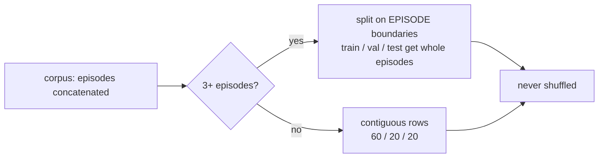

# 23. Reward-Free Tools: the Probe Harness and Offline Pretraining

Two tools that work on observations alone, with no reward: the probe harness (§1–§10) scores what an
encoder represents, and offline pretraining (§11–§18) trains a JEPA encoder before any PPO run.
Pretraining was its own page, `24_pretraining.md`, now a redirect: its §N is §(10+N) here.

## Part 1: the probe harness

`train/probe/` scores what an observation encoder has learned to represent, **without going
through the reward**. It is the implementation of Proposal A in
[22_jepa_integration.md](22_jepa_integration.md) §4.1.

Related: [10_testing.md](10_testing.md) §7 (the gap this closes),
[18_configuration.md](18_configuration.md) §5.4–5.5 (the encoder group and the comparison
protocol this supplies a metric for),
[05_observation_space.md](05_observation_space.md) (what the targets are read out of),
[29_fixed_issues.md](29_fixed_issues.md) (S1-1, S1-2, S1-3).

---

## 1. The question it answers

[10](10_testing.md) §7 states the gap:

> **No encoder is tested for whether it *learns***. §6.4 proves every encoder builds, trains for
> an iteration, checkpoints and survives a champion snapshot — mechanics, not merit. Nothing runs
> long enough to say whether the transformer or the LSTM beats the MLP, which is the question the
> `encoder` group exists to answer.

The obvious way to close it — train each architecture, compare returns — could not work when this
was written: S1-1 left the critic flat and S1-3 made passivity the joint optimum, so the winner
would have been whichever architecture descended fastest to doing nothing. Both are fixed
([S1-1](29_fixed_issues.md#s1-1--ppos-critic-receives-zero-gradient-verified-fixed), [S1-3](29_fixed_issues.md#s1-3--doing-nothing-is-a-dominant-strategy-verified-fixed); how they blocked a comparison is in [29](29_fixed_issues.md#23-1--the-two-blockers-to-a-returns-based-comparison)), so the strong form of the question
is open; what remains is that no multi-seed comparison has actually been run. The harness is still
the cheaper way in, because it does not need one. It asks a narrower question that does not touch
the reward:

> **How much microstructure does the latent make linearly available?**

Freeze an encoder, fit a ridge readout from its latents to a public quantity a few steps in the
future, score it held out. No policy, no reward, no value function — so the answer does not depend
on the reward.

---

## 2. Running it

```bash
python -m gym_continuousDoubleAuction.train.probe
python -m gym_continuousDoubleAuction.train.probe --encoders mlp transformer lstm moe_transformer
python -m gym_continuousDoubleAuction.train.probe --parquet <log_dir>/episodes
python -m gym_continuousDoubleAuction.train.probe --checkpoint <chkpt>/iter_12 --module-id policy_0
```

Defaults live in [`config/cli_defaults.json`](../config/cli_defaults.json) under `cda_probe`; this
module holds no literal default, on the same rule as `CDA_rand`. The report goes to the logger, so
it also lands in `run.log`; `--out` writes it to a file as well.

| Flag | What it selects |
|---|---|
| `--encoders` | Architectures scored **untrained** — the inductive-bias baseline |
| `--checkpoint` / `--module-id` | A trained module, scored alongside them |
| `--targets` / `--horizons` | Which microstructure quantities, how far ahead |
| `--episodes` / `--steps` / `--agents` / `--seed` | The random-agent rollout corpus (`--episodes` defaults to `cda_probe.num_episodes`, 3, in `config/cli_defaults.json`), always in the default env layout (`train.compare` instead passes its run's config to `from_rollouts(env_config=...)`) |
| `--parquet` / `--max-rows` | Use `episode_record` output instead of rollouts |

---

## 3. How to read the output

```
| target        | h | metric | rows | raw     | mlp     | transformer | best        |
|---------------|---|--------|------|---------|---------|-------------|-------------|
| mid_return    | 1 | r2     | 2400 | -0.0013 | -0.0013 | -0.0013     | tie         |
| spread_change | 1 | r2     | 2400 | +0.0071 | +0.0775 | +0.1457     | transformer |
| two_sided     | 1 | bal.ac | 2400 | +0.4994 | +0.9987 | +0.9981     | tie         |
```

**Read a row, never a cell.** Scores are not comparable across targets — an R² and a balanced
accuracy are different quantities — and are comparable across feature sets only because every set
is fit on identical rows with an identical split and an identical ridge grid.

Three kinds of column, and the comparison needs all three:

| Column | What it is | Why it must be there |
|---|---|---|
| `raw` | The observation itself, all 233 floats | The floor. Every latent is a *function* of this vector |
| `<encoder>` | That architecture **at initialisation** | The inductive-bias term: tokenisation, the two-axis positional encoding and the input LayerNorm, before any training |
| `<module>@ckpt` | The same architecture with trained weights | Trained minus untrained is what training actually taught it |

**Reporting a trained encoder without its untrained twin is the mistake the harness is shaped to
prevent.** [18](18_configuration.md) §5.5 already warns that comparing architectures at one
learning rate measures the learning rate; comparing a trained encoder against only `raw` has the
same shape, and credits the architecture with whatever its initialisation was already worth.

Two cell values are not numbers:

- **`-`** — that set could not be scored *at all* (too few rows for three splits), not that it
  scored zero.
- **`tie`** in the `best` column — the top two are within `TIE_MARGIN` (0.005), which is inside
  the harness's own run-to-run variation. A different seed reorders them.

A whole (target, horizon) that nothing could score is **dropped**, not rendered as a row of floor
values. A target with one class or no variance is a fact about the corpus; printed beside real
results it reads as a fact about the encoders.

---

## 4. Why the probe is linear

This is the load-bearing design decision, so it is worth stating plainly.

An encoder's latent is a **deterministic function of the observation it was computed from**. A
probe with enough capacity therefore scores identically on the latent and on `raw` — it would just
re-derive the encoder — and the comparison would measure the probe.

A **linear** probe cannot do that. It can only read what the encoder has already made linearly
separable. So:

> "the latent beats `raw` under a linear readout" **is** the claim that the encoder reorganised the
> information rather than merely preserving it.

Raising the probe's capacity would not make a result stronger. It would make it vacuous.

Ridge, closed-form, follows from the same reasoning: `w = (X'X + λI)⁻¹X'y` is deterministic, has
one hyperparameter, and needs no optimiser, learning rate or epoch count. Every one of those would
otherwise be a knob tuned per feature set — and tuning per feature set is how a comparison quietly
starts measuring the tuning. `λ` is chosen on a validation split from a fixed grid, identically for
every feature set and every target.

The grid reaches `1e7` deliberately. `raw` is 233 standardised features, and a short corpus gives a
few hundred training rows; under-regularised, that fit scores an R² of **−125** and the report ranks
overfitting rather than representation. With the grid reaching far enough the validation split
simply declines those fits and the score falls back toward 0 — the honest answer for "these
features carry nothing usable at this sample size".

---

## 5. The splits



**Never shuffled.** Rows are consecutive book states: `obs[t]` and `obs[t+1]` share three of their
four snapshots. A shuffled split puts near-duplicates of a test row in the training set, and the
number reported is then a memorisation score. This is the single easiest way to get a spectacular
and meaningless result out of this harness.

**On episode boundaries where possible**, which is strictly stronger. It removes the adjacent-row
leak at the seams entirely, and gives the test split its own random price anchors — each episode
draws one on reset — so the score measures generalisation to an unseen market rather than to the
tail of a market already trained on.

`int(g × fraction)` alone starves a split at small group counts: at three episodes it allocates
1 / 0 / 2 and the validation split is empty, so the episode split would silently never engage at
exactly the sizes a quick run uses. Train and validation each therefore take at least one episode,
with test keeping the remainder.

---

## 6. The targets

Every target is a **public microstructure quantity read out of a future snapshot** — nothing is a
reward, a NAV, or a policy output.

| Target | Kind | Definition |
|---|---|---|
| `mid_return` | regression | `log_mid[t+k] − log_mid[t]` |
| `mid_moves` | binary | whether the L1 midpoint changes at all |
| `spread_change` | regression | change in `log1p(spread in ticks)` |
| `imbalance_change` | regression | change in signed depth imbalance |
| `two_sided` | binary | whether a two-sided market exists at `t+k` |
| `realized_vol` | regression | dispersion of the per-step midpoint changes over `(t, t+k]`. Needs `k ≥ 2` |

**Differences, not levels, wherever a level would be trivially persistent.** A target that barely
changes over `k` steps is predicted almost perfectly by *any* feature set including `raw`, and so
separates none of them. `two_sided` is the one retained level, kept because it is the regime
indicator the others are conditional on.

`log_mid` is why a price target is expressible at all: midpoint normalisation throws the price
level away everywhere else in the snapshot, so without that scalar a market at 10 and one at 100
would be indistinguishable and "did the price move" would have no answer
([05](05_observation_space.md) §2).

**Targets read the newest *book* frame, not the end of the observation.** An observation ends with
the per-agent private block, so `corpus.snapshots` slices against `layout.book_flat_dim`. Slicing
off the end would hand every target the private tail plus a truncated snapshot — an array of the
right shape with every field misaligned.

Private state is deliberately *not* a target. These score how well an encoder represents **the
market**, and an agent's own inventory is an input to the encoder, not a fact about the book. A
target read from the private block would be scoring the encoder on copying its own input.

**Episode boundaries are masked out.** A return read across a reset is a jump between unrelated
random price anchors — the largest "signal" in the corpus, and entirely artificial.

Adding one is a `@register` decorator and a function of `(snapshots, layout, horizon)`; the
parametrised test picks it up automatically.

---

## 7. The corpus

| Source | Command | What it is |
|---|---|---|
| Rollouts (default) | *(none needed)* | The real env stepped by uniformly-random agents, as `CDA_rand` does. Self-contained: no prior training run, so a probe can be scored on a fresh clone |
| Parquet | `--parquet <dir>` | What `episode_record` wrote during a real training run |

They are **not interchangeable**. A book made by uniformly-random agents does not look like a book
made by a trained league — different spreads, different depth, different arrival intensity — so an
encoder scored on random-agent data is being asked how well it represents a market it will never
see. Rollouts are the default because they always work; Parquet is the one to use once a run exists.

### Which rows the Parquet reader keeps, and why

`episode_record` writes one row per `(episode, step, agent)`, so a file from an 8-agent run holds
eight rows per step. The reader keeps one per `(episode_id, step)` by default, and the rollout
reader likewise keeps one agent.

Each agent has its own private tail, so the eight rows at a step differ in their last
`private_dim` floats. Keeping one is a real choice — it drops seven agents' private state — and it
is the right default for the public-book targets this harness scores, none of which read the
private tail. (While S1-2 was open the rows were exact duplicates, and the default had a different
reason - [29](29_fixed_issues.md#23-7--one-row-per-step-the-reason-changed-with-s1-2).)

`--per-agent` (`per_agent=True` to `from_parquet`) keeps every row, and a corpus built that way is **refused for scoring**: targets look `horizon` *rows* ahead, which is `horizon` steps only with one row per step, so with several rows per step "horizon 1" mostly read the same step and "horizon 3" one step ahead ([15](15_findings_and_recommendations.md) R-18, #188). The CLI rejects the flag and `report.run` rejects the corpus. The rest of this paragraph is what a per-agent corpus is, for a reader that does not score targets: the eight rows at a step share an identical book prefix, so a split
that separates them still leaks the book. Episode-level splitting (§5) is what contains that, and
it is applied either way.

**The stream is one agent's, until that agent terminates.** The rollout corpus follows the first
agent still alive and the Parquet corpus keeps the first row it sees at each step. If that agent
goes bankrupt mid-episode the stream continues with another agent: the same public book, a
different private block (own position, cash, resting orders). In a measured set of 40 episodes at
low starting cash it happened in 1 episode and 0.3% of rows. Every target here is a public-book
quantity, so targets are unaffected; only the private-block columns jump at the switch. Pin the
stream to one agent and end its rows when it terminates if private-block quantities are ever
probed ([15](15_findings_and_recommendations.md) R-19, #189).

**A width that fits two book modes needs the mode.** A Parquet file records the observation but
not the space it came from, and some widths fit both layouts (569 floats: `grid` with `n_hist` 11
or `levels` with `n_hist` 8). `from_parquet(book_mode=...)` and `--book-mode` name the run's mode;
without it such a file raises `AmbiguousObsLayout` instead of being read as the default (`train.pretrain` takes the same flag). The
encoders being scored are built against an env with the corpus's own `book_mode` and `n_hist`
([R-17](29_fixed_issues.md#from-the-2026-10-07-review), #187).

---

## 8. What it does not tell you

It says nothing about whether an encoder makes a better **trader**. A latent that linearly carries
the next midpoint move is evidence that the architecture represents the market, not that PPO can
exploit it. That second question is answerable now that S1-1 and S1-3 are fixed ([S1-1](29_fixed_issues.md#s1-1--ppos-critic-receives-zero-gradient-verified-fixed), [S1-3](29_fixed_issues.md#s1-3--doing-nothing-is-a-dominant-strategy-verified-fixed)) — but
answering it means a multi-seed training comparison under [18](18_configuration.md) §5.5, not a
probe report. This harness is deliberately independent of the reward, which is why its own answer
survived those fixes unchanged.

It is also scored on a corpus, and a corpus has a distribution. A win on random-agent rollouts is a
win on random-agent books.

---

## 9. Layout

| Module | Owns |
|---|---|
| `corpus.py` | The observation stream: rollouts, Parquet, deduplication, episode marking |
| `targets.py` | The microstructure targets and the episode-boundary masking |
| `features.py` | `raw`, frozen latents from a built or restored module, checkpoint resolution |
| `probe.py` | The ridge readout, its splits, its metrics, its degeneracy checks |
| `report.py` | The (feature set × target) matrix and its rendering |
| `__main__.py` | The CLI |

Tests: [`test/test_probe.py`](../gym_continuousDoubleAuction/test/test_probe.py) (41, the
arithmetic, on synthetic observations) and
[`test/integration/test_probe_harness.py`](../gym_continuousDoubleAuction/test/integration/test_probe_harness.py)
(25, against the real env, every registered encoder, and a real checkpoint).

---

## 10. Effective rank

`train/probe/rank.py` reports the effective rank of every feature set on the corpus, printed as
its own table under the score matrix. It is a second, independent reading of an encoder: the
score matrix says how much microstructure the latent makes *linearly available*, and the rank
says how many directions it is using at all.

```
Effective rank of each feature set, on this corpus (99% of singular mass)
feature set     rank   width    used
raw               98     193     51% *
mlp              112     256     44% *
```

A threshold rank: the fewest singular values carrying 99% of the total mass. It is not the
entropy-based effective rank the plasticity papers usually plot; the two move together but sit on
different scales, so compare this number with its own history and not with the papers' curves. Read it against `width` — absolute values are not comparable between a 233-float
observation and a 256-unit latent. The `*` marks a set whose rank is bounded by the corpus rather
than by the encoder (rank cannot exceed `min(rows, width)`), which is a warning that the number
describes the corpus and not the thing you wanted to compare.

### 10.1 Why it is here and not on the Learner

Because it is only a statement about the network if the inputs hold still, and this harness is
the only place in the repository where they do.

`CBPLearnerMixin` reports the same quantity on whatever minibatch training produced. In a
supervised setting that would be equivalent. Here the policy chooses its own inputs, and under
S1-3 the reward makes passivity the joint optimum — so a converging agent visits an ever narrower
set of book states and the rank of its activations falls with the network unchanged.

That is measured, not argued ([16](16_verification_log.md) §16.16). Over ~18,000 optimiser steps:

| | change |
|---|---|
| rank on the training minibatch | **−24.6%** |
| rank on a fixed corpus, all 8 layers | **+2.5% to −1.9%** |

The first reads as a plasticity collapse and is the agent's behaviour; the second is the network,
and it did not move. The Learner-side metric is kept — "what the network is doing on the data it
is actually training on" is a real thing to want — but it is named `cbp_batch_effective_rank` so
that what it is measured on is visible before it is interpreted.

The practical consequence for [25](25_continual_backprop.md)'s open question: a plasticity
measurement that wants to say something about the *network* must read this table across
checkpoints (`--checkpoint`), not the training-time metric across a run.

---

## Part 2: offline JEPA pretraining

`train/pretrain/` trains a JEPA encoder's self-supervised objective on observations alone — no
reward, no policy, no opponents — and writes weights a training run can start from. It is the
implementation of Proposal D in [22_jepa_integration.md](22_jepa_integration.md) §4.4.

Related: [22 §4.2](22_jepa_integration.md) (the encoder this pretrains),
Part 1 (the corpus reader it reuses, §7, and how to measure what pretraining did), [18_configuration.md](18_configuration.md) §5.4 (`pretrained_encoder_path`).

## 11. Why

[12](12_perspective_rl_researcher.md) §7 puts the shipped budget at ~262k env steps against a
realistic 10⁷–10⁸. Reward-driven learning is the expensive way to teach an encoder what an order
book looks like, and here it is also the *slow* way: the gradient reaching the encoder is a
high-variance policy gradient over a market that only just stopped rewarding passivity.

The JEPA objective needs none of that. It is dense — every token, every step — and it is defined on
observations, so it can run on data that already exists, at whatever scale the disk allows, before a
single PPO iteration.

---

## 12. Running it

```bash
python -m gym_continuousDoubleAuction.train.pretrain --steps 300
python -m gym_continuousDoubleAuction.train.pretrain --parquet <log_dir>/episodes --steps 2000
```

Defaults live in [`config/cli_defaults.json`](../config/cli_defaults.json) under `cda_pretrain`:
`out_dir` (`pretrained/jepa`), `batch_size` (128) and `log_every` (50) are the keys behind
`--out`, `--batch-size` and `--log-every`, beside `encoder_type`, `steps`, `lr`, `seed` and the
rollout settings.
The encoder's *hyperparameters* are deliberately **not** duplicated there — they come from
`encoder_specs.jepa` in `train_config.json`, so a pretrained encoder is built from the same numbers
the training run will build it from, and the fingerprint written beside the weights is comparable
with the one `train.py` computes.

Then use it:

```jsonc
// config/train_config.json → encoder
"encoder_type": "jepa",
"pretrained_encoder_path": "pretrained/jepa"
```

---

## 13. What it reuses

Nothing here reads a Parquet file or steps an env:

| Reused | From | What it already handles |
|---|---|---|
| `from_rollouts`, `from_parquet` | `train/probe/corpus.py` | Both sources, the per-agent deduplication (an 8-agent record holds eight rows per step that share the book), episode marking, width validation |
| `split_masks` | `train/probe/probe.py` | The train/validation split, by episode |
| `build_module` | `train/probe/features.py` | Building the module *training* would build — same catalog, same `vf_share_layers`, same wrapper |

That last one matters more than it looks. Pretraining builds the whole `RLModuleSpec` and trains
the encoder inside it, rather than instantiating a `TorchJEPAEncoder` directly, so the pretrained
architecture is provably the one training will use. The pi and vf heads are built and never
touched; they cost a little memory and remove a whole class of "the pretrained thing was subtly not
the trained thing" bug.

---

## 14. The checkpoint, and the guard on it

A checkpoint directory holds three things:

| Piece | For |
|---|---|
| `encoder.pt` | The encoder's `state_dict`. What the probe loads into a module it built itself |
| `encoder_fingerprint.json` | `encoder_type` and `encoder_spec` — the guard |
| `rl_module/` | A full RLlib module checkpoint |

**The fingerprint is the point of the format.** `train.py` already refuses a restore whose
`encoder_type` or `encoder_spec` differs from the checkpoint's, because the weights are *that*
architecture's weights. Pretrained weights need exactly the same guard and get it from the same
`encoders.encoder_fingerprint` — one definition, so the two cannot drift apart.

That function exists because a `getattr`-only read once reported the `mlp` default from the first
champion onward, silently disabling the structural check for a whole run. This is a failure mode
the repository has already been bitten by.

The check runs at **spec-build time**, before the path reaches any encoder, so a mismatch names the
architectures instead of surfacing as a shape error on some env runner.

### 14.1 Why the path is not `RLModuleSpec.load_state_path`

There is a field on `RLModuleSpec` that looks made for this. It is not: in RLlib 2.56 it is stored,
merged and copied, and **never read back**. Setting it would have silently done nothing — the same
dead-config-key shape as `OrderBook`'s `tick_size` ([18](18_configuration.md) §6).

Instead the path rides on the model config, and `TorchJEPAEncoder.__init__` loads its own weights.
Every process that builds an encoder — env runners and learners alike — therefore loads them
itself, with no state to synchronise.

The load happens **last** in `__init__`, so anything explicit afterwards wins. That ordering is what
makes it safe on the two paths that would otherwise be surprising: a champion snapshot constructs
the encoder and then `set_state`s the trained weights over it, and a restored run does the same with
its checkpoint. Neither ends up running pretrained weights it did not ask for.

`mlp` cannot use a pretrained encoder and says so: it has no self-supervised objective, so nothing
could have produced those weights.

---

## 15. What to watch — and it is not the loss

```
steps            : 150
train loss       : 0.29140 -> 0.10990
validation loss  : 0.29386 -> 0.14596
latent std       : 0.71992 -> 0.66829
```

**`latent_std`, not the loss.** A collapsed JEPA maps every observation to the same vector, which
makes its prediction *perfect* — the loss goes to zero and reads as a spectacular success, with
throughput unchanged. `latent_std` goes to zero at the same moment and is the only signal that
separates the two. `PretrainReport.collapsed` checks for it and the CLI **exits non-zero**, rather
than leaving a good-looking number in the log beside weights nobody should load. It is also true
when the run diverged: a NaN or infinite loss or `latent_std`, or no reading at all (`diverged`).
The CLI checks before it saves, so a collapsed or diverged run writes **nothing**, and a
checkpoint already in `--out` is left as it was.

The validation curve is the second thing to read. It is split **by episode**, because consecutive
observations share three of their four snapshots — a row-level split would put near-duplicates of a
validation row into training, and the curve would mean nothing. In the run above it tracks the
training curve, so the objective is generalising to unseen episodes rather than memorising.

---

## 16. Measuring what pretraining did

The probe scores the same architecture twice, on identical rows with an identical split:

```bash
python -m gym_continuousDoubleAuction.train.probe --encoders jepa --pretrained pretrained/jepa
```

```
| target           | h  | metric | raw     | jepa    | jepa@pretrained |
| spread_change    | 1  | r2     | -0.0002 | -0.0094 | +0.0165         |
| spread_change    | 20 | r2     | -0.0733 | -0.0381 | +0.0105         |
| imbalance_change | 5  | r2     | -0.0248 | -0.0015 | +0.0438         |
| imbalance_change | 20 | r2     | -0.0245 | -0.3529 | +0.1090         |
| realized_vol     | 5  | r2     | +0.1197 | +0.1292 | -0.4961         |
```

Everything between the `jepa` and `jepa@pretrained` columns is what the objective taught the
encoder, and the pattern is coherent rather than uniform.

**It won on the structural targets and lost on the temporal ones.** `spread_change` and
`imbalance_change` improve at every horizon — `imbalance_change` at h=20 goes from −0.35 to +0.11 —
while `realized_vol` at h=5 falls from +0.13 to −0.50.

That is exactly what `mask_axis: level` should do. Level masking hides a contiguous depth band and
asks what depth is consistent with the rest of the book; it never asks a temporal question, so
nothing in the objective preserves temporal structure in the latent. The obvious next experiment is
`mask_axis: time`, or alternating the two.

**Do not over-read this.** It is a 150-step run on 4 random-agent episodes — a smoke budget. What it
establishes is that the mechanism works and that its effect is legible and directional, not that
pretraining is worth it at scale.

---

## 17. Distribution shift

A book made by uniformly-random agents does not look like one made by a trained league: different
spreads, different depth, different arrival intensity. Pretraining only on `--episodes` rollouts (default `cda_pretrain.num_episodes`, 6)
fits a market the agent will never trade in.

Once a run exists, prefer `--parquet` over its episode record (`episode_sample_every` already bounds
what that costs), or treat random-agent data as a warm start only.

---

## 18. Layout

| Module | Owns |
|---|---|
| `pretrain.py` | The loop, the report, `save` / `load_into` / `verify_fingerprint` |
| `__init__.py` | What it is, why, and the exports |
| `__main__.py` | The CLI |

Tests: [`test/test_pretrain.py`](../gym_continuousDoubleAuction/test/test_pretrain.py) (20) — the
loop trains only what it should, a collapse is reported rather than hidden, the fingerprint refuses
a mismatched architecture, and a real training spec starts from the weights.
