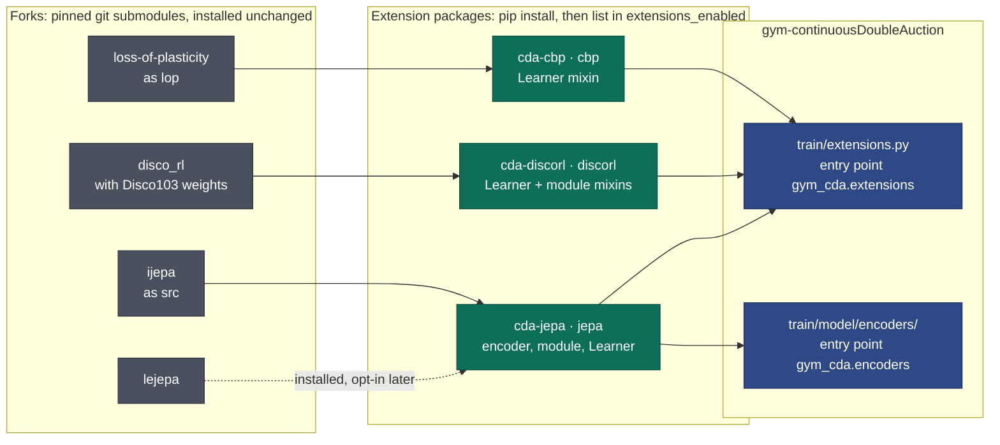

# 30. Extensions: Adding to the Learning Stack From Another Package

An extension is a separately installed Python package that adds to how agents learn, without an
edit to this repository. It can bring a Learner mixin (a new loss term, or a replacement for PPO's
loss), an RLModule mixin (extra heads or state), an env wrapper, an observation encoder, or any mix
of these.

Installing a package changes no run. A run uses an extension only when its name is listed in
`extensions_enabled`; uninstalling the package and removing the name is the whole undo. With
nothing enabled, the Learner class, the module classes and the env are the same objects as before
this feature existed, the Learner's `learner_config_dict` gains no `extensions` group, and a
checkpoint's sidecar gains no key.

This page is the one place in this repository that describes the extensions. Each package's own
repository documents what it does, its settings and its metrics; this page covers the contract and
the steps on this side.

## 0. The packages

Three extensions exist, each in its own repository. Each builds on the original authors' code,
which it ships as a git submodule pinned to one commit and installs unchanged; none of the forks is
edited.



| Name | Package and repository | What it adds | Section |
|---|---|---|---|
| `discorl` | `cda-discorl`, [cda_disco_rl](https://github.com/ChuaCheowHuan/cda_disco_rl) | Learning mechanisms from *Discovering state-of-the-art reinforcement learning algorithms* (Oh et al., 2025), on [disco_rl](https://github.com/ChuaCheowHuan/disco_rl) | §7 |
| `cbp` | `cda-cbp`, [cda_cbp](https://github.com/ChuaCheowHuan/cda_cbp) | Continual Backprop (Dohare et al., 2024), on [loss-of-plasticity](https://github.com/ChuaCheowHuan/loss-of-plasticity) | §8 |
| `jepa` | `cda-jepa`, [cda_jepa](https://github.com/ChuaCheowHuan/cda_jepa) | The `jepa` encoder: an auxiliary JEPA loss, an action-conditioned world model and an offline pretrainer, on [ijepa](https://github.com/ChuaCheowHuan/ijepa) and [lejepa](https://github.com/ChuaCheowHuan/lejepa) | §9 |

Continual Backprop and the `jepa` encoder were built into this repository and moved out; §8 and §9
list what stayed here so old configs and checkpoints keep working.

The code is [`train/extensions.py`](../gym_continuousDoubleAuction/train/extensions.py). Related:
[18_configuration.md](18_configuration.md) §5.7 (the config group),
[10_testing.md](10_testing.md) (the two test files).

---

## 1. What a package declares

A package registers one `Extension` object under the `gym_cda.extensions` entry-point group:

```toml
# the extension package's pyproject.toml
[project.entry-points."gym_cda.extensions"]
myext = "my_package:EXTENSION"
```

```python
from gym_continuousDoubleAuction.train.extensions import Extension

EXTENSION = Extension(
    name="myext",  # must equal the entry-point name
    version="0.1.0",  # recorded beside each checkpoint
    defaults={"coeff": 0.1},  # every setting it accepts, with its default
    validate=check,  # optional (settings, train_config) -> None, raises
    learner_mixin=MyLearnerMixin,  # optional
    learner_order=0,  # optional; a higher value wraps further out
    module_mixin=MyModuleMixin,  # optional
    module_ids=pick,  # optional (settings, trainable_ids) -> ids; default all
    env_wrapper=wrap,  # optional (env, settings) -> env
    structural_keys=("width",),  # settings that change a tensor shape
)
```

Discovery lists the entry points from package metadata and imports nothing. Only a name a run
enables, or a checkpoint being restored records, is imported, so an installed package costs a run
that does not enable it nothing, not even its imports (cda-discorl's JAX). An entry point that does
not resolve to an `Extension`, or whose `name` differs from the entry-point name, raises when it is
loaded. `extensions.discover()` loads every installed one, for tooling that wants them all; the
training path never calls it ([29](29_fixed_issues.md#from-30--extensions), #337).

An extension that relies on the lazy loading or on `extra_trunk_heads` (§8) pins
`gym_continuousDoubleAuction>=2.1,<3`.

## 2. Enabling one

```json
"extensions_enabled": ["myext"],
"extension_settings": {"myext": {"coeff": 0.2}}
```

The extension owns its settings the way `config/*.json` owns this repository's: `defaults` lists
every key, and a key it does not list is an error when the `TrainConfig` is built (CLAUDE.md
rule 1). Missing keys take the default. Enabling a name that is not installed, or listing one
twice, raises. Settings for an extension that is not enabled are ignored, so a config can keep
them while the package is uninstalled.

## 3. Where each piece is composed

| Piece | Composed in | Order |
|---|---|---|
| Learner mixin | `build._learner_class`, over the encoder's Learner and tuned Adam, so an extension that builds its own optimiser runs before tuned Adam's | Mixins sorted by `learner_order` (highest outermost), then by name, ahead of the base |
| Module mixin | `build.build_config`, on each trainable module the extension's `module_ids` selects | By extension name; frozen baselines are never touched |
| Env wrapper | `build.register_env`, on every env RLlib creates | By extension name |

So an extension inherits the MoE term and an encoder Learner's own terms (cda-jepa's, §9).
Continual Backprop (§8) declares `learner_order=100`, so it wraps every other extension and reads
the gradients of the final loss. The composed classes are built with `type()` and travel to remote Learners and runners pickled by value, so a
remote process needs the package importable but no registration of its own.

Two modules in one league can differ: an extension whose `module_ids` picks `policy_0` only leaves
`policy_1` as plain PPO, which is how one run compares the two. The module class carries its
extension's resolved settings as `extension_settings`. A Learner mixin reads its own with
`settings_for(self.config.learner_config_dict, "myext")`.

An env wrapper must not change the observation or action space: the spaces are built from the
unwrapped env before any wrapper runs. `train.evaluate` builds its own env from the checkpoint's
`env_config`, so it rolls episodes without any wrapper.

### 3.1 An encoder from a package

An encoder is not one of the three pieces above: it is selected per run by `encoder_type`, and
every process that builds a module must find it in the encoder registry
(`train/model/encoders/__init__.py`). A package that brings one lists the module that registers it
under a second entry-point group:

```toml
[project.entry-points."gym_cda.encoders"]
myenc = "my_package.encoder"
```

That module calls `@register("myenc", defaults=..., extension="myext")`, and may pass
`module_class_path`, `learner_class_path` and `needs_next_obs` like an encoder in this repository.
Nothing imports it until the name `myenc` is first looked up, which happens in each process that
builds the module, env runners and learners included. `selectable_encoder_types` lists it without
importing it. A run selects it with `encoder_type: "myenc"`, its settings in
`encoder_specs.myenc`, and `"myext"` in `extensions_enabled`; `TrainConfig` refuses the encoder
without its extension enabled, since installing a package changes no run.
If the module fails to import (a dependency of the package is missing, say), the lookup raises an
`ImportError` that names the package and the module, with the package's own error as its cause;
config validation and the checkpoint restore guard both make that lookup.

An encoder whose config has a `pretrained_path` field can start from pretrained weights. The
checkpoint format (`encoder.pt`, `encoder_fingerprint.json`, `rl_module/`) is
`train/model/encoders/pretrained.py`, which `pretrained_encoder_path` and the probe's
`--pretrained` use; a package that trains such weights writes them with its `save`.
[`test_encoder_plugins.py`](../gym_continuousDoubleAuction/test/test_encoder_plugins.py) pins both.

## 4. Adding a loss term, or replacing PPO's

`CDAPPOTorchLearner.compute_loss_for_module` is PPO's loss plus the MoE term, and an encoder's own
Learner (cda-jepa's `CDAJEPALearner`, §9) adds its term on top through `super()`. PPO's own part
sits behind one method, `_policy_value_loss`:

- **To add a term**, override `compute_loss_for_module` and add to `super()`'s result.
- **To replace PPO's policy, value and entropy loss**, override `_policy_value_loss`. The MoE and
  encoder terms are still added around it. Overriding `compute_loss_for_module` instead would drop
  them.

[`test_loss_seam.py`](../gym_continuousDoubleAuction/test/test_loss_seam.py) pins both halves for
the PPO Learner and for an encoder Learner that reaches it through `super()`.

## 5. Checkpoints and resumes

- `league_state.json` records `{"extensions": {name: version}}` beside a checkpoint whose run
  enabled any. A restore reads it before RLlib unpickles anything, and refuses by name when one is
  not installed: "trained with extension(s) myext 0.1.0, which are not installed here". A training
  resume and `train.evaluate` run the same guards, this one and the class check below
  ([29](29_fixed_issues.md#from-30--extensions), #336).
- `extensions_enabled` is unrestorable: changing it on a resume raises, whether it turns an
  extension on or off. A default run's config carries no extensions group, and it is compared as
  "none enabled". A checkpoint from before this feature reads the same way, so it restores with the
  default config.
- A restore unpickles the checkpoint's classes before RLlib does, so a class whose package is
  missing stops the restore with the import error's own message. RLlib would swallow it and fail
  later with an unrelated error, which read as a corrupt save and fell back to an older one.
- Every resolved setting is fingerprinted as `ext.<name>.<key>`. Changing one on a resume raises
  as unrestorable; changing one listed in `structural_keys` raises as structural.
- An encoder an extension provides counts as that extension enabled, in both fingerprints. A
  checkpoint written while this repository shipped `jepa` lists no extension, and the config that
  resumes it lists `"jepa"`; the two compare equal
  ([`test_jepa_moved.py`](../gym_continuousDoubleAuction/test/test_jepa_moved.py)).

## 6. Tests

[`test_extensions.py`](../gym_continuousDoubleAuction/test/test_extensions.py) installs a dummy
package as a `*.dist-info` directory on `sys.path`, exactly as pip leaves one, so discovery goes
through real entry points. It covers discovery errors, the nothing-enabled identity, validation,
composition order and the resume guards.
[`integration/test_extensions_wiring.py`](../gym_continuousDoubleAuction/test/integration/test_extensions_wiring.py)
builds a real `Algorithm` with a dummy extension enabled, trains one iteration through the
replaced loss, and round-trips a checkpoint.

An extension's own repository runs its tests against this one, so these two files are the
contract it relies on.

## 7. DiscoRL

The `cda-discorl` package imports what DeepMind's `disco_rl` provides (the Disco103 rule and its
weights, the debiased moving average, the published settings) and keeps local only what has to be
torch. Its own documentation covers each component, every setting, the metrics it logs and the
comparison against PPO:
[README](https://github.com/ChuaCheowHuan/cda_disco_rl/blob/main/README.md),
[components](https://github.com/ChuaCheowHuan/cda_disco_rl/blob/main/docs/components.md),
[configuration](https://github.com/ChuaCheowHuan/cda_disco_rl/blob/main/docs/configuration.md),
[findings](https://github.com/ChuaCheowHuan/cda_disco_rl/blob/main/docs/findings.md).

### 7.1 Install

Install this repository first, then the package:

```bash
pip install -e .
pip install "git+https://github.com/ChuaCheowHuan/cda_disco_rl"
```

pip fetches the submodule, so the second line also installs `disco_rl` and its JAX stack (JAX
runs on the CPU, beside PyTorch). A run that does not enable `discorl` never imports it or JAX
(§1).

### 7.2 Enable it for a run

For `train.train`, copy `config/train_config.json`, set the `extensions` group in the copy, and
pass the copy with `--config`:

```json
"extensions": {
  "extensions_enabled": ["discorl"],
  "extension_settings": {"discorl": {"modules": ["policy_0"], "target_policy": true}}
}
```

With two trained agents, this setting gives `policy_0` the component and leaves `policy_1` as plain
PPO, so one league compares the two.

### 7.3 Compare it against plain PPO

`train.compare` takes the same two keys with `--set`. Running it once with them and once without
gives a multi-seed comparison:

```bash
python -m gym_continuousDoubleAuction.train.compare \
  --encoders mlp --seeds 0 1 2 --iters 30 --out out/target_policy \
  --agents 4 --trained-agents 2 --max-step 512 --episodes-per-iter 4 --no-probe \
  --set 'extensions_enabled=["discorl"]' \
  --set 'extension_settings={"discorl":{"modules":["policy_0","policy_1"],"target_policy":true}}'
```

## 8. Continual Backprop

Continual Backprop is a Learner mixin only, and shows the parts of this contract the DiscoRL
example does not use:

- **`learner_order=100`.** CBP replaces units after the optimiser step, so it has to see the step
  every other mixin's loss produced. A higher order wraps further out, whatever the names.
- **The module layout contract.** CBP needs to know where each trunk ends and which heads read
  it. It asks [`train/model/layout.py`](../gym_continuousDoubleAuction/train/model/layout.py)
  rather than this repository's attribute paths, and
  [`test_model_layout.py`](../gym_continuousDoubleAuction/test/test_model_layout.py) fails here if
  a rename would break it.
- **Heads an extension adds.** A module mixin whose head reads a trunk's output declares it, so
  CBP resets that head's input weights with the trunk unit it replaces:

  ```python
  class MyModuleMixin:
      extra_trunk_heads = {"encoder": ("aux_pi",), "actor_encoder": ("aux_pi",)}
  ```

  The keys are trunk names (`encoder` under `vf_share_layers`, else `actor_encoder` and
  `critic_encoder`). The declarations of every class in the module's MRO merge, and
  `trunk_outputs` reports the attributes the module has as `TrunkOutput.extra_heads`, apart from
  `heads` (`pi`, `vf`). An undeclared head keeps reading a replaced unit with the old unit's
  weights ([29](29_fixed_issues.md#from-30--extensions), #338).

```bash
pip install "git+https://github.com/ChuaCheowHuan/cda_cbp"
```

```json
"extensions_enabled": ["cbp"],
"extension_settings": {"cbp": {"replacement_rate": 1e-4}}
```

The package documents the method and what was measured
([continual_backprop.md](https://github.com/ChuaCheowHuan/cda_cbp/blob/main/docs/continual_backprop.md),
which keeps the section numbers of this repository's former doc 25), every setting
([settings.md](https://github.com/ChuaCheowHuan/cda_cbp/blob/main/docs/settings.md)), the `cbp_*`
metrics ([metrics.md](https://github.com/ChuaCheowHuan/cda_cbp/blob/main/docs/metrics.md)) and how
to move a config or resume a checkpoint from the built-in version
([migration.md](https://github.com/ChuaCheowHuan/cda_cbp/blob/main/docs/migration.md)).

What stayed here:

- **Tuned Adam** (`adam_betas`, `adam_weight_decay`, [18](18_configuration.md) §5.6), which the CBP
  papers pair with it but which is a separate intervention. Its mixin is
  `train/model/optim_learner.py`.
- **The module layout contract** (`train/model/layout.py`, above).
- **The probe's effective rank** (`train/probe/rank.py`, [23](23_probe_harness.md) §10), the
  reward-free instrument for plasticity. cda-cbp's `cbp_batch_effective_rank` calls it.
- **Old configs and checkpoints.** A config or `--set` that still carries a `cbp_*` key fails at
  load, naming cda-cbp. `train/model/cbp_learner.py` forwards the old mixin names to the package
  for checkpoints that pickled them, and a checkpoint written with CBP on refuses to restore
  without the package, before RLlib loads anything. With the package, the restore check reads the
  checkpoint's old `continual_backprop` group as the `cbp` extension's settings, so it resumes
  with `extensions_enabled: ["cbp"]` and the same values.

## 9. JEPA

The `jepa` encoder is the example of §3.1: an encoder, its module and Learner classes, and the
action-conditioned world model that asks for `Columns.NEXT_OBS`, all registered from the package
through the `gym_cda.encoders` entry point.

```bash
pip install "git+https://github.com/ChuaCheowHuan/cda_jepa"
```

```json
"extensions_enabled": ["jepa"],
"encoder_type": "jepa",
"encoder_specs": {"jepa": {}}
```

The package documents the research note
([jepa.md](https://github.com/ChuaCheowHuan/cda_jepa/blob/main/docs/jepa.md), which keeps the
section numbers of this repository's former doc 22), its settings, metrics, offline pretraining
(`python -m cda_jepa.pretrain`) and the migration from the built-in version.

What stayed here, so nothing written before the move breaks:

- `train/model/jepa_learner.py` forwards `CDAJEPALearner` and `JEPARLModule` to the package, for
  checkpoints that pickled them by that path, and without the package fails naming it.
- `encoder_type: "jepa"` without the package fails naming it (`MOVED_ENCODERS`), and the restore
  guard treats an old `jepa` checkpoint as having had the extension on (§5).
- The pretrained-weights format (§3.1), so weights pretrained before the move load, and the probe
  that reads them ([23](23_probe_harness.md) §2).
